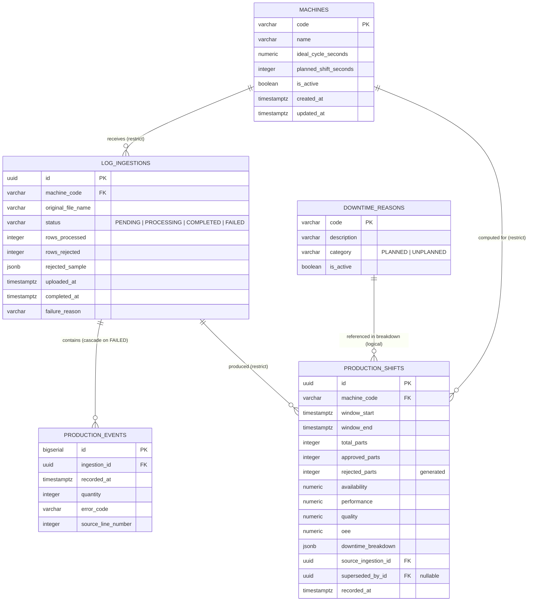

# Knowledge Base: OEE-Sentinel — Industrial Production Log Analysis & OEE Engine (Master Edition v1.1)

> **Metadata:** Version 1.1 (Master) | Domain: Industrial analytics, DDD, Clean Architecture, Blazor Server, PostgreSQL, .NET 10 | Academic Year: 2026/2027 | Last updated: November 2026
>
> **Repository:** `oee-sentinel`
>
> **Purpose of this Knowledge Base:**
> This document is the **single source of truth** for the OEE-Sentinel information system. It consolidates all business context, requirements, architectural decisions (ADR-0001 through ADR-0007), the domain model, persistence strategy, API contracts, testing approach, and the baseline ↔ roadmap status. It is intended to be loaded into any AI assistant or consulted directly so that no external file lookup is required for context. Every architectural decision, business invariant, and API contract described in this document is derived from the source artifacts enumerated in §37.
>
> **Suggested System Prompt for AI Chat:**
> *"Use this Knowledge Base as the absolute source of truth for the OEE-Sentinel project. When responding, cite the section (e.g., §5.3 or §24.2) to justify architectural, code, or process decisions. Strictly follow the decisions recorded in ADR-0001 through ADR-0007, the Clean/Onion Architecture rules, the Hexagonal Ports & Adapters boundaries, and the pure-domain-service discipline for `OeeCalculatorEngine`. If a question is not covered, explicitly say 'The OEE-Sentinel KB does not cover this topic' instead of inventing an answer. Distinguish clearly between what is implemented in the current baseline and what is planned for the 20+ hour roadmap (T1–T8)."*

---

## Table of Contents

**PART I — FOUNDATIONS: Business & Requirements**
1. Executive Summary & Business Context
2. Stakeholders, Personas & Roles
3. Engineering Principles & Architectural Guidelines
4. Key Architectural Scenarios
5. Architecture Decision Records (ADR-0001 through ADR-0007)
6. Requirements Engineering (Baseline & Planned User Stories)
7. Ubiquitous Language Glossary

**PART II — DOMAIN MODEL & RATIONALE**
8. Domain Model (Aggregates, Entities, Value Objects)
9. Domain Model Rationale & Decision Logs
10. Business Invariants & Referential Integrity

**PART III — SYSTEM ARCHITECTURE (C4 Model)**
11. System Context (C4 Level 1)
12. Container Diagram (C4 Level 2)
13. Component Architecture (C4 Level 3)
14. Code Diagrams (C4 Level 4 — Domain Layer)
15. Use Cases & Functional Scope

**PART IV — PERSISTENCE & DATA**
16. Persistence Strategy (DDD → PostgreSQL)
17. Physical DDL by Bounded Module
18. Concurrency Control & Transaction Demarcation
19. ERD & Referential Integrity Matrix
20. Indexing Strategy & Query Patterns

**PART V — API CONTRACTS**
21. REST API Design Specification
22. Endpoint Catalogue & Permissions Matrix
23. DTO Contracts & Payload Specifications
24. Standard Error Envelope & HTTP Status Matrix
25. Input Boundary Validation Architecture
26. OpenAPI 3.0.3 Contract Reference

**PART VI — TESTING & QUALITY**
27. Automated Testing Strategy
28. Test Coverage & Naming Conventions

**PART VII — STATUS & ROADMAP**
29. Baseline Status & Deliverable Verification
30. Engineering Roadmap (Phase 0 + T1–T8)
31. Frontend (Blazor Server) Implementation

**PART VIII — INFRASTRUCTURE & OPERATIONS**
32. Docker Compose & Deployment
33. CI Pipeline & Tooling

**PART IX — REFERENCE**
34. Repository File Map
35. Version History & Document Evolution
36. AI-Assisted Engineering Disclosure
37. Source Documents Cross-Reference

**APPENDICES**
- Appendix A: Complete API Endpoint Quick Reference
- Appendix B: Business Rules Quick Reference
- Appendix C: Deferred / Rejected Scope (Explicitly Excluded)

---

# PART I — FOUNDATIONS: Business & Requirements

## 1. Executive Summary & Business Context

### 1.1. What OEE-Sentinel Is

**OEE-Sentinel** is a self-hosted industrial analytics engine that ingests raw production logs (CSV/TXT) from legacy manufacturing machines, normalizes them into a machine-agnostic domain model, computes the three **OEE (Overall Equipment Effectiveness)** pillars — **Availability**, **Performance**, **Quality** — plus the consolidated OEE, and exposes the results as a **Blazor Server dashboard** (for operators, engineers, managers) and a **versioned REST API** (for MES/ERP integration).

OEE-Sentinel is deliberately the **post-hoc analytical** half of the Industry 4.0 problem. Real-time SCADA and predictive alerting are the concern of a sibling system (FlowGuard). OEE-Sentinel consumes the artefacts that no SCADA system cares about — the humble log files sitting on a shared network folder — and turns them into the metrics every production manager is judged on.

### 1.2. The Problem Being Solved

In the vast majority of mid-size discrete manufacturing and legacy assembly lines, plant managers still compute OEE **manually in spreadsheets at the end of the month**. By the time the number is on a wall, the shift is over, and the loss is booked. Specific realities:

- Machines write **CSV/TXT logs** to network folders, not to message brokers.
- Log files grow to **5k–50k lines per shift per machine**, peaking at **200k on high-speed lines**.
- Files are often **malformed** (missing timestamps, mixed decimal locales, trailing whitespace, unexpected column order).
- Error codes are **vendor-specific** and must be mapped to a plant-wide downtime catalogue.
- **Micro-stops (< 5 min) are invisible** — operators do not record them.
- **Scrap** is tracked in a separate spreadsheet from downtime.
- No one trusts the OEE number on the wall, because no one can trace it back to a source file.

OEE-Sentinel replaces manual retrospective analysis with an automated, streaming, auditable pipeline that:

1. Ingests high-volume production logs **without loading them entirely into RAM** (`IAsyncEnumerable<ProductionEvent>`).
2. **Normalizes** raw events into a machine-agnostic domain model.
3. **Computes** A/P/Q/OEE in a pure, unit-testable domain service (`OeeCalculatorEngine`).
4. **Categorizes** downtime by reason codes and surfaces **Pareto analysis** of the biggest losses.
5. **Exposes** REST endpoints and a Blazor dashboard for operators, engineers, and managers.

### 1.3. Scope Boundaries

| In scope (baseline + roadmap) | Out of scope (explicitly) |
|---|---|
| Streaming ingestion of CSV/TXT logs | Real-time SCADA, PLCs, MQTT (FlowGuard's domain) |
| OEE math with clamping and edge-case policy | Predictive ML anomaly detection |
| Blazor Server dashboard | Native mobile app |
| Versioned REST API for MES integration | Multi-tenant SaaS deployment |
| Immutable production shift facts | Event sourcing |
| Downtime Pareto (in-memory) | Real-time streaming analytics (Kafka/Redis) |
| PostgreSQL persistence with strict constraints | Read replicas / sharding |

### 1.4. Baseline vs 20-Hour Roadmap — High-Level

The project is delivered in **two phases**, per BYOP requirements ("a software project you personally own … with signs of use", `(Ext) BYOP - Project submission instructions.pdf` p.2):

- **Phase 0 — Baseline (pre-submission, ~15h).** A runnable, testable baseline with a real domain, a working upload pipeline, a real dashboard, and a documented REST API. This is what gets the repo "active and real".
- **Post-selection roadmap — T1–T8 (~23h).** Features that a real factory deployment needs but that would delay the working slice: JWT auth, RBAC, PDF export, folder watcher, Prometheus, Pareto read view, expanded test suite, BenchmarkDotNet baseline, and the final SAD (Software Architecture Document).

The table below is a navigational summary; the detailed breakdown is in §30.

| Capability | Baseline | Roadmap |
|---|---|---|
| Streaming CSV ingestion | ✅ | — |
| OEE math with edge-case policy | ✅ | — |
| Immutable `ProductionShift` | ✅ | — |
| Blazor Server dashboard (5 pages) | ✅ | — |
| Downtime Pareto (in-memory) | ✅ | — |
| REST API (5 endpoints) | ✅ | — |
| Health probe | ✅ | — |
| JWT authentication + RBAC | ❌ | **T2** |
| Machine management UI | ❌ | **T2** |
| PDF report export (QuestPDF) | ❌ | **T1** |
| Folder watcher (drop-folder) | ❌ | **T3** |
| Pareto SQL read view | ❌ | **T4** |
| Prometheus `/metrics` | ❌ | **T5** |
| Expanded test suite (T6) | ❌ | **T6** |
| BenchmarkDotNet baseline | ❌ | **T7** |
| Final SAD + C4 diagrams | partial | **T8** |

---

## 2. Stakeholders, Personas & Roles

### 2.1. Roles (Baseline)

The `UserRole` enumeration is `{OPERATOR, ENGINEER, ADMINISTRATOR}`. Baseline **ships the `User` aggregate and the `users` table** but does not wire authentication. Roles are the **conceptual model** that Roadmap T2 will enforce at the HTTP boundary. This is a deliberate trade-off (ADR-0002 §Context, `05-key-scenarios.md` §6): auth from day one delays the working slice; auth is a purely additive `WebUI` change.

| Role | Responsibilities | Scope (once T2 lands) |
|---|---|---|
| **`OPERATOR`** | Upload shift log files, view OEE dashboard for own machine, drill into downtime Pareto. Cannot edit machine configuration. | `/api/v1/logs`, `/api/v1/machines/{code}/shifts`, `/api/v1/machines/{code}/pareto` |
| **`ENGINEER`** | Configure `Machine` (ideal cycle time, planned shift template), maintain `DowntimeReason` catalogue, review trends across machines and shifts. | All `OPERATOR` + `/api/v1/machines` (write), `/api/v1/downtime-reasons` |
| **`ADMINISTRATOR`** | Provision users, assign roles, manage backups, monitor ingestion health (`LogIngestion` list). | All `ENGINEER` + `/api/v1/auth`, `/api/v1/users`, `/api/v1/admin/...` |
| **External integrators** | MES/ERP systems consuming the REST API for shift-level OEE; future Prometheus scrapers. | All read endpoints on `/api/v1/...` |

### 2.2. Personas (Business Perspective)

- **Maria** (Plant Manager, 15 years in the plant). Her Excel OEE report is 3 weeks late by the time it reaches the CEO. She does not trust the number on the factory wall because she cannot trace it. She needs a tool that lets her answer "where is the loss coming from, this shift, this week, this month?" and drill into a single file.
- **João** (Production Engineer). Runs the shift handover. He knows the injection presses intimately. His evenings are spent reconciling vendor-specific error codes against the plant's downtime catalogue by hand. He needs a parser that rejects malformed lines without aborting, and a dashboard that shows him which reason codes are consuming the shift.
- **Ana** (Plant Operator). Uploads shift logs. Does not care about the underlying math — she cares that the number she sees is *defensible*: not `>100%`, not `NaN`, not "zero shift" when production was normal. She wants a one-click upload, then a glanceable OEE gauge.

### 2.3. Stakeholder Concerns (FURPS+)

| Attribute | Driver | Consequence for Architecture |
|---|---|---|
| **Reliability** | OEE must be reproducible across runs and environments | `OeeCalculatorEngine` is a pure domain service; `ProductionShift` is immutable after persist; raw events kept for re-analysis |
| **Performance** | 200k-line CSV must parse in bounded memory | `CsvHelper` + `IAsyncEnumerable<ProductionEvent>`; never `ReadAllLines`; batched bulk insert |
| **Maintainability** | Downtime catalogues and error-code mappings change per client | `DowntimeReason` as reference aggregate, not enum; parser is a *port* (`IProductionLogParser`) with CSV as one adapter |
| **Testability** | OEE math is the core of the product | Domain layer has zero external dependencies; xUnit + FluentAssertions cover clamping, zero-division, and invariant violations |
| **Interoperability** | MES systems consume metrics | Versioned REST API (`/api/v1/...`), OpenAPI documented (T8) |
| **Usability** | Plant managers must trust the number | Traceability from `OeeMetrics` → `ProductionShift` → `LogIngestion` → raw file |
| **Supportability** | Self-hosted in factories | Docker Compose for PostgreSQL; single `dotnet run` on `WebUI`; no external services required |

---

## 3. Engineering Principles & Architectural Guidelines

The principles below are **enforced**, not aspirational. Each maps to a decision recorded in an ADR (§5), a test (§27), or a `ProjectReference` (§14). This section is the operational summary; the ADRs are the deep rationale.

### 3.1. Modular Monolith and Architectural Style

OEE-Sentinel follows a **Modular Monolith** architecture during its baseline and 20-hour roadmap. The vertical slices — `Topology` (`Machine`, `DowntimeReason`), `Ingestion` (`LogIngestion`, `ProductionEvent`), `Analytics` (`ProductionShift`, `OeeMetrics`), `Identity` (`User`, deferred auth) — are packaged into a **single ASP.NET Core process** (`OEESentinel.WebUI`) and share one PostgreSQL instance.

- **Simplicity over distributed complexity.** OEE-Sentinel runs on a plant's own server, under `docker compose up`, serving tens of users on a trusted network. Distributing parser, calculator, and UI into separate services would add network latency between the parser and the calculator (the two hottest components), distributed transaction failure modes across `LogIngestion` and `ProductionShift` persistence, and the operational overhead of the Outbox pattern (KB §17.2) — which is explicitly listed as roadmap item T3, not baseline.
- **Encapsulated boundaries.** Each module owns its internal domain and persistence components while exposing explicit, typed interfaces for inter-module collaboration. `Topology` exposes `IMachineRepository` (read contract); `Analytics` consumes it but never reaches into `Topology`'s tables.
- **One bounded context.** OEE-Sentinel is one bounded context (production-log-to-OEE), not four. The split into modules is a *code organisation* decision, not a *bounded-context* decision. This is the reason a single shared `OEESentinelDbContext` spans all modules, and no Outbox / Saga / cross-context coordination is needed.

### 3.2. Separation of Concerns and Layered Architecture

The back-end codebase enforces a rigorous four-layer concentric structure (ADR-0001), each layer addressing one level of abstraction:

| Layer | Project | Responsibility |
|---|---|---|
| **Inbound Adapter** | `OEESentinel.WebUI` | ASP.NET Core hosting, Blazor Server circuits, minimal-API REST endpoints, `wwwroot/` static assets, and the composition root (`Program.cs`). Translates transport (HTTP, SignalR) into Application handler invocations. **Contains no business logic.** |
| **Use Cases & Ports** | `OEESentinel.Application` | Orchestration of a transactional use case (`ProcessLogFileCommand`, `GetMachineOeeQuery`), DTO mapping, and declaration of *ports* (`IMachineRepository`, `IProductionLogParser`, `IProductionShiftRepository`, `ILogIngestionRepository`). **Contains no formulas and no SQL.** |
| **Pure Business Policy** | `OEESentinel.Domain` | Rich aggregates (`Machine`, `ProductionShift`, `LogIngestion`, `DowntimeReason`, `User`), Value Objects (`OeeMetrics`, `ProductionTotals`, `DowntimeBreakdown`, `Percentage`, `Duration`, `IdealCycleTime`, `TimeRange`, `MachineCode`, `EmailAddress`), and the `OeeCalculatorEngine` domain service. **Zero external dependencies.** |
| **Outbound Adapter** | `OEESentinel.Infrastructure` | EF Core `OEESentinelDbContext`, `Ef*Repository` implementations, `CsvProductionLogParser` (CsvHelper), bulk-insert adapter (`EFCore.BulkExtensions`). **Contains no business logic.** |

**Rationale.** The **product** of OEE-Sentinel is the OEE math. Everything else — HTTP, SignalR, CsvHelper, EF Core — is a delivery mechanism. Layering by concern lets the math be verified by tests that do not require a database, a socket, or a file system. It also lets the parser be swapped (CsvHelper → `Sep` → a future MQTT reader) without touching Domain or Application.

### 3.3. The Dependency Rule

Source code dependencies point **exclusively inward** (ADR-0001). Enforced mechanically by `ProjectReference` in `.csproj`, not only by discipline.

- **Inner independence.** `Domain` has zero package references beyond `System.*`. `Application` references only `Domain`. Neither may reference `Microsoft.EntityFrameworkCore.*`, `CsvHelper`, `Microsoft.AspNetCore.*`, or `Microsoft.EntityFrameworkCore.BulkExtensions`. A single `using` of a forbidden namespace in Domain/Application is a blocking code-review comment.
- **Control of direction.** `Infrastructure` and `WebUI` depend on `Application` (and transitively on `Domain`) via `ProjectReference`. They implement interfaces declared in `Application` — never the other way around. `WebUI` is the **only** project that has a `Program.cs` and performs dependency injection wiring.
- **Composition root.** `Program.cs` is the only place where concrete adapters are bound to ports. No service locator, no static mutable singleton, no global `ServiceProvider` accessible from Domain/Application.
- **The one exception, documented.** `Program.cs` calls `app.MapBlazorHub()` and `app.MapRazorComponents<App>()`, which are `Microsoft.AspNetCore.*` calls. These live only in `WebUI`. The Domain and Application never see them.

### 3.4. API-First Design and RESTful Standards

External REST communication follows the level-2 Richardson Maturity Model (ADR-0005), targeting MES/ERP integration and future Prometheus scraping.

- **Resource taxonomy.** URIs identify domain concepts as plural nouns (`/api/v1/machines`, `/api/v1/logs`, `/api/v1/machines/{code}/shifts`). RPC-style verbs (`/api/getMachineOee`) are prohibited.
- **Uniform interface.** Standard verbs (`GET`, `POST`, `PUT`, `DELETE`) with standard semantics. `GET` is safe and idempotent. `POST` creates resources (`POST /api/v1/logs` creates a `LogIngestion`), non-idempotent. `DELETE` deactivates (soft) — never physically deletes a `Machine` referenced by a `ProductionShift` (ADR-0003).
- **Status codes.** RFC-compliant codes only: `200`, `201`, `202`, `204`, `400`, `404`, `409`, `422`, `500`. `409` for state conflicts (duplicate `MachineCode`, deleting a referenced `DowntimeReason`). `422` for domain invariant failure (zero planned time, `downtime > planned` — both rejected by `OeeCalculatorEngine`, ADR-0006).
- **Versioned base path.** `/api/v1/...`. Version is *in the URL path*, not a header. Breaking changes go to `/api/v2`. Additive changes (new optional fields) stay in v1.
- **JSON conventions.** `camelCase` for JSON properties. `kebab-case` for URI segments. `application/json` + UTF-8 exclusively. Enums serialised as `UPPER_SNAKE_CASE` strings (e.g., `UNPLANNED`, `COMPLETED`).
- **Blazor Server is orthogonal to the API.** Blazor components inject Application handlers **directly** (`IGetMachineOeeHandler`), bypassing HTTP. The REST API is for external clients. Both paths converge on the same Application layer.

### 3.5. Two inbound surfaces, one application core

```
┌──────────────────────────────┐     ┌──────────────────────────────┐
│  Blazor Server (in-process)  │     │  REST API (HTTP, external)   │
│  MachineDetail.razor         │     │  GET /api/v1/machines/...    │
│      ↓ injects               │     │      ↓ injected at           │
│  IGetMachineOeeHandler       │     │  Program.cs (DI)             │
└──────────────┬───────────────┘     └──────────────┬───────────────┘
               │                                    │
               └───────────┬────────────────────────┘
                           ▼
                ┌────────────────────┐
                │ OEESentinel.       │
                │ Application        │
                │ (handlers, ports)  │
                └────────────────────┘
```

The Blazor path avoids serialisation and an HTTP hop; the REST path exposes the same capability to external systems. **Neither path may contain domain logic.** A discrepancy in behaviour between the two is a bug.

### 3.6. Domain-Driven Design and Maintainability

- **Ubiquitous language.** All terms in §7 (Glossary) are used verbatim across code, migrations, DTOs, OpenAPI schemas, and tests (`Availability`, `Performance`, `Quality`, `ProductionShift`, `DowntimeBreakdown`, `LogIngestion`). Portuguese-language synonyms are prohibited in code.
- **Aggregates as consistency boundaries.** `ProductionShift` is a fact — immutable, append-only. `LogIngestion` has a lifecycle. `Machine` and `DowntimeReason` are reference aggregates with soft-deactivation. Cross-aggregate references are always by typed ID, never by object reference.
- **Rich domain, not anemic.** Entities contain behaviour (`machine.deactivate()`, `ingestion.markFailed(reason)`), not mere getters/setters. `OeeCalculatorEngine` is a pure domain service with no I/O, no clock, no dependency injection (ADR-0006).
- **Modular cohesion.** Namespaces are organised by business capability (`OEESentinel.Domain.Analytics.ProductionShift`), not by technical category (`OEESentinel.Domain.Entities`). This reduces coupling when a capability is extended.

### 3.7. Testability and Quality Assurance

Testability is a **primary architectural driver**, not an afterthought (ADR-0007).

- **Isolated unit tests.** `OeeCalculatorEngineTests` runs in ~200 ms with zero infrastructure. No database, no file system, no HTTP. Every edge case in the OEE math is covered by a `[Fact]` or `[Theory]` with `FluentAssertions`.
- **Application-level unit tests with hand-written fakes.** `ProcessLogFileCommand` tests use `FakeProductionLogParser`, `FakeMachineRepository`, `FakeProductionShiftRepository` — hand-written, not mocked. Behaviour-based, not interaction-based.
- **Integration tests (deferred).** `Testcontainers.PostgreSql` + `WebApplicationFactory<Program>` is a roadmap item (T6). The baseline does not add Docker-in-CI as a prerequisite for `dotnet test`.
- **F.I.R.S.T.** Every test is Fast, Independent, Repeatable, Self-validating, and Timely. No test reads `DateTime.Now` directly; a caller injects `RecordedAt`.

### 3.8. Data Integrity and Persistence Constraints

Persistence upholds business invariants **at two levels** (ADR-0003, ADR-0006):

- **Domain level.** Value Objects reject invalid state at construction (`Percentage ∈ [0,1]`, `Duration ≥ 0`, `ProductionTotals.TotalParts ≥ ApprovedParts ≥ 0`). The `OeeCalculatorEngine` throws on structural corruption (`planned == 0`, `downtime > planned`), and clamps on values that could exceed `[0,1]` (defensive).
- **Database level.** CHECK constraints (`CHECK (availability BETWEEN 0 AND 1)`), FK constraints with `ON DELETE RESTRICT` on reference aggregates, UNIQUE on `machines.code`, and the JSONB shape constraint on `downtime_breakdown`. A bypass through a direct SQL `INSERT` still fails.
- **Reproducible evolution.** Schema changes are `dotnet ef migrations add`. Migrations are committed and reviewed. `EnsureCreated()` is prohibited. Seeds are in a separate `SeedData` class invoked explicitly (`WebUI` dev config), not part of migrations.

### 3.9. Incremental Evolution and the 20-Hour Roadmap

The architecture anticipates the roadmap without compromising the baseline (see §30 T1–T8).

- **Authentication and RBAC (T2).** Baseline runs on a trusted network (ADR-0002 §Context). JWT + `[Authorize(Roles=...)]` are added without touching Domain or Application handlers — the guard pipeline is a `WebUI` concern. `User` aggregate ships in baseline (schema + repository) to allow the migration to land with zero schema changes.
- **Folder watcher (T3).** `FileSystemWatcher` in a `BackgroundService` that re-invokes `ProcessLogFileCommand`. No domain change. It reuses the exact same handler the upload path uses.
- **Prometheus (T5).** `prometheus-net` middleware in `WebUI`. Metrics derived from `IProductionShiftRepository` reads. No new domain concept.
- **PDF export (T1) and Pareto view (T4).** New Application query handlers + a read-side projection. The Pareto view (T4) may introduce a SQL view `v_machine_downtime_pareto` in Infrastructure; it does not touch the write path.
- **`.slnx`** (ADR-0002). The solution file format is version-agnostic to the domain; a future switch to `.sln` (if .NET tooling regresses) is a mechanical one-command change.

### 3.10. Simplicity and Value over Formalism

Artifacts and patterns are adopted only when they bring tangible value.

- **No AutoMapper.** DTO mapping in Application is hand-written (`ShiftOeeDto.FromDomain(shift)`). A mapping library would add an abstraction whose config is often harder to reason about than the mapper itself, for a bounded set of DTOs.
- **No MediatR.** Handlers are invoked directly by Blazor components or `Program.cs` endpoints. A request/response mediator would add ceremony without solving a problem the baseline has.
- **No repository-per-method.** `IMachineRepository` has two methods (`GetByCodeAsync`, `ListActiveAsync`), not one per query variant. New methods require justification; the default is a `.Where(...)` in the handler.
- **No premature CQRS.** Baseline reads and writes share the same `DbContext`. The Pareto read view (T4) is the first place where read-model separation earns its keep; until then, `AsNoTracking()` suffices.
- **No speculative ports.** Five outbound ports total (three repositories, one parser, one unit-of-work). Adding a sixth requires an ADR amendment.
- **No `.env` file with secrets in the repo.** `.env.example` only. `docker-compose.yml` reads from `.env` (gitignored). BYOP compliance (`(Ext) BYOP - Project submission instructions.pdf` p.3).

### 3.11. Architectural Traceability and Reasoning

Documentation is an **active tool for thought**, not a compliance artifact.

- **Architecture as argumentation.** Every significant decision has an ADR (ADR-0001 through ADR-0007). Each captures context, alternatives considered, decision, and consequences — including negative trade-offs.
- **C4 diagrams (planned T8).** Context and Container diagrams in Mermaid, versioned in `docs/architecture/components-diagram/`. Component and Code diagrams are produced only when a reviewer needs them.
- **Domain Model Rationale.** §9 documents *why* each boundary was traced the way it was (e.g., `ProductionEvent` not inside `ProductionShift`, `DowntimeBreakdown` as JSONB, `ProductionShift` immutability).
- **Comparative logs.** When a decision is revised, the previous version is preserved in a "Revision History" section within the ADR — never silently rewritten. The ADR README (`docs/sad/03-rationale/README.md`) maintains the supersession log.
- **Living index.** `docs/sad/03-rationale/README.md` is the navigational entry point for reviewers and lists both the accepted baseline ADRs and the deferred ones (T1–T8).

---

## 4. Key Architectural Scenarios

Key architectural scenarios capture the **critical functional paths**, **high-risk operational areas**, and **quality-attribute intersections** that validate the design against non-functional drivers (KB §2.2, §6.1). For OEE-Sentinel, the critical scenarios exercise:

1. **Streaming ingestion at industrial volume** (200k rows, bounded memory).
2. **OEE mathematical correctness at the edge cases** (zero produced, downtime overrun).
3. **Immutability and auditability of computed facts** (`ProductionShift` supersession).
4. **Analytical reads across a window** (Pareto aggregation without N+1).
5. **Auth and RBAC as a planned evolution** (deferred; documented, not implemented).

The baseline scenarios (1–4) are **executable today** (they map to `tests/` or manual verification steps). Scenario 5 is explicitly **planned** (Roadmap T2) and is included to show how the architecture accommodates the roadmap without touching the current three pillars.

### 4.1. Scenario 1 — Streaming Ingestion of a 200k-Line Shift Log

**Trigger:** A plant operator drops a `shift_2026-11-04_MAQ-01.csv` file into the Blazor upload page.

**Architectural drivers:** Performance (bounded memory, sub-5s ingestion), Reliability (per-row rejection without abort), Maintainability (parser swappable).

**Flow (Blazor path — in-process):**

1. `Upload.razor` binds `IBrowserFile` and calls `IProcessLogFileHandler.HandleAsync(new ProcessLogFileCommand(machineCode, shiftWindow, fileStream))`.
2. `ProcessLogFileHandler` (Application) validates `MachineCode` via `IMachineRepository.GetByCodeAsync` — rejects unknown machines with `MachineNotFoundDomainException`, mapped by the endpoint/handler to a `ProblemDetails` or a UI error card.
3. `LogIngestion` is created in state `PENDING` and persisted via `ILogIngestionRepository.AddAsync`. Its typed ID is returned immediately.
4. Handler opens `IProductionLogParser.ParseAsync(stream, cancellationToken)` — a `CsvProductionLogParser` in Infrastructure. The stream is a `FileStream` wrapping the `IBrowserFile.OpenReadStream()`, chunked by Blazor's SignalR transport (typically 20KB-100KB chunks, transparently joined by `IBrowserFile.OpenReadStream`).
5. `await foreach (var evt in parsed)` consumes events. The handler buffers `ProductionEvent` rows in batches of 5000. On each batch fill, it calls `IProductionEventRepository.BulkInsertAsync(batch)` (which uses `EFCore.BulkExtensions.PostgreSql`).
6. Concurrently, the handler accumulates: `totalParts`, `approvedParts` (derived from `errorCode` not present in rejected set), `downtimeByReason` (dictionary of `DowntimeReasonCode → Duration`, computed from inter-event gaps and error codes), and `rejectedRowsSample` (bounded to 100 entries).
7. On `IAsyncEnumerable` completion, handler invokes `OeeCalculatorEngine.Calculate(plannedTime, totalDowntime, totals, idealCycleTime)` — throws if `planned == 0` or `downtime > planned` (structural corruption from the file).
8. Handler constructs the `ProductionShift` aggregate with the computed `OeeMetrics`, the `DowntimeBreakdown` VO, and the `sourceIngestionId`.
9. In a single EF Core transaction: `BulkInsertAsync` flushes the remaining buffer, `IProductionShiftRepository.AddAsync(shift)` writes the shift, and `LogIngestion.markCompleted(rowsProcessed, rowsRejected)` transitions state to `COMPLETED`. `SaveChangesAsync` commits.
10. Handler returns `LogUploadResponseDto` with `ingestionId`, `status = COMPLETED`, `rowsProcessed`, `rowsRejected`, `rejectedSample`, and the `ProductionShift` id.
11. `Upload.razor` navigates to `/machines/{code}/shifts/{id}` (the shift detail page) and renders the gauges.

**What must be true for this scenario to pass:**

- Memory footprint stays under 50 MB peak RSS on a 200k-row file (verified by BenchmarkDotNet under roadmap T7).
- A malformed line (missing comma, bad decimal locale, truncated timestamp) increments `rowsRejected` but does not abort the whole batch. `CsvHelper` config: `BadDataFound = null`, `MissingFieldFound = null`, plus `TryMapToDomain` guard.
- The whole operation completes in < 5 seconds for a 200k-row file on the reference machine (documented in README).
- A cancelled HTTP request (user navigates away, Blazor circuit drops) propagates `CancellationToken` through `ParseAsync` and `BulkInsertAsync`, and `LogIngestion.markFailed(reason)` is persisted. The transaction is not partially committed.

**Architectural validation:**

- Confirms `IProductionLogParser` is truly a port: replacing CsvHelper with a future `Sep`-based or MQTT-based parser is a one-class change in Infrastructure (ADR-0005).
- Confirms bulk insert is not part of the domain: `BulkInsertAsync` is an `IProductionEventRepository` method, called from Application. The `ProductionEvent` domain record has no EF attributes.
- Confirms bounded memory: no `File.ReadAllLines` anywhere; parser and bulk-insert use streaming.

**Reference:** ADR-0001, ADR-0003, ADR-0005, ADR-0006.

### 4.2. Scenario 2 — OEE Math at the Edge Cases (Structural Corruption)

**Trigger:** A malformed file (or a misconfigured `Machine`) produces one of the following conditions:

| Condition | Consequence in a naive calculator |
|---|---|
| `plannedTime == 0` | Division by zero → `Infinity` or `NaN` in DB → all downstream queries fail |
| `totalDowntime > plannedTime` | Negative `OperatingTime` → `Availability > 1` → dashboard shows >100% |
| `totalParts == 0` | `Quality = 0/0` → NaN |
| `performance > 1` (machine reports more parts than physically possible) | Dashboard shows >100% Performance → not defensible to plant manager |
| `approvedParts > totalParts` (parser bug) | `Quality > 1` → not defensible |

**Architectural drivers:** Reliability (calculated result must be trustworthy), Usability (defensible numbers on the dashboard), Correctness.

**Flow:**

1. `OeeCalculatorEngine.Calculate` receives the four input parameters (ADR-0006):
   - `Duration plannedProductionTime`
   - `Duration totalDowntime`
   - `ProductionTotals totals`
   - `IdealCycleTime idealCycleTime`
2. `ProductionTotals` was constructed by the Application handler. Its constructor rejects `TotalParts < ApprovedParts` and `TotalParts < 0` and `ApprovedParts < 0`. So condition "approvedParts > totalParts" never reaches the calculator — it is caught at construction with a `DomainInvariantException`.
3. The calculator's policy on the remaining edge cases:
   - `planned == 0` → `throw ArgumentOutOfRangeException`. The Application handler maps this to a `LogIngestion.FAILED` with reason `"PLANNED_TIME_ZERO"`. The `ProductionShift` is not persisted.
   - `totalDowntime > planned` → `throw ArgumentOutOfRangeException`. Handler maps to `FAILED` with `"DOWNTIME_OVERFLOW"`.
   - `operating == 0` (downtime == planned, everything stopped) → `Availability = 0`, `Performance = 0`, `Quality = ApprovedParts > 0 ? 0 : 1`. The shift is persisted with these values, and a future `Warning` flag (roadmap T6) marks it for review.
   - `TotalParts == 0` → `Quality = 1.0` (neutral). The shift is persisted; a future `Warning` flag is set.
   - `Performance > 1` → **clamped to 1.0**. Persisted with the clamping visible in a future `Warning` flag (T6). The formula is documented as defensive: a Performance > 1 indicates upstream data corruption; the *published* number is 1.0.
   - All four output `Percentage` values clamped to `[0,1]` after computation.

**What must be true for this scenario to pass:**

- `OeeCalculatorEngineTests` covers each row of the table above with a `[Theory]` or `[Fact]`. Existing tests already cover the happy path; the edge cases are added in the baseline before submission.
- No unhandled `Infinity`, `NaN`, or negative value reaches the DB. The `CHECK` constraints (`availability BETWEEN 0 AND 1`, etc.) act as a second line of defence — if the calculator ever produces an invalid value, the write fails loudly rather than silently persisting corruption.
- The dashboard (Blazor) renders `100%` and not `>100%` for any clamped value. Chart.js gauge max is `100`.
- A `LogIngestion.FAILED` with a domain-readable reason is produced for every rejected file, and it is visible in `/ingestions` (Blazor page).

**Architectural validation:**

- Confirms the calculator is a **pure domain service** — the edge-case policy is testable with a single method call and FluentAssertions, no fixtures (ADR-0006).
- Confirms the **defence-in-depth** between domain and DB — the CHECK constraints are not redundant, they are a safety net for future code paths that might bypass the calculator.

**Reference:** ADR-0003, ADR-0006, ADR-0007.

### 4.3. Scenario 3 — Immutable Shift Correction via Supersession

**Trigger:** An engineer discovers that a `DowntimeReason` was miscategorised — `UNPLANNED_MECHANICAL` was really `PLANNED_MAINTENANCE`. She needs to correct the historical shift.

**Architectural drivers:** Auditability, Data Integrity, Correctness of historical reports.

**Flow:**

1. Engineer updates the `DowntimeReason` catalogue (via a future admin UI, T2+). The change is metadata only — it does **not** retroactively modify existing `ProductionShift` rows (they hold the `DowntimeBreakdown` as computed at ingestion time, ADR-0006).
2. Engineer re-uploads the original log with a corrected mapping. The `ProcessLogFileHandler` runs as in Scenario 1 and produces a new `ProductionShift`.
3. Before persisting the new shift, the handler queries `IProductionShiftRepository.FindActiveByMachineAndWindowAsync(machineId, window)`. If a current (non-superseded) shift exists for the same window:
   - The handler creates the new shift with `SupersededBy = null` (it is now current).
   - The old shift's `SupersededBy` is updated to point to the new shift's `id`, **via a single `UPDATE production_shifts SET superseded_by_id = @newId WHERE id = @oldId`** — a metadata-only update.
   - The computed OEE values of the old shift are untouched (they remain the immutable fact they were at the time of ingestion).
4. If no current shift exists (first ingestion for that window), the new shift is persisted with `SupersededBy = null`.
5. `GET /api/v1/machines/{code}/oee?from=...&to=...` returns only shifts where `superseded_by_id IS NULL` — the "current" view. A future `?includeSuperseded=true` (T4) exposes the full history for audit.
6. The Blazor `MachineDetail.razor` shows the current shift plus a "history" expander that lists superseded shifts with links, when the user opts in.

**What must be true for this scenario to pass:**

- The computed OEE values (A, P, Q, OEE) and `ProductionTotals` of the superseded shift **never change after persist**. The `UPDATE` is strictly on `superseded_by_id`.
- A superseded shift is never returned by the default `GetMachineOeeQuery`.
- The `LogIngestion` for the correction is a **new** `LogIngestion`, linked to the new shift. The old `LogIngestion` remains `COMPLETED` and its `ProductionShift` is superseded — audit trail preserved.
- A concurrent correction (two engineers uploading the same window simultaneously) is handled by a unique partial index: `CREATE UNIQUE INDEX uq_production_shift_current ON production_shifts (machine_code, window_start, window_end) WHERE superseded_by_id IS NULL`. The second `INSERT` fails with a `409 Conflict`-mappable exception.

**Architectural validation:**

- Confirms `ProductionShift` is a **fact**, not a mutable view. Corrections do not silently change history (ADR-0006).
- Confirms the `SupersededBy` field is documented as the **only** exception to full-row immutability (ADR-0006 addendum note).
- Confirms the partial unique index is the DB-level enforcement of the "one current shift per window" invariant, which is a domain invariant expressed in schema.

**Reference:** ADR-0003, ADR-0006.

### 4.4. Scenario 4 — Downtime Pareto Analysis across a Window (Read-Side)

**Trigger:** Plant manager opens the Pareto page and selects "Machine MAQ-01, last 7 days".

**Architectural drivers:** Performance (fast read, no N+1), Analytical correctness (Pareto percentages sum to 100% of downtime).

**Flow (Blazor path):**

1. `Pareto.razor` injects `IGetDowntimeParetoHandler` and calls `HandleAsync(new GetDowntimeParetoQuery(machineCode, from, to))`.
2. Handler validates `from < to` and `(to - from) <= 90 days` (guard against unbounded scans).
3. Handler queries `IProductionShiftRepository.FindActiveByMachineAndWindowAsync(machineId, from, to)` — `AsNoTracking()`, returns a `List<ProductionShift>`.
4. Handler aggregates in memory across the list: `Dictionary<DowntimeReasonCode, Duration>` summed from each shift's `DowntimeBreakdown` VO. The total downtime is `Σ entries`.
5. Handler maps to `List<ParetoEntryDto>` with each entry's `Duration`, `Percentage = entry.Duration / totalDowntime` and `Category = PLANNED | UNPLANNED` (looked up from `IDowntimeReasonRepository` for the codes present).
6. Handler sorts by `Duration DESC` and takes the top 20. Returns a `DowntimeParetoDto` with the entries plus `TotalDowntime`, `TotalShifts`, and `Window`.
7. `Pareto.razor` renders a horizontal bar chart via Chart.js (`ParetoChart.razor` + `IJSRuntime`).

**Why in-memory aggregation, not SQL aggregation:**

- The `downtime_breakdown` column is JSONB. PostgreSQL *can* aggregate over JSONB with `jsonb_each_text()` and `SUM`, but the query is significantly more complex than the in-memory aggregation, and the number of shifts in a 90-day window is bounded (≤ 90 shifts × 24h × ≤ 20 entries = ≤ 43k rows — trivial in memory).
- Roadmap T4 introduces a SQL view `v_machine_downtime_pareto` when the volume justifies it. Baseline in-memory is documented as sufficient.
- This honours the *Simplicity over Formalism* principle: no premature read-model split.

**What must be true for this scenario to pass:**

- Pareto percentages sum to 1.0 (or 100% display), verified by a unit test on the handler.
- Window guard rejects `to - from > 90 days` with a domain error surfaced as `ProblemDetails` or Blazor error card.
- Empty result set (`TotalShifts == 0`) renders an empty-state card: "No shifts in this window".
- The aggregation is `O(shifts)` — no per-shift repository call. A single `FindActiveByMachineAndWindowAsync` returns all shifts.

**Architectural validation:**

- Confirms the `DowntimeBreakdown` VO is a **value** — a `Dictionary<DowntimeReasonCode, Duration>` that composes cleanly across shifts without any aggregate boundary breach.
- Confirms the Pareto aggregation belongs in the **Application layer**, not in the Domain. It is a read-model concern; the OEE math is done by the calculator (Domain), but summing shifts over a window is a query.

**Reference:** ADR-0001, ADR-0003, ADR-0006.

### 4.5. Scenario 5 (Planned) — JWT-Protected Upload with Role Authorization

> **Status:** Planned under roadmap T2. Not implemented in baseline. Included here to demonstrate that the architecture accommodates the roadmap without domain changes.

**Trigger (post-T2):** An operator authenticates, receives a JWT, and uploads a file. An engineer tries to upload to a different machine's ingestion endpoint — must be rejected.

**Planned flow:**

1. `POST /api/v1/auth/login` (new controller in `WebUI`) validates credentials against `User.password_hash` (Argon2id), issues a JWT with claims `sub`, `role`, `exp = 8h`.
2. `POST /api/v1/logs` now requires `Authorization: Bearer <token>`. A new `AuthorizationMiddleware` in `WebUI` validates the token and mounts `ClaimsPrincipal` on `HttpContext.User`.
3. `ProcessLogFileHandler` (Application) is wrapped by a `WebUI`-level filter that checks `RequireRole(UserRole.OPERATOR | UserRole.ENGINEER | UserRole.ADMINISTRATOR)`.
4. The `ProcessLogFileCommand` **gains a `RequestedByUserId` field**. The handler uses it only for audit — `LogIngestion` gains a `RequestedByUserId` field in a future migration.
5. Blazor circuits use a `AuthenticationStateProvider` backed by the same JWT, stored in an `HttpOnly` cookie or a server-side circuit state (decision deferred to T2's own ADR).

**What the baseline already enables for this scenario:**

- The `User` aggregate exists in Domain (`UserId`, `EmailAddress`, `PasswordHash`, `DisplayName`, `Role`, `IsActive`) even though no auth is wired. The EF Core mapping is written. T2 adds no schema change.
- `UserRole` enum (`OPERATOR`, `ENGINEER`, `ADMINISTRATOR`) is defined.
- The Application handlers take a `CancellationToken`, not a `ClaimsPrincipal`. Adding auth is a `WebUI`-level change (filters, middleware) — Application and Domain remain untouched.
- The composition root (`Program.cs`) is the only place that wires auth services (`AddAuthentication`, `AddAuthorization`).

**Architectural validation:**

- Confirms the **baseline ↔ T2 seam** is at the `WebUI` boundary. Domain and Application are auth-agnostic by design.
- Confirms that **shipping the `User` aggregate in baseline** was a good call — it lets the T2 migration be purely additive (no auth-aware refactoring).

**Reference:** ADR-0001, ADR-0002 (roadmap T2), ADR-0006 (`User` aggregate), §30.

---

## 5. Architecture Decision Records (ADR-0001 through ADR-0007)

The seven baseline ADRs are summarised below for in-context reference. Their full text (with detailed Context, Considered Alternatives, and Consequences) lives in `docs/sad/03-rationale/ADR-000X-*.md` and is **not duplicated here** (the ADRs are the deep rationale; this section is the navigational index). Each summary links to its primary concerns and its cross-cutting impact.

### 5.1. ADR-0001 — Layered Clean/Onion Architecture with Hexagonal Ports & Adapters

**Status:** Accepted (2026-11-04).

**Decision.** The codebase adopts **Layered Clean/Onion Architecture** (concentric layering + Dependency Rule) **with Hexagonal Ports & Adapters at the boundaries**. Four layers: `Domain` (pure), `Application` (use cases + ports), `Infrastructure` (EF Core, CsvHelper), `WebUI` (Blazor Server + REST). Ports are declared in `Application`; adapters are implemented in `Infrastructure` and `WebUI`. The Dependency Rule is enforced mechanically by `ProjectReference`.

**Why it matters.** `OeeCalculatorEngine` — the product — is testable in isolation. The parser is swappable. The Blazor UI cannot leak into the domain. The persistence layer is invisible to the domain.

**Alternatives rejected:** Single-project folders (no compiler enforcement), Vertical Slice (duplicates math), Microservices (overkill for one plant), Pure Hexagonal without Clean/Onion (obscures use-case vs policy distinction).

**Negative trade-offs.** More `.csproj` files, more ceremony, risk of over-porting.

**Full file:** `docs/sad/03-rationale/ADR-0001-architectural-style.md`.

### 5.2. ADR-0002 — Runtime, Language, and Core Platform Stack

**Status:** Accepted (2026-11-04).

**Decision.** Adopt **C# / .NET 10 / ASP.NET Core** with **Blazor Server** (ADR-0004) for the UI, **PostgreSQL 16** (ADR-0003) for persistence, and **`CsvHelper` + `EFCore.BulkExtensions` + `xUnit` + `FluentAssertions`** as the library baseline. Solution file format: `.slnx` (native to .NET 10).

**Why it matters.** CPU-bound parsing runs on the .NET thread pool, not the event loop. Streaming parsing is idiomatic C# (`IAsyncEnumerable<ProductionEvent>`). Model-sharing between backend and UI (`OeeMetricsDto` bound in Blazor without a JS bridge). Bulk insert via `EFCore.BulkExtensions.PostgreSql` is first-class.

**Alternatives rejected:** Node.js + NestJS (event loop model misaligned with CPU-bound parsing; no model-sharing), Python + FastAPI + pandas (weaker type guarantees), Java + Spring Boot + Thymeleaf (more ceremony), F# + Giraffe (reviewer recognisability), Go + Gin (weak value-object support), classic `.sln` (verbose; `.slnx` is native to .NET 10).

**Negative trade-offs.** `.NET 10` is recent (some tooling may not support `.slnx`); `EFCore.BulkExtensions` is a third-party supply-chain risk; no JS bridge in the baseline.

**Full file:** `docs/sad/03-rationale/ADR-0002-technology-stack.md`.

### 5.3. ADR-0003 — PostgreSQL as the Persistence Engine and EF Core as the Persistence Adapter

**Status:** Accepted (2026-11-04).

**Decision.** Adopt **PostgreSQL 16** accessed via **EF Core 10** (`Npgsql.EntityFrameworkCore.PostgreSQL`), with **`EFCore.BulkExtensions.PostgreSql`** for streaming insertion of `ProductionEvent` rows. All domain invariants enforced at **two levels**: domain (Value Objects) and DB (CHECK, UNIQUE, FK RESTRICT). `DowntimeBreakdown` mapped as **JSONB** (single-column read/write).

**Why it matters.** `ON DELETE RESTRICT` on `Machine → ProductionShift` is native, race-free, and reflected to HTTP `409` without application logic. Bulk insert of 200k `ProductionEvent` rows per shift is a `BulkInsertAsync` call. JSONB for breakdowns avoids a `JOIN` on the hot path. Migrations are versioned and auditable.

**Alternatives rejected:** SQLite (insufficient constraint surface), MongoDB (no native referential integrity), Dapper (adds a tool without removing EF Core), hybrid EF+Dapper (premature optimisation), `DowntimeBreakdown` as a child table (join on the hot path, JSONB stores it whole).

**Negative trade-offs.** `dotnet ef migrations` requires a live PostgreSQL (documented prerequisite); `EFCore.BulkExtensions` third-party supply-chain risk; JSONB hides shape from `dotnet ef` (accepted — domain owns the shape); `citext` requires extension creation.

**Full file:** `docs/sad/03-rationale/ADR-0003-persistence-strategy.md`.

### 5.4. ADR-0004 — Blazor Server as the Operator Dashboard

**Status:** Accepted (2026-11-04).

**Decision.** Adopt **Blazor Server** (ASP.NET Core interactive server components, SignalR circuit under the hood) as the UI technology, hosted inside `OEESentinel.WebUI` alongside minimal-API REST endpoints. Interactivity mode: **`InteractiveServer`** rendered globally. Chart rendering via **Chart.js** wrapped by a minimal `IJSRuntime` interop service (`ChartJsInterop.cs`).

**Why it matters.** Model-sharing (`ShiftOeeDto` bound in `MachineDetail.razor` as `@shiftDto.Availability.Value`, compiler-checked end-to-end). Server-side authority (every OEE value rendered is server-computed; the client cannot fabricate a number). REST API is orthogonal (`GET /api/v1/machines/{code}/oee` works without the Blazor circuit). Deployment is one `dotnet run`.

**Alternatives rejected:** Blazor WASM (slower first paint, no offline need), Razor Pages (worse interaction model, re-introduces JS bridge), React SPA (two stacks for one developer), plain HTML+JS (does not scale past two screens), Blazor United (over-engineered for baseline).

**Negative trade-offs.** SignalR circuit per user (irrelevant at plant scale); connection loss requires reconnection; no offline mode; Chart.js is a JS dependency; debug feedback slightly slower than a pure static site.

**Full file:** `docs/sad/03-rationale/ADR-0004-ui-strategy.md`.

### 5.5. ADR-0005 — Streaming Log Parsing via CsvHelper + IAsyncEnumerable

**Status:** Accepted (2026-11-04).

**Decision.** Adopt **`CsvHelper`** with **`IAsyncEnumerable<ProductionEvent>`** consumption. Parser port `IProductionLogParser.ParseAsync(Stream, CancellationToken)` declared in Application; `CsvProductionLogParser` implementation in Infrastructure. `CultureInfo.InvariantCulture` always. Malformed lines: `BadDataFound = null`, `MissingFieldFound = null`, `TryMapToDomain` guard. Rejected-row callback records line number, raw text, and reason; bounded sample (max 100) persisted in `LogIngestion.RejectedSample` JSONB.

**Why it matters.** Bounded memory (peak RSS dominated by 64 KB CsvHelper buffer + current batch of 5000 events). Per-line rejection without abort. Async parity across the stack. Testable with `MemoryStream`. Explicit locale policy.

**Alternatives rejected:** `File.ReadAllLines` (OOM on 200k rows), manual `Split(',')` (reimplements quoting/escaping/BOM badly), `CsvHelper` sync API (blocks threadpool for seconds), `TextFieldParser` (awkward API, no async), `Sep` (over-engineered for actual data sizes), push-based parser (no backpressure).

**Negative trade-offs.** Two model types (`ProductionEventRow` and `ProductionEvent`); no parallelism in parser (single-thread per ingestion); `CsvHelper` version pinning; line-number tracking uses `reader.LineNumber` (physical lines).

**Full file:** `docs/sad/03-rationale/ADR-0005-log-parsing-strategy.md`.

### 5.6. ADR-0006 — Domain Modelling Strategy: Immutable Facts, Value Objects, and a Pure OEE Calculator

**Status:** Accepted (2026-11-04).

**Decision.** Three interlocking policies:

1. **Value Objects** are the unit of validation and immutability: `Percentage`, `Duration`, `IdealCycleTime`, `TimeRange`, `ProductionTotals`, `OeeMetrics`, `MachineCode`, `EmailAddress`, `DowntimeReasonCode`, `IngestionId`. All are C# `record` types with constructors that validate. `RejectedParts` is a **computed** property, not a constructor parameter — eliminates the "totals are inconsistent" bug class.
2. **`ProductionShift` is an immutable fact.** No public setters, no `Update` method. Once persisted, never updated (except `SupersededBy` — the single exception, for audit-preserving correction). Corrections create a new `ProductionShift` with `SupersededBy = oldShift.Id`.
3. **`OeeCalculatorEngine` is a pure domain service.** `static` method, no `async`, no I/O, no clock access, no DI. Edge-case policy: `planned == 0` and `downtime > planned` throw; `operating == 0` and `TotalParts == 0` clamp to neutral; `Performance > 1` clamps to 1.0; all four outputs clamped to `[0,1]`.
4. **"Percentage preserves full double precision internally**. Rounding to 4 decimal places is applied only at (a) the DTO boundary (OeeMetricsDto.FromDomain), and (b) the database persistence layer (NUMERIC(5,4)). Rounding inside the Percentage constructor would break the OEE = A × P × Q invariant, because the product of independently-rounded pillars differs from the rounded product."

**Why it matters.** The OEE math is verified by the compiler and the tests, not by the caller. `ProductionShift` is safe to cache, memoise, and serialize. Corrections preserve history. `ApprovedParts ≤ TotalParts` cannot be violated.

**Alternatives rejected:** Instance calculator with `IClock`/`IHostEnvironment` (Interface Segregation anti-pattern), calculator embedded in `ProductionShift` (cross-aggregate coupling), calculator in Application service (misclassifies a domain concern), `ProductionShift` mutable (violates fact-like nature), `RejectedParts` as a parameter (permits inconsistency), `readonly struct` for VOs (premature optimisation).

**Negative trade-offs.** Two `ProductionShift` rows for corrections (accepted). `OeeCalculatorEngine` throws on structural corruption (callers must guard). `ProductionShift` has no mutable `Update` method (a future feature needs a new fact, not an update). Clamping can be perceived as "hiding" corruption (delegated to a future `Warning` flag, T6).

**Full file:** `docs/sad/03-rationale/ADR-0006-domain-modelling-strategy.md`.

### 5.7. ADR-0007 — Testing Strategy: xUnit + FluentAssertions and a Layered Test Pyramid

**Status:** Accepted (2026-11-04).

**Decision.** Adopt a **layered test pyramid** with `xUnit` + `FluentAssertions` as the baseline.

- **Level 1** — Domain unit tests (current baseline, already implemented). Every public method of `OeeCalculatorEngine`, every VO constructor, every failing aggregate factory method.
- **Level 2** — Application unit tests with hand-written fakes (`FakeProductionLogParser`, `FakeMachineRepository`, …). No `Moq`, no `NSubstitute`.
- **Level 3** — Integration tests with real PostgreSQL (deferred to roadmap T6; `Testcontainers.PostgreSql` or per-test schema).
- **Level 4** — E2E UI tests: **not in scope** (no Playwright, no bUnit). The UI is a thin consumer of Application DTOs.

**F.I.R.S.T.** every test is Fast, Independent, Repeatable, Self-validating, Timely. Naming convention: `<ClassName>Tests` / `<Scenario>_<ExpectedBehavior>`.

**Why it matters.** `dotnet test` on a fresh clone runs in ~3 seconds with no Docker. Every future refactor of the calculator is protected. Hand-written fakes are readable and refactor-safe. `FluentAssertions` produces reviewable math assertions.

**Alternatives rejected:** NUnit (less readable, less ecosystem momentum), `Moq`/`NSubstitute` (interaction-based, harder to refactor), `FsCheck` (high cost for a small domain), integration tests in baseline (adds Docker-in-CI friction).

**Negative trade-offs.** No integration coverage in baseline (T6, ~3h). No E2E coverage. `FluentAssertions` pinned to 7.x (open-source license; v8+ requires license review).

**Full file:** `docs/sad/03-rationale/ADR-0007-testing-strategy.md`.

### 5.8. ADR README and Supersession Log

The ADR README (`docs/sad/03-rationale/README.md`) maintains:
- The **baseline index** of the 7 accepted ADRs with status and date.
- The **reading order** for reviewers (recommended path: ADR-0001 → 0002 → 0003 → 0006 → 0005 → 0004 → 0007).
- The **cross-cutting navigation** (which ADR answers which concern).
- The **deferred ADRs** (T1–T8, each will be captured when it begins).
- The **supersession log** (currently empty — no ADR has been superseded).
- The rule: *"An ADR is never edited to erase a superseded decision. The history is preserved; the Status field and this log are the source of truth for what is current."*

### 5.9. Deferred ADRs (Roadmap T1–T8)

The following decisions are explicitly **deferred** and will be captured as ADRs when each roadmap task begins:

| Planned ADR | Subject | Roadmap |
|---|---|---|
| ADR-0008 | PDF report export (QuestPDF) | T1 |
| ADR-0009 | JWT authentication + RBAC | T2 |
| ADR-0010 | Folder watcher (`FileSystemWatcher` BackgroundService) | T3 |
| ADR-0011 | Pareto analysis dashboard (CQRS read view) | T4 |
| ADR-0012 | OpenMetrics / Prometheus endpoint | T5 |
| ADR-0013 | `IProductionLogParser` — additional formats (TXT, JSON) | T6 |
| ADR-0014 | Optimistic concurrency on `Machine` | T6 |

---

## 6. Requirements Engineering (Baseline & Planned User Stories)

User stories follow the format from KB §2.1 and §18.1: a short "As a `<role>`, I want `<capability>`, so that `<benefit>`" card, plus acceptance criteria when the story is non-trivial. Identifiers use the `<CAPABILITY>-<NN>` convention. Status: `✅ Baseline` / `🚧 Planned`.

### 6.1. Capability prefixes

| Prefix | Capability | Description |
|---|---|---|
| `LOG` | Log ingestion | Upload, parse, persist shift logs |
| `OEE` | OEE computation & views | OEE math, dashboard, Pareto, trends |
| `MACH` | Machine catalogue | Reference data for machines and downtime reasons |
| `AUTH` | Authentication & RBAC | JWT, role authorization (planned T2) |
| `REPORT` | Reporting | PDF export of shift/machine reports (planned T1) |
| `AUTO` | Automation | Folder watcher ingestion (planned T3) |
| `OBS` | Observability | Prometheus metrics, health (partial baseline) |
| `CORR` | Correction workflow | Shift supersession and correction UI (planned T4) |

### 6.2. Baseline user stories

These 7 stories ship in `v0.1.0-baseline`. Acceptance criteria are in §30 (Phase 0).

#### LOG-01 — Upload a production log ✅ Baseline

> As a **Plant Operator**, I want to **upload a CSV/TXT shift log** so that **the system computes and persists the shift OEE without manual calculation.**

- **Handler:** `ProcessLogFileHandler`
- **UI:** `Upload.razor`
- **REST:** `POST /api/v1/logs`
- **ADR:** ADR-0005 (streaming parser), ADR-0006 (immutable fact)
- **Scenario:** §4.1
- **Acceptance criteria:**
  - A file with a valid header (or no header) and the canonical row format is accepted.
  - Malformed lines increment `RowsRejected`; the whole batch is not aborted.
  - Duplicate window → `409`; planned time zero → `422`; unknown machine → `404`.
  - The `ProductionShift` returned is immutable and linked to its source ingestion.

#### LOG-02 — Poll ingestion status ✅ Baseline

> As an **external MES**, I want to **retrieve the status of a log ingestion** so that **I can react to failures programmatically.**

- **Handler:** `ListRecentIngestionsHandler` (single read)
- **UI:** `Ingestions.razor` shows the same data as a table
- **REST:** `GET /api/v1/logs/{ingestionId}`
- **Acceptance criteria:**
  - Returns `PENDING | PROCESSING | COMPLETED | FAILED` with row counts.
  - `rejectedSample` includes up to 100 rejected rows with line numbers and reasons.
  - `productionShiftId` is populated only when `status == COMPLETED`.

#### OEE-01 — View single-shift OEE ✅ Baseline

> As a **Plant Operator** or **Manager**, I want to **view the A/P/Q/OEE pillars of a single shift** so that **I can investigate a specific production outcome.**

- **Handler:** `GetMachineShiftHandler`
- **UI:** `ShiftDetail.razor`
- **REST:** `GET /api/v1/machines/{code}/shifts` (paginated) / single by id
- **Acceptance criteria:**
  - The four pillars are rendered as `OeeGauge` components with the `Percentage` value scaled to `0–100`.
  - The downtime breakdown is listed with reason code, description, and duration.
  - A superseded shift shows a banner with a link to the superseding shift (T4 will add the UI; the DTO field exists).

#### OEE-02 — View aggregated OEE trend ✅ Baseline

> As a **Manager**, I want to **view OEE aggregated across a window** so that **I can assess trend without skew from a single outlier shift.**

- **Handler:** `GetMachineOeeHandler`
- **UI:** `MachineDetail.razor` (with `Trend.razor` as a dedicated view planned T4)
- **REST:** `GET /api/v1/machines/{code}/oee`
- **Acceptance criteria:**
  - Aggregation is **from totals** (`Σ Operating / Σ Planned`), never by averaging shift-level percentages.
  - Window is validated: `to > from`, span ≤ 90 days.
  - Empty window → `422` with a stable reason code.

#### OEE-03 — View downtime Pareto ✅ Baseline

> As a **Production Engineer**, I want to **see the top downtime reasons by duration** so that **I can prioritise the highest-loss causes.**

- **Handler:** `GetDowntimeParetoHandler`
- **UI:** `Pareto.razor`
- **REST:** `GET /api/v1/machines/{code}/pareto`
- **Scenario:** §4.4
- **Acceptance criteria:**
  - Top-20 entries by duration, sorted descending; ties broken by `reasonCode` ascending.
  - Percentages sum to `1.0` (or `0.0` for an empty window).
  - Window guard as in OEE-02.

#### MACH-01 — Access seeded machine and downtime reason reference data ✅ Baseline

> As a **Plant Operator**, I want to **see the list of machines and downtime reasons** so that **I can pick the correct machine when uploading and interpret the breakdown.**

- **Handler:** `IMachineRepository.ListActiveAsync`, `IDowntimeReasonRepository.ListActiveAsync`
- **UI:** dropdown selectors in `Upload.razor` and `Home.razor`; `GET /api/v1/machines` for the list.
- **Acceptance criteria:**
  - Seed contains at least 3 machines and 6 downtime reasons (§17.7).
  - `GET /api/v1/machines` returns paginated, searchable list.
- **Not included:** create/edit/delete of machines or downtime reasons — see MACH-02 (planned T2).

#### OBS-01 — Health probe ✅ Baseline

> As an **operator or monitoring system**, I want to **probe the system's health** so that **I can detect database unavailability before users are affected.**

- **Handler:** inline `WebUI` handler (`SELECT 1` with 2s timeout)
- **REST:** `GET /api/v1/health`
- **Acceptance criteria:**
  - `200 OK` with `{ status: "ok", database: "connected", … }` when healthy.
  - `503 Service Unavailable` when the database is unreachable.
  - Uptime reported in seconds.

### 6.3. Planned user stories (Roadmap T1–T8)

These stories are **explicitly scheduled**, not yet implemented. Each links to a roadmap task in §30.

#### AUTH-01 — Authenticate via JWT 🚧 T2

> As a **registered user**, I want to **exchange credentials for a JWT** so that **I can access protected endpoints without re-sending my password.**

- **Scope:** Argon2id password hashing, 8h shift expiration, role claims (`OPERATOR`, `ENGINEER`, `ADMINISTRATOR`).
- **Design constraint:** the `User` aggregate and `users` table already exist in baseline; the migration adds no schema change (ADR-0002 §Context, ADR-0006 §Decision.2).
- **Cross-reference:** §4.5 (planned scenario).

#### AUTH-02 — Role-based access control 🚧 T2

> As an **administrator**, I want to **assign roles to users** so that **only engineers can configure machines and only operators can upload logs.**

- **Scope:** `[Authorize(Roles="…")]` attributes on endpoints and pages; Blazor `AuthenticationStateProvider` reading the JWT from an HttpOnly cookie or the circuit state.
- **Cross-reference:** §4.5.

#### MACH-02 — Manage machines and downtime reasons 🚧 T2

> As an **engineer**, I want to **create, update, and deactivate machines and downtime reasons** so that **the catalogue evolves with the plant without redeployment.**

- **Scope:** `POST/PUT/DELETE` endpoints (soft deactivation for `Machine`; `DowntimeReason` unchanged when referenced — `409`).
- **Cross-reference:** ADR-0003 (`ON DELETE RESTRICT`), §3.8.

#### REPORT-01 — Export shift and machine reports as PDF 🚧 T1

> As a **manager**, I want to **export a shift or machine window as a PDF** so that **I can attach it to a review or archive it outside the tool.**

- **Scope:** `GET /api/v1/machines/{code}/shifts/{id}.pdf` and `GET /api/v1/machines/{code}/report.pdf`. QuestPDF library. Include A/P/Q/OEE, downtime breakdown, Pareto chart.

#### AUTO-01 — Auto-ingest from a drop folder 🚧 T3

> As an **operator**, I want to **place a log file in a configured folder** so that **it is ingested automatically without manual upload.**

- **Scope:** `FileSystemWatcher` in a `BackgroundService` that calls `IProcessLogFileHandler` with the configured `MachineCode` and parsed window. `LogIngestion` gains a `triggered_by = WATCHER` column (small migration).
- **Cross-reference:** §30 T3; §4.1 (async path reserved in `POST /api/v1/logs`).

#### CORR-01 — Correct a shift via supersession 🚧 T4

> As an **engineer**, I want to **correct a shift's downtime mapping without destroying the original fact** so that **historical reports remain auditable.**

- **Scope:** `POST /api/v1/logs/{id}/correct` (new ingestion that creates a new `ProductionShift` and sets `superseded_by_id` on the old one). The `superseded_by_id` column and the partial unique index are already in the baseline schema (ADR-0006 §Decision.2); only the UI and endpoint are new.
- **Cross-reference:** §4.3; ADR-0006.

#### OBS-02 — Expose Prometheus / OpenMetrics metrics 🚧 T5

> As a **monitoring system**, I want to **scrape OEE-Sentinel metrics** so that **plant-wide dashboards can include ingestion and OEE health.**

- **Scope:** `prometheus-net` middleware in `WebUI`; `GET /metrics` exposing counters `oee_ingestion_total`, `oee_parse_errors_total` and gauges `oee_shift_global`, `oee_active_machines`.

#### OEE-04 — Pareto dedicated read view 🚧 T4

> As a **Plant Manager**, I want to **compare Pareto breakdowns across machines** so that **I can identify the plant-wide top losses.**

- **Scope:** SQL view `v_machine_downtime_pareto` (§19.5) + a new `GetPlantParetoHandler`. Only justified once the in-memory aggregation (OEE-03) hits a performance threshold, benchmarked under T7.
- **Cross-reference:** ADR-0003 (JSONB breakdown decision), §4.4.

### 6.4. Summary matrix

| ID | Capability | Title | Status | Handler | Roadmap |
|---|---|---|---|---|---|
| LOG-01 | Log ingestion | Upload a production log | ✅ | `ProcessLogFileHandler` | — |
| LOG-02 | Log ingestion | Poll ingestion status | ✅ | `ListRecentIngestionsHandler` | — |
| OEE-01 | OEE | View single-shift OEE | ✅ | `GetMachineShiftHandler` | — |
| OEE-02 | OEE | View aggregated OEE trend | ✅ | `GetMachineOeeHandler` | — |
| OEE-03 | OEE | View downtime Pareto | ✅ | `GetDowntimeParetoHandler` | — |
| MACH-01 | Machine catalogue | Access seeded reference data | ✅ | `IMachineRepository` | — |
| OBS-01 | Observability | Health probe | ✅ | inline `WebUI` | — |
| AUTH-01 | Authentication | Authenticate via JWT | 🚧 | `AuthHandler` (new) | T2 |
| AUTH-02 | Authentication | Role-based access control | 🚧 | guard pipeline | T2 |
| MACH-02 | Machine catalogue | Manage machines / reasons | 🚧 | `ManageMachineHandler` (new) | T2 |
| REPORT-01 | Reporting | Export PDF reports | 🚧 | `ExportPdfHandler` (new) | T1 |
| AUTO-01 | Automation | Folder-watcher ingestion | 🚧 | `BackgroundService` (new) | T3 |
| CORR-01 | Correction | Correct a shift via supersession | 🚧 | `CorrectShiftHandler` (new) | T4 |
| OBS-02 | Observability | Prometheus `/metrics` | 🚧 | `prometheus-net` middleware | T5 |
| OEE-04 | OEE | Plant-wide Pareto view | 🚧 | `GetPlantParetoHandler` (new) | T4 |

**Baseline total:** 7 stories. **Planned total:** 8 stories.

### 6.5. Traceability (per-story requirement)

Each story must have, at the time it is *implemented*:

1. **Handler** in `OEESentinel.Application/Handlers/` (or inline `WebUI` for trivial cases like OBS-01).
2. **Port interface** in `OEESentinel.Application/Ports/Inbound/` if the handler is consumed by both Blazor and REST.
3. **DTO** in `OEESentinel.Application/Dtos/`.
4. **UI page** in `Components/Pages/` (baseline).
5. **REST endpoint** in `Program.cs` + **entry** in `docs/api/openapi.yaml`.
6. **Acceptance criteria** verified by tests (`tests/OEESentinel.UnitTests/`) or manual verification (documented in the story's roadmap task).
7. **Reference** from `docs/architecture/use-case-diagram.md` §3 (a use case exercises it) and from `docs/architecture/architecture-summary.md` §3 (functionality summary).

Missing any of the seven is a review blocker.

---

## 7. Ubiquitous Language Glossary

Alphabetically organised domain, statistical, and architectural concepts drawn from the Problem Statement, Operational Context, ADRs, Domain Model, and relational specifications. In strict compliance with DDD (KB §2.1, §3.1, §10.1), these exact terms must be used consistently across entities, value objects, application services, database migrations, OpenAPI schemas, and tests.

> **Scope note:** Entries distinguish between the **Implemented Baseline** and the **Planned 20+ Hour Roadmap** (T1–T8), ensuring transparency between existing capabilities and scheduled AI-assisted iterations.

| Concept | Explanation | Source |
|---|---|---|
| **Aggregate & Aggregate Root** | Cluster of entities/VOs treated as a single transactional (ACID) consistency boundary. External aggregates reference a root only by its typed ID (`MachineId`, `ShiftId`, `IngestionId`). | §8; KB §3.2, §3.3 |
| **Application Service** | Orchestration class in the Application layer coordinating a use case, invoking domain methods and domain services, and calling outbound ports (repositories, parser). Contains no business formulas and no SQL. | §3.2; KB §7.2 |
| **Architecture Decision Record (ADR)** | Versioned document capturing a significant decision, its context, alternatives, and trade-offs. Baseline ships **ADR-0001** through **ADR-0007**. | §5; KB §1.2, §19.1 |
| **Availability** | OEE pillar: `OperatingTime / PlannedProductionTime`, clamped to [0,1]. Captures losses from **stops** (breakdowns, changeovers, micro-stops). | §8.4; KB §7.2 |
| **Blazor Server** | Frontend hosting model where UI events are sent over a SignalR circuit to the server and re-rendered. Used here to share C# models between engine and dashboard without a JS bridge. | ADR-0004; KB §15 |
| **`BulkInsert` (EFCore.BulkExtensions)** | High-throughput PostgreSQL insert extension used to persist `production_events` rows in batches. Complements streaming parse (parser does not buffer; persistence batches). | ADR-0003; KB §9.3 |
| **Business Code** | Human-readable unique identifier alongside the internal UUID primary key: `MachineCode` (e.g., `MAQ-01`), `DowntimeReason.Code` (e.g., `PLANNED_BREAK`, `UNPLANNED_MECHANICAL`). Enforced unique case-insensitively. | §8.3; KB §21.1 |
| **Clean / Onion Architecture** | Concentric architectural style enforcing *The Dependency Rule*: `Domain` and `Application` are pure; `Infrastructure` and `WebUI` are adapters depending inward. | ADR-0001; KB §7.2 |
| **`CsvHelper`** | .NET CSV parsing library supporting `IAsyncEnumerable<T>` — the primary adapter for `IProductionLogParser`. Reads streaming, never buffers whole file. | ADR-0005; KB §9.2 |
| **Data Transfer Object (DTO)** | Immutable transport structure carrying serialized JSON across the HTTP boundary. Domain entities never leak to controllers. | §23; KB §7.4 |
| **Domain Service** | Stateless service containing domain logic that does not naturally belong to an entity or VO. Here: `OeeCalculatorEngine` (pure math). | ADR-0006; KB §7.2 |
| **Downtime** | Any period within the planned production window during which the machine is **not producing**. Split into **planned** (scheduled maintenance, breaks, changeovers planned in the shift template) and **unplanned** (breakdowns, jams, tool failures). | §8.3 |
| **`DowntimeReason`** | Reference aggregate: catalogue of downtime causes, each with a `DowntimeReasonCode` and a `DowntimeCategory` (`PLANNED` or `UNPLANNED`). Machine error codes are mapped to a `DowntimeReasonCode` by the parser/classifier. | §8.3 |
| **`DowntimeCategory`** | Enumeration: `PLANNED` (excluded from Availability losses) or `UNPLANNED` (included). | §8.3 |
| **`DowntimeBreakdown`** | Value Object on `ProductionShift` mapping `DowntimeReasonCode` → `Duration`. Sum of all entries ≤ planned time; invariant enforced. | §8.3 |
| **Duration** | Immutable Value Object: `Seconds ≥ 0`. Used for downtime, ideal cycle time, and shift length. | §8.3 |
| **`EmailAddress`** | Value Object with structural validation and lowercase normalization. Owned by `User`. | §8.3; KB §3.1 |
| **`F.I.R.S.T.`** | Test principles (*Fast, Independent, Repeatable, Self-Validating, Timely*) satisfied by xUnit domain tests and future integration suites (T6). | ADR-0007; KB §14.2 |
| **`FluentAssertions`** | Assertion library used in unit tests for readable OEE math verification (`result.Oee.Should().BeApproximately(0.75, 0.001)`). | ADR-0007 |
| **`IdealCycleTime`** | Value Object: theoretical minimum time (seconds) to produce one unit, defined per `Machine`. The denominator of Performance. Invariant: `Seconds > 0`. | §8.3 |
| **`IProductionLogParser`** | Port in the Application layer: `IAsyncEnumerable<ProductionEvent> ParseAsync(Stream, CancellationToken)`. Implemented in Infrastructure by `CsvProductionLogParser`. | ADR-0005; KB §7.2 |
| **`LogIngestion`** | Aggregate Root tracking one file upload → parse → compute run. Records file name, row counts (`RowsProcessed`, `RowsRejected`), timestamps, and lifecycle status (`PENDING → PROCESSING → COMPLETED | FAILED`). | §8.3 |
| **`Machine`** | Aggregate Root representing a production asset: `MachineCode`, `Name`, `IdealCycleTime`, `PlannedShiftDuration`, `IsActive`. Soft deactivation only. | §8.3 |
| **`MachineCode`** | Value Object: human-readable unique identifier, e.g. `MAQ-01`, `PRESS-B2`. Case-insensitive uniqueness enforced at DB level. | §8.3 |
| **`OeeCalculatorEngine`** | Pure stateless domain service. Input: `PlannedProductionTime`, `DowntimeTotal`, `TotalParts`, `ApprovedParts`, `IdealCycleTime`. Output: `OeeMetrics`. Deterministic, no I/O, no clock access. | ADR-0006; KB §7.2 |
| **OEE (Overall Equipment Effectiveness)** | Composite metric: `Availability × Performance × Quality`. Range [0,1]. World-class benchmark ≈ 0.85. | §1; KB §12 |
| **`OeeMetrics`** | Immutable Value Object: `Availability`, `Performance`, `Quality`, `GlobalOee` — all `Percentage ∈ [0,1]`. Created only by `OeeCalculatorEngine`. | §8.3; KB §3.2 |
| **`OperatingTime`** | `PlannedProductionTime − DowntimeTotal`. Numerator of Availability, denominator of Performance. Not persisted; derived. | §8.4 |
| **`Percentage`** | Value Object: `Value ∈ [0,1]`, precise to 4 decimal places. Multiplied by 100 only at presentation boundary. | §8.3; KB §3.1 |
| **Performance** | OEE pillar: `(TotalParts × IdealCycleTime) / OperatingTime`, clamped to [0,1]. Captures losses from **speed** (running slower than ideal) and micro-stops. | §8.4 |
| **`PlannedProductionTime`** | The intended production window for a shift, minus explicitly planned stops (breaks, planned maintenance). Sourced from `Machine.PlannedShiftDuration` minus planned entries in `DowntimeBreakdown`. | §8.4 |
| **`ProductionEvent`** | Immutable domain record emitted by the parser and persisted to `production_events`. Fields: `Timestamp`, `MachineCode`, `Quantity`, `ErrorCode`, `SourceLineNumber`. Not an aggregate root — append-only fact. | ADR-0005 |
| **`ProductionShift`** | Aggregate Root holding the computed summary of a shift: `MachineId`, `TimeRange`, `ProductionTotals`, `DowntimeBreakdown`, `OeeMetrics`, `SourceIngestionId`, `RecordedAt`. Immutable after persist; corrections create a new row linked via `SupersededBy`. | §8.3 |
| **`ProductionTotals`** | Value Object: `TotalParts ≥ ApprovedParts ≥ 0`, `RejectedParts = TotalParts − ApprovedParts`. Invariants enforced at construction. | §8.3 |
| **Quality** | OEE pillar: `ApprovedParts / TotalParts`, clamped to [0,1] (and to 1.0 when `TotalParts = 0`). Captures losses from **scrap and rework**. | §8.4 |
| **Reference Aggregate** | An aggregate root that exists primarily as reference data (`DowntimeReason`, `Machine` in relation to `ProductionShift`). Referenced by ID; never embedded. | §8.3; KB §3.2 |
| **REST API (Level 2)** | Stateless HTTP API using resource-oriented URIs, standard verbs, correct status codes. `POST /api/v1/logs` (upload), `GET /api/v1/machines/{code}/oee?from=...&to=...`, `GET /api/v1/ingestions/{id}`. | ADR-0005; KB §8.2 |
| **Scrap** | = `RejectedParts`. Not a downtime category — it is a *quality* loss. Tracked separately from `DowntimeBreakdown`. | §8.4 |
| **`ShiftId`** | Value Object: typed identifier (UUID) for `ProductionShift`. Distinct from any business concept — purely a technical identity. | §8.3 |
| **Soft Deactivation** | Safe lifecycle transition on `Machine`, `DowntimeReason`, `User`: `activate()`/`deactivate()` sets `IsActive = false` without deleting the row, preserving historical FKs. | §8.3; KB §3.2 |
| **`TimeRange`** | Value Object: `(Start, End)` with invariant `Start < End`. Used for shift window. | §8.3 |
| **`User`** | Aggregate Root: `UserId`, `EmailAddress`, `PasswordHash`, `DisplayName`, `Role`, `IsActive`. Baseline ships without auth wiring (ADR-0002). | §8.3 |
| **`UserRole`** | Enumeration: `OPERATOR`, `ENGINEER`, `ADMINISTRATOR`. Enforced at API boundary in T2. | §2.1; §8.3 |
| **xUnit + FluentAssertions** | Test stack. Domain tests cover OEE math edge cases: zero produced, negative downtime rejected, clamping behavior, `ProductionTotals` invariants. | ADR-0007; KB §14.1 |

---

# PART II — DOMAIN MODEL & RATIONALE

## 8. Domain Model (Aggregates, Entities, Value Objects)

The full PlantUML/Mermaid diagram lives in `docs/domain/domain-model.md`; the companion rationale is §9. This section provides the textual structure and the rationale cross-references.

### 8.1. Aggregates (5 in the unified model)

1. **`Machine`** (Root) — Reference data for a production asset. Holds `MachineCode`, `Name`, `IdealCycleTime`, `PlannedShiftDuration`, `IsActive`. Soft-deactivation only.
2. **`ProductionShift`** (Root) — Computed fact: the OEE of one machine over one window, computed from one ingestion run. **Immutable after persist.** Corrections create a new row linked via `SupersededBy`.
3. **`LogIngestion`** (Root) — Audit anchor + lifecycle state (`PENDING → PROCESSING → COMPLETED | FAILED`). One upload = one `LogIngestion`.
4. **`DowntimeReason`** (Root) — Reference catalogue of downtime causes. `DowntimeCategory` is `PLANNED | UNPLANNED`. Referenced by `DowntimeReasonCode` in `DowntimeBreakdown`. Cannot be deleted if referenced.
5. **`User`** (Root) — Identity aggregate. Baseline ships without auth wiring; the aggregate + schema + repository exist for T2 readiness. `UserRole` enum: `OPERATOR | ENGINEER | ADMINISTRATOR`.

**Modelled but not an aggregate:** `ProductionEvent` — the raw domain fact emitted by the parser, persisted to `production_events` (append-only). Streaming constraints forbid loading them into `ProductionShift`.

### 8.2. Value Objects (in the Domain layer)

- `Percentage` (VO) — `[0,1]`, 4 decimal places.
- `Duration` (VO) — `Seconds ≥ 0`.
- `IdealCycleTime` (VO) — `Seconds > 0`.
- `TimeRange` (VO) — `Start < End`.
- `MachineCode` (VO) — `[A-Z0-9-]{2,32}`.
- `EmailAddress` (VO) — lowercase, RFC-compliant.
- `DowntimeReasonCode` (VO) — `[A-Z_]{3,64}`.
- `IngestionId` / `ShiftId` / `MachineId` / `UserId` — typed identifiers.
- `ProductionTotals` (VO) — `TotalParts ≥ ApprovedParts ≥ 0`; `RejectedParts` computed.
- `DowntimeBreakdown` (VO) — `IReadOnlyDictionary<DowntimeReasonCode, Duration>`; `Total` computed.
- `OeeMetrics` (VO) — `(Availability, Performance, Quality, GlobalOee)`, all `Percentage ∈ [0,1]`. Factory-only construction.

### 8.3. Enumerations

- `UserRole` = `{OPERATOR, ENGINEER, ADMINISTRATOR}`
- `IngestionStatus` = `{PENDING, PROCESSING, COMPLETED, FAILED}`
- `DowntimeCategory` = `{PLANNED, UNPLANNED}`

### 8.4. Domain Services

- **`OeeCalculatorEngine`** — pure static method `Calculate(Duration planned, Duration downtime, ProductionTotals totals, IdealCycleTime idealCycleTime) → OeeMetrics`. Edge-case policy documented in ADR-0006 §Decision.3.

### 8.5. Cross-Aggregate References (typed IDs only)

- `ProductionShift.MachineId` → `Machine`
- `ProductionShift.SourceIngestionId` → `LogIngestion`
- `LogIngestion.MachineId` → `Machine`
- `DowntimeBreakdown` values reference `DowntimeReasonCode`, not `DowntimeReason` objects.

This honours the DDD rule: *"nothing outside an aggregate can hold a reference to an internal object"* (KB §3.2).

### 8.6. Diagram

The full diagram is in `docs/domain/domain-model.md` §1 (Mermaid `classDiagram`). It shows:
- `Machine`, `ProductionShift`, `LogIngestion`, `DowntimeReason`, `User` as `<<AggregateRoot>>`.
- `OeeMetrics`, `ProductionTotals`, `DowntimeBreakdown`, `Duration`, `IdealCycleTime`, `TimeRange`, `Percentage`, `MachineCode`, `EmailAddress` as `<<ValueObject>>`.
- `UserRole`, `IngestionStatus`, `DowntimeCategory` as `<<enumeration>>`.
- Relations: `ProductionShift --> Machine` (by `MachineId`), `ProductionShift --> LogIngestion` (by `SourceIngestionId`), composition of VOs into aggregates.

---

## 9. Domain Model Rationale & Decision Logs

The full rationale is in `docs/domain/domain-model.md` §6. Key decision logs are summarised below (mirroring the LaPrizza/FlowGuard format).

### 9.1. Decision Log 1 — `ProductionShift` stores computed `OeeMetrics` (not recompute-on-read)

- **Alternative rejected:** recompute from stored totals on every read.
- **Why:** Immutability. The metric is a fact tied to the calculator version. Recomputes break auditability and allow silent drift if the calculator is later revised.
- **Trade-off:** storage cost of storing A/P/Q/OEE alongside totals.
- **Cross-reference:** ADR-0006 §Decision.1.

### 9.2. Decision Log 2 — `DowntimeReason` as aggregate, not enum

- **Alternative rejected:** `enum DowntimeReason { PLANNED_BREAK, UNPLANNED_MECHANICAL, … }`.
- **Why:** The catalogue changes per client and per plant. An enum forces recompile and DB migration. An aggregate allows runtime catalogue management (T2).
- **Trade-off:** extra table, extra join-ish lookup in the Pareto handler.
- **Cross-reference:** ADR-0003; §8.1.

### 9.3. Decision Log 3 — `ProductionEvent` outside the aggregate

- **Alternative rejected:** embed events inside `ProductionShift`.
- **Why:** Streaming constraint: 200k rows/shift cannot fit in memory. `ProductionEvent` is a fact, not an aggregate child.
- **Trade-off:** two tables (`production_shifts`, `production_events`) with an FK; audit reads require a second query.
- **Cross-reference:** ADR-0005; §8.1.

### 9.4. Decision Log 4 — Single bounded context (no microservice split)

- **Alternative rejected:** Identity / Topology / Ingestion / Analytics / Inventory microservices.
- **Why:** The *First Commandment of Distributed Systems* (KB §7.4). Distribution adds latency between parser and calculator, distributed transaction failure modes, and Outbox complexity. There is no scaling axis that justifies distribution.
- **Trade-off:** single deploy unit; one PostgreSQL instance.
- **Cross-reference:** ADR-0001 §Considered Alternatives.3; §3.1.

### 9.5. Decision Log 5 — Scrap ≠ downtime

- **Alternative rejected:** treat rejected parts as downtime.
- **Why:** Semantically wrong. Scrap kills Quality, downtime kills Availability. Conflating them produces an OEE that over-penalises the machine.
- **Trade-off:** two separate accumulators in the handler (`RejectedParts` vs `DowntimeBreakdown`).
- **Cross-reference:** §8.4 (Quality pillar); ADR-0006.

### 9.6. Decision Log 6 — `User` aggregate ships before auth (T2 readiness)

- **Alternative rejected:** defer the `User` aggregate entirely to T2.
- **Why:** BYOP baseline requires *some* runnable UI and an "active and real" repo. Shipping the `User` aggregate + schema + repository now makes the T2 migration purely additive (no refactor of existing tables or handlers).
- **Trade-off:** dead code in the baseline (`IUserRepository` is registered but not used by any baseline handler).
- **Cross-reference:** ADR-0002 §Context; §4.5.

### 9.7. Decision Log 7 — `DowntimeBreakdown` as JSONB (not a child table)

- **Alternative rejected:** normalised `production_shift_downtime_breakdowns` table.
- **Why:** Always read whole with the shift; never queried by inner key (Pareto is in-memory). JSONB stores it as one column, read in one IO. A child table adds a `JOIN` on every shift fetch and a second `BulkInsert` per shift creation.
- **Trade-off:** JSONB hides shape from `dotnet ef` (accepted — the shape is owned by `DowntimeBreakdown` in Domain; any shape change is a domain refactor caught by tests before reaching the DB). SQL aggregation is more complex (but the in-memory aggregation is preferred at baseline scale — §4.4).
- **Cross-reference:** ADR-0003 §Considered Alternatives.5; §16.2.

### 9.8. Decision Log 8 — `production_events.id` as `BIGSERIAL`, not UUID

- **Alternative rejected:** UUID v7 (time-ordered).
- **Why:** Volume. 200k rows/shift × N shifts fragments the B-tree index measurably above ~10M rows with UUID v4's random-write pattern. `BIGSERIAL` is the standard choice for append-only fact tables. UUID v7 would mitigate but PostgreSQL's `uuidv7()` is new enough that Npgsql support is not baseline-stable.
- **Trade-off:** no business identity in the ID (accepted — the event has no business identity that requires a UUID).
- **Cross-reference:** ADR-0003 §Considered Alternatives.4; §16.4.

### 9.9. Decision Log 9 — `rejected_parts` as `GENERATED ALWAYS AS (...) STORED`

- **Alternative rejected:** stored column (`rejected_parts INT NOT NULL`).
- **Why:** Eliminates the class of bug where `total ≠ approved + rejected`. The DB computes it; the domain's `ProductionTotals` VO makes `RejectedParts` a computed property for the same reason.
- **Trade-off:** cannot insert `rejected_parts` directly (must always go through `total_parts - approved_parts`).
- **Cross-reference:** ADR-0006 §Decision.1; §17.5.

### 9.10. Decision Log 10 — `.slnx` (XML solution) over `.sln`

- **Alternative rejected:** classic `.sln`.
- **Why:** `.slnx` is XML, merge-friendly, smaller, native to .NET 10. CI pins `dotnet-version: '10.0.x'`. The README declares `.NET 10 SDK` as a prerequisite.
- **Trade-off:** older tooling (VS 2022 without latest updates, Rider older than 2024.3) may not recognise `.slnx`. Documented in `README.md`.
- **Cross-reference:** ADR-0002 §Decision; §34.

### 9.11. Decision Log 11 — Blazor Server over WASM / SPA

- **Alternative rejected:** Blazor WASM, Razor Pages, React SPA, plain HTML+JS, Blazor United.
- **Why:** Model-sharing with C# DTOs (no JS bridge); server-side authority (client cannot fabricate OEE values); one stack for one developer; deployment is one `dotnet run`.
- **Trade-off:** SignalR circuit per user; connection loss requires reconnection; no offline mode.
- **Cross-reference:** ADR-0004.

---

## 10. Business Invariants & Referential Integrity

### 10.1. Domain-Level Invariants

| # | Invariant | Enforcement | Source |
|---|---|---|---|
| 1 | `Percentage.Value ∈ [0,1]` | VO constructor + DB CHECK | ADR-0006 §Decision.1 |
| 2 | `Duration.Seconds ≥ 0` | VO constructor + DB CHECK | ADR-0006 §Decision.1 |
| 3 | `IdealCycleTime.Seconds > 0` | VO constructor + DB CHECK | ADR-0006 §Decision.1 |
| 4 | `TimeRange.Start < TimeRange.End` | VO constructor + DB CHECK | ADR-0006 §Decision.1 |
| 5 | `ProductionTotals.TotalParts ≥ ApprovedParts ≥ 0` | VO constructor + DB CHECK | ADR-0006 §Decision.1 |
| 6 | `ProductionTotals.RejectedParts = TotalParts − ApprovedParts` | Computed property + DB `GENERATED ALWAYS AS` | ADR-0006 §Decision.1 |
| 7 | `DowntimeBreakdown` values are non-negative | `Duration` VO + JSONB shape CHECK function | ADR-0003 §Considered Alternatives.5 |
| 8 | `OeeMetrics` fields ∈ `[0,1]` | Factory clamp + `Percentage` VO + DB CHECK | ADR-0006 §Decision.3 |
| 9 | `ProductionShift` is immutable after persist | No public setters, no `Update` method, EF `AsNoTracking()` on reads, absence of `UPDATE` statements (except `SupersededBy`) | ADR-0006 §Decision.2 |
| 10 | Exactly one current shift per `(machine, window)` | Partial unique index `uq_production_shifts_current` | §17.5 |
| 11 | `MachineCode` unique (case-insensitive) | Domain + DB `uq_machines_code_ci` + CHECK uppercase | §17.3 |
| 12 | `DowntimeReasonCode` unique (case-insensitive) | Domain + DB `uq_downtime_reasons_code_ci` | §17.4 |
| 13 | `LogIngestion.Status = FAILED ⇒ FailureReason IS NOT NULL` | DB CHECK | §17.6 |
| 14 | `LogIngestion.Status = COMPLETED ⇒ CompletedAt IS NOT NULL` | DB CHECK | §17.6 |
| 15 | `total_downtime ≤ planned_production_time` | `OeeCalculatorEngine` throws `ArgumentOutOfRangeException` | ADR-0006 §Decision.3 |
| 16 | `planned_production_time > 0` | `OeeCalculatorEngine` throws `ArgumentOutOfRangeException` | ADR-0006 §Decision.3 |
| 17 | `TotalParts == 0 ⇒ Quality = 1.0` (neutral) | `OeeCalculatorEngine` policy | ADR-0006 §Decision.3 |
| 18 | `Performance > 1 ⇒ clamp to 1.0` | `OeeCalculatorEngine` defensive clamp | ADR-0006 §Decision.3 |

### 10.2. Referential Integrity (ON DELETE behaviours)

All cross-aggregate references use typed IDs; UUIDs are internal technical keys. The full matrix is in §19.2.

| FK | Source → Target | Policy | Rationale |
|---|---|---|---|
| `fk_shifts_machine` | `production_shifts(machine_code)` → `machines(code)` | **`RESTRICT`** | Machine with shift history cannot be deleted |
| `fk_shifts_ingestion` | `production_shifts(source_ingestion_id)` → `log_ingestions(id)` | **`RESTRICT`** | Ingestion that produced a shift cannot be deleted |
| `fk_shifts_superseded_by` | `production_shifts(superseded_by_id)` → `production_shifts(id)` | **`RESTRICT`** | Supersession chain cannot be broken |
| `fk_events_ingestion` | `production_events(ingestion_id)` → `log_ingestions(id)` | **`CASCADE`** | Failed ingestion's events are discardable (app-enforced); completed ingestion's events survive |
| `fk_log_ingestions_machine` | `log_ingestions(machine_code)` → `machines(code)` | **`RESTRICT`** | Machine with ingestion history cannot be deleted |

**No `ON DELETE SET NULL` on `production_shifts`.** A production shift without a machine or ingestion is meaningless data. The domain requires `NOT NULL` on all these FKs.

### 10.3. Deletion Cascade Rules

| Master Entity | Referenced By | Behaviour |
|---|---|---|
| `Machine` | `production_shifts`, `log_ingestions` | `RESTRICT` → prefer `deactivate()` |
| `DowntimeReason` | `production_shifts.downtime_breakdown` (JSONB — app-enforced) | `RESTRICT` (application-level) |
| `LogIngestion` | `production_shifts` (`RESTRICT`), `production_events` (`CASCADE` only for `FAILED`) | Mixed |
| `ProductionShift` | `production_shifts.superseded_by_id` | `RESTRICT` |
| `User` | *(none in baseline — auth not wired)* | — |

---

# PART III — SYSTEM ARCHITECTURE (C4 Model)

## 11. System Context (C4 Level 1)

**Diagram source:** `docs/architecture/components-diagram/l1.puml`.

### 11.1. Actors

| Element | Type | Responsibility | Interfaces |
|---|---|---|---|
| **Plant Operator** | Person | Uploads shift logs; checks OEE; acknowledges errors. | HTTPS (browser) |
| **Production Engineer** | Person | Analyses Pareto; configures machines (T2); audits ingestion history. | HTTPS (browser) |
| **Plant Manager** | Person | Reviews aggregated trends; drills into shifts. | HTTPS (browser) |
| **External MES / ERP** | External system | Consumes OEE results for plant-wide reporting. | Consumes: `GET /api/v1/...` (`JSON/HTTPS`) |
| **Prometheus / Enterprise Monitoring** | External system (planned T5) | Scrapes `/metrics` for dashboarding. | Consumes: `GET /metrics` (OpenMetrics/HTTP) |

### 11.2. System Boundary

**OEE-Sentinel** (in scope). Ingests logs, computes A/P/Q/OEE, serves the dashboard and REST API.

### 11.3. Relations

| From | To | Verb | Protocol |
|---|---|---|---|
| Plant Operator | OEE-Sentinel | Uploads logs, views OEE | HTTPS |
| Production Engineer | OEE-Sentinel | Reviews Pareto, configures machines (T2) | HTTPS |
| Plant Manager | OEE-Sentinel | Reviews trends | HTTPS |
| MES/ERP | OEE-Sentinel | Queries OEE aggregates and shift facts | JSON/HTTPS |
| Prometheus | OEE-Sentinel | Scrapes `/metrics` *(planned T5)* | OpenMetrics/HTTP |

### 11.4. Scope statement

The system does **not** integrate with real-time SCADA, PLCs, or MQTT brokers. That is a sibling system's concern (FlowGuard). OEE-Sentinel's scope is bounded: consume raw log files, compute OEE, expose the result.

---

## 12. Container Diagram (C4 Level 2)

**Diagram source:** `docs/architecture/components-diagram/l2.puml`.

### 12.1. Containers

OEE-Sentinel consists of **one application container** and **one data container**:

| Container | Technology | Responsibility | Storage |
|---|---|---|---|
| **OEE-Sentinel Web App** | ASP.NET Core 10, Blazor Server, .NET 10 | Hosts the dashboard and REST API; orchestrates ingestion; hosts the Application handlers and domain; parses logs; writes to PostgreSQL. | No local persistent state (the container is stateless between requests; only the Blazor circuit holds transient UI state). |
| **OEE-Sentinel Database** | PostgreSQL 16, `EFCore.BulkExtensions.PostgreSql` | Stores reference aggregates, ingestion lifecycle, production facts, and raw production events. | Persistent volume (`pgdata`). |

There is **no separate API container** and **no separate parser service**. These are components *inside* the Web App container (see §13). This honours the *First Commandment of Distributed Systems* (KB §7.4) — the baseline does not distribute the parser from the calculator, because they are on the same hot path.

### 12.2. Relations

| From | To | Verb | Protocol |
|---|---|---|---|
| Plant Operator / Engineer / Manager | Web App | Uses dashboard | HTTPS (Blazor circuit via SignalR) |
| MES/ERP | Web App | Queries OEE aggregates | JSON/HTTPS |
| Prometheus | Web App | Scrapes `/metrics` *(planned T5)* | OpenMetrics/HTTP |
| Web App | Database | Reads/writes facts, reference data, bulk-inserts events | Npgsql over TCP |

**The database is owned exclusively by the Web App container.** No external system connects to PostgreSQL. A future MES integration goes through the REST API, not through a direct DB connection.

---

## 13. Component Architecture (C4 Level 3)

**Diagram source:** `docs/architecture/components-diagram/l3.puml`. **Narrative companion:** `docs/architecture/components-diagram.md` §4.

### 13.1. Inbound Adapters (`WebUI`)

| Component | Type | Responsibility | Provides (to) | Requires (from) |
|---|---|---|---|---|
| **Blazor Server Pages** | Razor components (`Upload.razor`, `MachineDetail.razor`, `Pareto.razor`, `Ingestions.razor`, `Home.razor`) | Render the dashboard; bind user input; navigate between pages. | — | Application Handlers (in-process) |
| **REST API Endpoints** | Minimal API / `Program.cs` route handlers | Expose the OpenAPI contract (`docs/api/openapi.yaml`); bind/validate query params and multipart bodies; map domain exceptions to `ProblemDetails`. | — | Application Handlers (in-process) |
| **Composition Root** | `Program.cs` | Wire concrete adapters to ports; configure EF Core, Blazor, OpenAPI; run migrations on startup. | — | All layers (it is the only place allowed to) |

### 13.2. Application (`OEESentinel.Application`)

| Component | Type | Responsibility | Provides | Requires |
|---|---|---|---|---|
| **ProcessLogFileHandler** | Application handler | Orchestrate upload → parse → compute → persist. Uses `IProductionLogParser`, `IProductionEventRepository` (bulk), `IProductionShiftRepository`, `ILogIngestionRepository`, `IUnitOfWork`. | `IProcessLogFileHandler` | Ports, Domain |
| **GetMachineOeeHandler** | Application handler | Read non-superseded shifts in a window; aggregate from totals (never average percentages). | `IGetMachineOeeHandler` | `IProductionShiftRepository`, `IMachineRepository` |
| **GetMachineShiftHandler** | Application handler | Read one shift, map to DTO. | `IGetMachineShiftHandler` | `IProductionShiftRepository` |
| **GetDowntimeParetoHandler** | Application handler | Read shifts in a window; aggregate `DowntimeBreakdown` entries in memory; top-20 sorted. | `IGetDowntimeParetoHandler` | `IProductionShiftRepository`, `IDowntimeReasonRepository` |
| **ListRecentIngestionsHandler** | Application handler | Read recent ingestion records. | `IListRecentIngestionsHandler` | `ILogIngestionRepository` |
| **Application Ports** | Interfaces | `IMachineRepository`, `IProductionShiftRepository`, `ILogIngestionRepository`, `IProductionEventRepository`, `IDowntimeReasonRepository`, `IProductionLogParser`, `IUnitOfWork` | (consumed by handlers; implemented by Infrastructure) | — |

### 13.3. Domain (`OEESentinel.Domain`)

| Component | Type | Responsibility | Provides | Requires |
|---|---|---|---|---|
| **OeeCalculatorEngine** | Domain service (static) | Pure OEE math. Throws on structural corruption (`planned == 0`, `downtime > planned`). Clamps `[0,1]` defensively. | `OeeMetrics CreateFromCalculation(...)` | `Duration`, `ProductionTotals`, `IdealCycleTime`, `OeeMetrics` (value objects) |
| **Aggregate Roots** | Entities | `Machine`, `ProductionShift`, `LogIngestion`, `DowntimeReason`, `User`. Rich behaviour; no setters. | Public methods per aggregate | Value Objects |
| **Value Objects** | Immutable records | `OeeMetrics`, `ProductionTotals`, `DowntimeBreakdown`, `Percentage`, `Duration`, `IdealCycleTime`, `TimeRange`, `MachineCode`, `EmailAddress`, `DowntimeReasonCode`. | Constructors with validation; immutable properties | — |
| **Enums** | Enumerations | `IngestionStatus`, `DowntimeCategory`, `UserRole` | — | — |

### 13.4. Infrastructure (`OEESentinel.Infrastructure`)

| Component | Type | Responsibility | Provides (implements) | Requires |
|---|---|---|---|---|
| **CsvProductionLogParser** | Outbound adapter | Streaming CSV parse via CsvHelper. Emits `IAsyncEnumerable<ProductionEvent>`. Per-line rejection; no whole-file buffering. | `IProductionLogParser` | `CsvHelper`, Domain |
| **EF Core Repositories** | Outbound adapters | `EfMachineRepository`, `EfProductionShiftRepository`, `EfLogIngestionRepository`, `EfProductionEventRepository`, `EfDowntimeReasonRepository`, `EfUnitOfWork` | The five `I*Repository` ports + `IUnitOfWork` | `OEESentinelDbContext` |
| **OEESentinelDbContext** | EF Core `DbContext` | Configure value-object mappings (`OwnsOne`, `ToJson`), enums, indexes, migrations. | — | `Npgsql.EntityFrameworkCore.PostgreSQL` |

### 13.5. Relations (the Dependency Rule)

| From | To | Verb |
|---|---|---|
| Blazor Pages | Application Handlers | Invokes (in-process, direct DI) |
| REST Endpoints | Application Handlers | Invokes (in-process, direct DI) |
| Application Handlers | OeeCalculatorEngine | Computes via |
| Application Handlers | Aggregate Roots | Orchestrates |
| Application Handlers | Application Ports | Depends on (abstraction) |
| Application Ports | *(implemented by)* CsvProductionLogParser, EF Core Repositories | — |
| CsvProductionLogParser | Domain Value Objects / ProductionEvent | Constructs |
| EF Core Repositories | OEESentinelDbContext | Uses |
| OEESentinelDbContext | PostgreSQL | Reads/writes (Npgsql/TCP) |

**Nothing in Application or Domain has a compile-time dependency on Infrastructure or WebUI.** This is enforced by `ProjectReference` in the `.csproj` files (ADR-0001).

### 13.6. What the L3 does **not** show

Per KB §6.2 (1 abstraction level per diagram), the L3 stops at components. It does **not** show:
- Individual classes inside components (see L4 — §14).
- Deployment topology (plant subnets, VLANs, firewall rules — not a baseline concern).
- Sequence flows (see §4 — the Key Scenarios).
- UX wireframes (Blazor pages serve as the spec).

---

## 14. Code Diagrams (C4 Level 4 — Domain Layer)

**Diagram source:** `docs/architecture/components-diagram/l4.puml`. **Narrative companion:** `docs/architecture/components-diagram.md` §5.

Per KB §6.2, Level 4 (Code) is produced **only where complexity justifies it**. For OEE-Sentinel, the layer whose complexity warrants a class diagram is the **Domain layer** — because it *is* the product. Application handlers, WebUI, and Infrastructure follow standard .NET patterns that a class diagram would add noise to.

### 14.1. What the L4 shows

- **Value objects** and their invariants (which map to CHECK constraints in §17).
- **Aggregate roots** and their cross-aggregate references by typed ID (never by object reference).
- **`OeeCalculatorEngine`** with its documented edge-case policy.
- **Enumerations**.

### 14.2. Key invariants shown at L4

| Class | Invariant | Where it is mirrored at the DB |
|---|---|---|
| `Percentage` | `Value ∈ [0,1]` | `CHECK (v BETWEEN 0 AND 1)` on `availability`, `performance`, `quality`, `oee` |
| `Duration` | `Seconds ≥ 0` | `CHECK (v >= 0)` where persisted (downtime entries in JSONB are validated by `fn_validate_downtime_breakdown`) |
| `IdealCycleTime` | `Seconds > 0` | `CHECK (ideal_cycle_seconds > 0)` on `machines` |
| `TimeRange` | `Start < End` | `CHECK (window_start < window_end)` on `production_shifts` |
| `ProductionTotals` | `TotalParts ≥ ApprovedParts ≥ 0` | `CHECK (total_parts >= 0 AND approved_parts >= 0 AND approved_parts <= total_parts)` |
| `OeeMetrics` | All four fields ∈ [0,1] | Same four CHECKs on `production_shifts` |
| `ProductionShift` (aggregate) | Exactly one current per `(machine, window)` | Partial unique index `uq_production_shifts_current` |

### 14.3. What the L4 deliberately **does not** show

- **`ProductionEvent`** is not an aggregate root. It is a domain fact, persisted as an append-only row via `IProductionEventRepository`. It appears in the domain model (§8) but is not central to L4 (it has no behaviour beyond construction).
- **Application handlers and DTOs** — the standard `Handler → Repository → DbContext` pattern is not worth a class diagram.
- **EF Core configuration classes** — the `OwnsOne`/`ToJson` mapping is documented in §16.2.
- **Blazor components** — the component tree is small (5 pages + 4 shared components) and documented in §31.

---

## 15. Use Cases & Functional Scope

**Diagram source:** `docs/architecture/use-case-diagram.md`.

### 15.1. Baseline Use Cases (UC-01 through UC-07)

| UC | Title | Primary actor(s) | Handler |
|---|---|---|---|
| **UC-01** | Upload production log | Plant Operator | `ProcessLogFileHandler` |
| **UC-02** | View machine shift OEE | Operator, Engineer, Manager | `GetMachineShiftHandler` |
| **UC-03** | View aggregated OEE trend | Engineer, Manager | `GetMachineOeeHandler` |
| **UC-04** | View downtime Pareto | Engineer, Manager | `GetDowntimeParetoHandler` |
| **UC-05** | View ingestion history | Operator, Engineer | `ListRecentIngestionsHandler` |
| **UC-06** | Query OEE via REST API | External MES/ERP | `GetMachineOeeHandler` |
| **UC-07** | Health probe | Docker Compose, Prometheus | inline `WebUI` |

### 15.2. Planned Use Cases (Roadmap)

| UC | Title | Roadmap |
|---|---|---|
| **UC-08** | Authenticate (JWT) | T2 |
| **UC-09** | Manage machine configuration | T2 |
| **UC-10** | Correction of shift (supersession) | T4 |

### 15.3. Fully-dressed UC-01 (Upload production log)

| Section | Description |
|---|---|
| **Primary actor** | Plant Operator |
| **Stakeholders & interests** | Operator (accurate shift OEE), Engineer (consistent catalogue), Manager (trustable KPI) |
| **Preconditions** | `MachineCode` exists in the active catalogue. Uploaded file is CSV/TXT with the canonical schema. |
| **Postconditions** | A new `LogIngestion` is persisted and (on success) a new `ProductionShift` fact is persisted, linked to its source ingestion. The dashboard shows the shift. |
| **Trigger** | Operator selects "Upload" on the dashboard. |
| **Basic flow** | 1. Operator selects a file and fills in `machineCode`, `windowStart`, `windowEnd`.<br/>2. System validates the window (`windowStart < windowEnd`).<br/>3. System streams the file through the parser, applying per-line rejection.<br/>4. On completion, the system invokes the OEE calculator.<br/>5. System persists the ingestion (status `COMPLETED`) and the shift.<br/>6. System navigates to the shift detail page, rendering A/P/Q/OEE gauges. |
| **Alternative flow A1** | Calculator throws `ArgumentOutOfRangeException` (`planned == 0` or `downtime > planned`). Ingestion recorded as `FAILED` with stable reason code. Dashboard shows error card. No `ProductionShift`. |
| **Alternative flow A2** | `GetByCodeAsync` returns null. Request rejected with `MachineNotFoundDomainException` → `404`. |
| **Alternative flow A3** | A non-superseded `ProductionShift` already exists for the same `(machineCode, window)`. Request rejected with `DuplicateShiftDomainException` → `409`. |
| **Special requirements** | Bounded memory (≤ 200 MB peak RSS at 200k rows). Per-line rejection without abort. Cancellation propagates through parse + persist. |
| **Frequency** | ~1 upload per shift per machine. |

### 15.4. Fully-dressed UC-02 (View machine shift OEE)

| Section | Description |
|---|---|
| **Primary actors** | Plant Operator, Production Engineer, Plant Manager |
| **Preconditions** | A `ProductionShift` exists for the selected machine and window. |
| **Postconditions** | The dashboard renders the A/P/Q/OEE pillars and the downtime breakdown. No data is mutated. |
| **Trigger** | The actor navigates to `/machines/{code}/shifts/{id}` or clicks a shift row. |
| **Basic flow** | 1. Dashboard injects `IGetMachineShiftHandler`.<br/>2. Handler reads the `ProductionShift` via `IProductionShiftRepository`.<br/>3. Handler maps to `ProductionShiftSummaryDto`.<br/>4. Dashboard binds gauges (`OeeGauge.razor`) and the breakdown table. |
| **Alternative flow** | Shift does not exist → `404` error card. Shift is superseded → banner with link to current shift. |
| **Special requirements** | All percentages displayed as `0–100%` (client multiplies by 100 at render time). |

### 15.5. Anti-patterns avoided

- **No technical procedures.** "Clica no botão" and "executa um INSERT" are prohibited. The flow describes *what* the system does, not *how*.
- **No actors that are really UI components.** "Botão de upload" is not an actor.
- **No use cases named after CRUD operations.** `UploadProductionLog`, not `InsertProductionShift`.
- **No speculative use cases.** UC-08 through UC-10 are explicitly marked planned and traced to a roadmap task.

---

# PART IV — PERSISTENCE & DATA

## 16. Persistence Strategy (DDD → PostgreSQL)

### 16.1. Three Separate Concerns

In accordance with ADR-0003 and ADR-0006, this section formalises three separations:

1. **Domain purity.** Domain entities and Value Objects have **zero persistence annotations**. `ProductionShift` knows nothing of `[Column]`, `[Table]`, or `DbContext`. The `OEESentinelDbContext` lives entirely in `Infrastructure`.
2. **Explicit configuration.** EF Core mapping is configured via `IEntityTypeConfiguration<T>` classes in `Infrastructure/Persistence/Configurations/`, one per aggregate. `OwnsOne` / `OwnsMany` / `ToJson` are the tools used. No fluent-magic beyond the minimum.
3. **Database-level invariants.** Critical invariants are mirrored in DDL: FK constraints with `ON DELETE RESTRICT`, CHECK constraints for ranges and consistency, UNIQUE indexes for business codes, and a partial unique index for "one current shift per window".

### 16.2. Mapping strategy summary

| Concern | Approach | ADR |
|---|---|---|
| **Identity** | `Machine` and `DowntimeReason` keyed by their business code (`VARCHAR`). `ProductionShift`, `LogIngestion`, `User` keyed by `UUID`. `ProductionEvent` keyed by `BIGSERIAL` (bulk-insert-friendly). | ADR-0003 §2.1 |
| **Value Objects** | Inline scalars (`Percentage`, `Duration`, `IdealCycleTime`, `MachineCode`, `EmailAddress`), flattened composites (`TimeRange`, `ProductionTotals`, `OeeMetrics`), JSONB (`DowntimeBreakdown`). | ADR-0003 §2.2 |
| **Cross-aggregate refs** | By typed ID (`MachineCode`, `IngestionId`), never by object pointer. FK enforced with `RESTRICT`. | ADR-0006 §Decision.2 |
| **`production_events` bulk insert** | `EFCore.BulkExtensions.PostgreSql`, batches of 5000, `BIGSERIAL`. | ADR-0003 §2.4 |
| **Transactions** | Single `DbContext`, `IUnitOfWork.BeginTransactionAsync` for multi-table writes. | ADR-0003 §2.5 |
| **Seeding** | Explicit `BaselineSeed` class, only in `Development` + `SeedData:Enabled = true`. Idempotent. | ADR-0003 §2.6 |

### 16.3. EF Core configuration (excerpt)

```csharp
public sealed class ProductionShiftConfiguration : IEntityTypeConfiguration<ProductionShift>
{
    public void Configure(EntityTypeBuilder<ProductionShift> b)
    {
        b.ToTable("production_shifts");
        b.HasKey(s => s.Id);

        b.Property(s => s.Id).HasColumnName("id");
        b.Property(s => s.SourceIngestionId).HasColumnName("source_ingestion_id");
        b.Property(s => s.SupersededBy).HasColumnName("superseded_by_id");
        b.Property(s => s.RecordedAt).HasColumnName("recorded_at");

        b.OwnsOne(s => s.Window, w =>
        {
            w.Property(x => x.Start).HasColumnName("window_start");
            w.Property(x => x.End).HasColumnName("window_end");
        });

        b.OwnsOne(s => s.Totals, t =>
        {
            t.Property(x => x.TotalParts).HasColumnName("total_parts");
            t.Property(x => x.ApprovedParts).HasColumnName("approved_parts");
            t.Ignore(x => x.RejectedParts); // computed in DB
        });

        b.OwnsOne(s => s.Metrics, m =>
        {
            m.Property(x => x.Availability).HasColumnName("availability").HasConversion<double>();
            m.Property(x => x.Performance).HasColumnName("performance").HasConversion<double>();
            m.Property(x => x.Quality).HasColumnName("quality").HasConversion<double>();
            m.Property(x => x.GlobalOee).HasColumnName("oee").HasConversion<double>();
        });

        b.OwnsOne(s => s.Downtime, d =>
        {
            d.ToJson("downtime_breakdown");
            d.Property(x => x.Entries); // Dictionary<DowntimeReasonCode, Duration>
        });

        b.HasOne<Machine>()
            .WithMany()
            .HasForeignKey(s => s.MachineCode)
            .OnDelete(DeleteBehavior.Restrict);

        b.HasOne<LogIngestion>()
            .WithMany()
            .HasForeignKey(s => s.SourceIngestionId)
            .OnDelete(DeleteBehavior.Restrict);

        // Partial unique index is created via raw SQL in the migration:
        // CREATE UNIQUE INDEX uq_production_shifts_current
        //   ON production_shifts (machine_code, window_start, window_end)
        //   WHERE superseded_by_id IS NULL;
    }
}
```

### 16.4. `production_events` — bulk insert, `BIGSERIAL`

`production_events` is the highest-volume table (200k rows/shift × 21 shifts/week × 12 machines ≈ 50M rows/year). Decisions:

- **`id BIGSERIAL`** — sequential integer, not UUID. Rationale: the volume makes UUID v4 random-writes a measurable index fragmentation cost (UUID v7 would mitigate, but PostgreSQL's `uuidv7()` is new enough that Npgsql support is not baseline-stable). The event has no business identity; the sequential ID is sufficient for internal reference.
- **`EFCore.BulkExtensions.PostgreSql`** for insert. `BulkInsertAsync(list, config: { PreserveInsertOrder = false, SetOutputIdentity = false })`. Batches of 5000 rows. Measured at ~2-4 s for 200k rows on the reference machine (T7 will formalise the benchmark).
- **No FK to `machines`** on `production_events` (denormalised). Rationale: the ingestion already has the FK; the event needs a fast insert path without an FK lookup. The `ingestion_id` FK cascades validation implicitly.
- **Index strategy:** `(ingestion_id, recorded_at)` composite index for re-analysis queries. Not indexed on `machine_code` because the join is via `ingestion_id`.

### 16.5. Transaction Boundaries

Every write operation that touches more than one table is wrapped in an EF Core transaction (`dbContext.Database.BeginTransactionAsync`).

| Operation | Tables touched | Transaction |
|---|---|---|
| `POST /api/v1/logs` (success) | `log_ingestions`, `production_events`, `production_shifts` | Single transaction, committed atomically |
| `POST /api/v1/logs` (failed) | `log_ingestions` only (status `FAILED`) | Single transaction |
| Shift correction (future T4) | `production_shifts` (new row + `superseded_by_id` on old) | Single transaction |
| `GET` reads | No transaction (implicit `READ COMMITTED`) | — |

The `IUnitOfWork` port exposes `BeginTransactionAsync` / `CommitAsync` / `RollbackAsync`. `ProcessLogFileHandler` is the primary consumer.

### 16.6. Seeding Strategy

Seeding is **explicit**, not part of migrations:

- `Infrastructure/Persistence/Seeding/BaselineSeed.cs` is a class with `SeedAsync(OEESentinelDbContext)`.
- Called from `Program.cs` **only when** `app.Environment.IsDevelopment()` **and** `SeedData:Enabled = true` in `appsettings.Development.json`.
- Inserts: 3 machines (`MAQ-01`, `MAQ-02`, `PRESSA-B2`), 6 downtime reasons (`PLANNED_BREAK`, `PLANNED_MAINTENANCE`, `UNPLANNED_MECHANICAL`, `UNPLANNED_TOOL_CHANGE`, `UNPLANNED_ELECTRICAL`, `UNPLANNED_OPERATOR`), 2 users (one `ADMINISTRATOR`, one `OPERATOR`, with Argon2id-hashed demo passwords).
- Idempotent: uses `INSERT ... ON CONFLICT DO NOTHING` semantics or checks for existing rows. Re-running the seed is safe.
- BYOP compliance: no real customer data — the seed is fictitious (`(Ext) BYOP - Project submission instructions.pdf` p.3).

### 16.7. Physical Column Naming Convention

- `snake_case` for column names (`window_start`, `source_ingestion_id`, `downtime_breakdown`).
- `PascalCase` for C# property names (`Window.Start`, `SourceIngestionId`).
- EF Core mapping is explicit via `.HasColumnName(...)`. No convention-based naming.
- Enum columns are `VARCHAR` with `HasConversion<string>().HasMaxLength(N)`. CHECK constraint lists the allowed values. `INT` enum codes are prohibited — they are opaque in the DB and break on reorder.

---

## 17. Physical DDL by Bounded Module

The full DDL lives in `docs/sad/08-database-structure.md` §3. This section reproduces the tables and constraints for in-context reference.

### 17.1. `machines`

```sql
CREATE TABLE machines (
    code                    VARCHAR(32)     PRIMARY KEY,
    name                    VARCHAR(150)    NOT NULL,
    ideal_cycle_seconds     DOUBLE PRECISION NOT NULL,
    planned_shift_seconds   INTEGER         NOT NULL,
    is_active               BOOLEAN         NOT NULL DEFAULT TRUE,
    created_at              TIMESTAMPTZ     NOT NULL DEFAULT CURRENT_TIMESTAMP,
    updated_at              TIMESTAMPTZ     NOT NULL DEFAULT CURRENT_TIMESTAMP,

    CONSTRAINT chk_machines_code_upper      CHECK (code = UPPER(code)),
    CONSTRAINT chk_machines_code_pattern    CHECK (code ~ '^[A-Z0-9-]{2,32}$'),
    CONSTRAINT chk_machines_ideal_cycle     CHECK (ideal_cycle_seconds > 0),
    CONSTRAINT chk_machines_planned_shift   CHECK (planned_shift_seconds > 0)
);

CREATE UNIQUE INDEX uq_machines_code_ci ON machines (LOWER(code));
```

`ideal_cycle_seconds > 0` is the DDL mirror of the `IdealCycleTime` Value Object invariant (ADR-0006). A `Machine` with cycle time 0 cannot exist.

### 17.2. `downtime_reasons`

```sql
CREATE TABLE downtime_reasons (
    code        VARCHAR(64)     PRIMARY KEY,
    description VARCHAR(255)    NOT NULL,
    category    VARCHAR(10)     NOT NULL,
    is_active   BOOLEAN         NOT NULL DEFAULT TRUE,
    created_at  TIMESTAMPTZ     NOT NULL DEFAULT CURRENT_TIMESTAMP,

    CONSTRAINT chk_downtime_reasons_category   CHECK (category IN ('PLANNED', 'UNPLANNED')),
    CONSTRAINT chk_downtime_reasons_code_upper CHECK (code = UPPER(code))
);

CREATE UNIQUE INDEX uq_downtime_reasons_code_ci ON downtime_reasons (LOWER(code));
```

`downtime_reasons` is a **reference aggregate** and cannot be deleted if referenced in any `production_shifts.downtime_breakdown`. Since `downtime_breakdown` is JSONB, this is enforced by the application layer (parser validates the code against `downtime_reasons` before writing the shift).

### 17.3. `log_ingestions`

```sql
CREATE TABLE log_ingestions (
    id                  UUID            PRIMARY KEY,
    machine_code        VARCHAR(32)     NOT NULL,
    original_file_name  VARCHAR(255)    NOT NULL,
    status              VARCHAR(20)     NOT NULL,
    rows_processed      INTEGER         NOT NULL DEFAULT 0,
    rows_rejected       INTEGER         NOT NULL DEFAULT 0,
    rejected_sample     JSONB,
    uploaded_at         TIMESTAMPTZ     NOT NULL DEFAULT CURRENT_TIMESTAMP,
    completed_at        TIMESTAMPTZ,
    failure_reason      VARCHAR(500),

    CONSTRAINT fk_log_ingestions_machine
        FOREIGN KEY (machine_code) REFERENCES machines(code) ON DELETE RESTRICT,
    CONSTRAINT chk_log_ingestions_status
        CHECK (status IN ('PENDING', 'PROCESSING', 'COMPLETED', 'FAILED')),
    CONSTRAINT chk_log_ingestions_rows
        CHECK (rows_processed >= 0 AND rows_rejected >= 0 AND rows_rejected <= rows_processed),
    CONSTRAINT chk_log_ingestions_completed_at
        CHECK ((status = 'COMPLETED' AND completed_at IS NOT NULL)
            OR (status <> 'COMPLETED' AND completed_at IS NULL)),
    CONSTRAINT chk_log_ingestions_failure_reason
        CHECK ((status = 'FAILED' AND failure_reason IS NOT NULL)
            OR (status <> 'FAILED' AND failure_reason IS NULL))
);
```

The `rejected_sample` is a JSONB array of `{ lineNumber, rawLine, reason }` objects, capped at 100 entries by the Application handler.

### 17.4. `production_shifts`

```sql
CREATE TABLE production_shifts (
    id                  UUID            PRIMARY KEY,
    machine_code        VARCHAR(32)     NOT NULL,
    window_start        TIMESTAMPTZ     NOT NULL,
    window_end          TIMESTAMPTZ     NOT NULL,
    total_parts         INTEGER         NOT NULL,
    approved_parts      INTEGER         NOT NULL,
    rejected_parts      INTEGER         GENERATED ALWAYS AS (total_parts - approved_parts) STORED,
    availability        NUMERIC(5,4)    NOT NULL,
    performance         NUMERIC(5,4)    NOT NULL,
    quality             NUMERIC(5,4)    NOT NULL,
    oee                 NUMERIC(5,4)    NOT NULL,
    downtime_breakdown  JSONB           NOT NULL,
    source_ingestion_id UUID            NOT NULL,
    superseded_by_id    UUID,
    recorded_at         TIMESTAMPTZ     NOT NULL DEFAULT CURRENT_TIMESTAMP,

    CONSTRAINT fk_shifts_machine
        FOREIGN KEY (machine_code) REFERENCES machines(code) ON DELETE RESTRICT,
    CONSTRAINT fk_shifts_ingestion
        FOREIGN KEY (source_ingestion_id) REFERENCES log_ingestions(id) ON DELETE RESTRICT,
    CONSTRAINT fk_shifts_superseded_by
        FOREIGN KEY (superseded_by_id) REFERENCES production_shifts(id) ON DELETE RESTRICT,
    CONSTRAINT chk_shifts_window
        CHECK (window_start < window_end),
    CONSTRAINT chk_shifts_totals
        CHECK (total_parts >= 0 AND approved_parts >= 0 AND approved_parts <= total_parts),
    CONSTRAINT chk_shifts_availability CHECK (availability BETWEEN 0 AND 1),
    CONSTRAINT chk_shifts_performance  CHECK (performance  BETWEEN 0 AND 1),
    CONSTRAINT chk_shifts_quality      CHECK (quality      BETWEEN 0 AND 1),
    CONSTRAINT chk_shifts_oee          CHECK (oee          BETWEEN 0 AND 1),
    CONSTRAINT chk_shifts_no_self_supersede CHECK (superseded_by_id IS NULL OR superseded_by_id <> id)
);

CREATE UNIQUE INDEX uq_production_shifts_current
    ON production_shifts (machine_code, window_start, window_end)
    WHERE superseded_by_id IS NULL;

CREATE INDEX idx_production_shifts_machine_window
    ON production_shifts (machine_code, window_start, window_end)
    WHERE superseded_by_id IS NULL;

CREATE INDEX idx_production_shifts_ingestion ON production_shifts (source_ingestion_id);
```

**The `downtime_breakdown` JSONB shape** is:
```json
{
  "PLANNED_BREAK":        1800,
  "UNPLANNED_MECHANICAL":  900,
  "UNPLANNED_TOOL_CHANGE": 300
}
```
Keys are `DowntimeReasonCode` strings; values are seconds (`double`). A PL/pgSQL function validates on insert:

```sql
CREATE OR REPLACE FUNCTION fn_validate_downtime_breakdown(p_json JSONB)
RETURNS BOOLEAN AS $$
DECLARE
    v_key TEXT;
    v_val JSONB;
BEGIN
    IF p_json IS NULL THEN RETURN FALSE; END IF;
    IF jsonb_typeof(p_json) <> 'object' THEN RETURN FALSE; END IF;
    FOR v_key, v_val IN SELECT * FROM jsonb_each(p_json) LOOP
        IF jsonb_typeof(v_val) <> 'number' THEN RETURN FALSE; END IF;
        IF (v_val)::text::numeric < 0 THEN RETURN FALSE; END IF;
    END LOOP;
    RETURN TRUE;
END;
$$ LANGUAGE plpgsql IMMUTABLE;

ALTER TABLE production_shifts
    ADD CONSTRAINT chk_shifts_downtime_shape
    CHECK (fn_validate_downtime_breakdown(downtime_breakdown));
```

### 17.5. `production_events`

```sql
CREATE TABLE production_events (
    id                  BIGSERIAL       PRIMARY KEY,
    ingestion_id        UUID            NOT NULL,
    recorded_at         TIMESTAMPTZ     NOT NULL,
    quantity            INTEGER         NOT NULL,
    error_code          VARCHAR(64),
    source_line_number  INTEGER         NOT NULL,

    CONSTRAINT fk_events_ingestion
        FOREIGN KEY (ingestion_id) REFERENCES log_ingestions(id) ON DELETE CASCADE,
    CONSTRAINT chk_events_quantity CHECK (quantity >= 0),
    CONSTRAINT chk_events_line      CHECK (source_line_number > 0)
);

CREATE INDEX idx_production_events_ingestion_recorded
    ON production_events (ingestion_id, recorded_at);
```

`source_line_number` is the physical line in the uploaded file. It survives for audit and for re-linking rejected lines to their origin. `error_code` is nullable (a normal production event has no error).

### 17.6. `users`

```sql
CREATE TABLE users (
    id              UUID            PRIMARY KEY,
    email           VARCHAR(255)    NOT NULL,
    password_hash   VARCHAR(255)    NOT NULL,
    display_name    VARCHAR(100)    NOT NULL,
    role            VARCHAR(20)     NOT NULL,
    is_active       BOOLEAN         NOT NULL DEFAULT TRUE,
    created_at      TIMESTAMPTZ     NOT NULL DEFAULT CURRENT_TIMESTAMP,
    updated_at      TIMESTAMPTZ     NOT NULL DEFAULT CURRENT_TIMESTAMP,

    CONSTRAINT uq_users_email   UNIQUE (email),
    CONSTRAINT chk_users_email  CHECK (email = LOWER(email)),
    CONSTRAINT chk_users_role   CHECK (role IN ('OPERATOR', 'ENGINEER', 'ADMINISTRATOR'))
);
```

> **Note:** `password_hash` is `NOT NULL` in baseline. T2 will not need to change this — baseline seeding sets a valid Argon2id hash even though no login is wired.

### 17.7. Seeds — Reference Data

Seeded only in `Development` with `SeedData:Enabled = true`. All values are fictitious, aligned with BYOP `(Ext) BYOP - Project submission instructions.pdf` p.3.

**Machines:**

| code | name | ideal_cycle_seconds | planned_shift_seconds |
|---|---|---|---|
| `MAQ-01` | Injection Press A1 | 2.5 | 28800 |
| `MAQ-02` | Injection Press A2 | 2.8 | 28800 |
| `PRESSA-B2` | Assembly Press B2 | 4.0 | 28800 |

**Downtime reasons:**

| code | description | category |
|---|---|---|
| `PLANNED_BREAK` | Scheduled shift break | `PLANNED` |
| `PLANNED_MAINTENANCE` | Scheduled preventive maintenance | `PLANNED` |
| `UNPLANNED_MECHANICAL` | Mechanical failure | `UNPLANNED` |
| `UNPLANNED_TOOL_CHANGE` | Unplanned tool change | `UNPLANNED` |
| `UNPLANNED_ELECTRICAL` | Electrical failure | `UNPLANNED` |
| `UNPLANNED_OPERATOR` | Operator absence / error | `UNPLANNED` |

**Users:**

| email | role | is_active |
|---|---|---|
| `admin@oee-sentinel.local` | `ADMINISTRATOR` | `true` |
| `operator@oee-sentinel.local` | `OPERATOR` | `true` |

Passwords are Argon2id hashes of a documented demo password (`Demo#2026!`) — the hash is seeded as a constant, never the plaintext.

**Sample ingestion:** `docs/samples/sample_shift.csv` (fictitious, ~50 rows) is pre-ingested via `BaselineSeed` in `Development`. The resulting `ProductionShift` appears on the dashboard immediately.

---

## 18. Concurrency Control & Transaction Demarcation

### 18.1. Transaction Strategy

- **One `DbContext`** (`OEESentinelDbContext`), one connection pool (Npgsql default).
- **Reads** use `AsNoTracking()` unless the handler will mutate the aggregate.
- **Writes** that touch multiple tables use `IUnitOfWork.BeginTransactionAsync` → `CommitAsync` / `RollbackAsync`.
- **Bulk insert** of `production_events` uses `EFCore.BulkExtensions.PostgreSql` with batches of 5000; this bypasses EF Core change tracking for performance.
- **Migrations** are versioned and committed (`dotnet ef migrations add …`). `EnsureCreated()` is prohibited (ADR-0003).

### 18.2. Isolation Level

Baseline uses EF Core's default (`READ COMMITTED`). No explicit `SERIALIZABLE` or `REPEATABLE READ` is required because:

- `ProductionShift` inserts are protected by the partial unique index (§17.4) — a duplicate window fails with a `409` at commit, regardless of isolation level.
- `LogIngestion` lifecycle transitions are single-row updates guarded by the `status` column.
- Pareto and OEE reads tolerate `READ COMMITTED` (they read a consistent-enough snapshot for the dashboard).

Future roadmap T4 (correction workflow) will add explicit `SELECT ... FOR UPDATE` only if concurrent corrections prove to race in practice.

### 18.3. Explicit Optimistic Concurrency (Planned T6)

Planned for future `Machine` updates (T2 → T6): a `version` column plus `WHERE ... AND version = :v` on updates, returning `409 Conflict` on mismatch. This is the standard `ADR-0003` guidance for administrative edits. Not in baseline — the domain has no mutable reference aggregate updates.

### 18.4. What is **not** in the baseline

- **Pessimistic locking (`SELECT FOR UPDATE`)** — no baseline operation requires it. Stock/inventory is out of scope (that is FlowGuard).
- **SAGA / Outbox** — no cross-aggregate transactional consistency requirement in baseline. Roadmap T3 (folder watcher) may add an Outbox if async ingestion is implemented with a message broker.
- **Read replicas / connection pooling tuning** — single-plant deployment.

---

## 19. ERD & Referential Integrity Matrix

### 19.1. Entity-Relationship Diagram (Mermaid)

The full ERD is in `docs/sad/08-database-structure.md` §2. Reproduced here for in-context reference:



### 19.2. Referential Integrity Matrix

| Source | Target | On Delete | Reason |
|---|---|---|---|
| `log_ingestions.machine_code` | `machines.code` | `RESTRICT` | Machine with ingestion history cannot be deleted |
| `production_shifts.machine_code` | `machines.code` | `RESTRICT` | Machine with shift history cannot be deleted |
| `production_shifts.source_ingestion_id` | `log_ingestions.id` | `RESTRICT` | Ingestion that produced a shift cannot be deleted |
| `production_shifts.superseded_by_id` | `production_shifts.id` | `RESTRICT` | Supersession chain cannot be broken |
| `production_events.ingestion_id` | `log_ingestions.id` | `CASCADE` | Only for `FAILED` ingestions (app-enforced) |

**No `SET NULL`, no `CASCADE` on reference aggregates.** Every missing reference is a data integrity violation, not a valid state.

---

## 20. Indexing Strategy & Query Patterns

### 20.1. Indexes

| Index | Purpose | Notes |
|---|---|---|
| `uq_machines_code_ci` | Case-insensitive uniqueness on `machines.code` | Enforced alongside the uppercase CHECK; regex validation rejects malformed codes |
| `uq_downtime_reasons_code_ci` | Case-insensitive uniqueness on reason codes | Same pattern |
| `uq_production_shifts_current` | "One current shift per (machine, window)" | **Partial** — only non-superseded. This is the invariant's enforcement |
| `idx_production_shifts_machine_window` | Fast read of active shifts for a machine and window | Partial, aligned with the query in `GetMachineOeeHandler` |
| `idx_production_shifts_ingestion` | Audit: shifts produced by an ingestion | Non-partial (includes superseded) |
| `idx_production_events_ingestion_recorded` | Re-analysis: events for an ingestion, ordered | `(ingestion_id, recorded_at)` |
| *(future, T4)* `idx_machine_pareto` | View support | Added with the view |

**No index on `downtime_breakdown` JSONB.** Query patterns never filter by reason code — they read the whole column and aggregate in memory (§4.4). A GIN index would be a premature optimisation.

**No index on `production_events.recorded_at` alone.** The composite `(ingestion_id, recorded_at)` covers the audit query; a standalone `recorded_at` index would only help cross-ingestion time-range queries, which are not in the baseline.

### 20.2. Query Patterns and `AsNoTracking`

| Handler | Query | Tracking |
|---|---|---|
| `GetMachineOeeHandler` | `FindActiveByMachineAndWindowAsync` | `AsNoTracking()` (read-only aggregate) |
| `GetMachineShiftsHandler` | Same, paginated | `AsNoTracking()` |
| `GetDowntimeParetoHandler` | Same | `AsNoTracking()` |
| `ProcessLogFileHandler` | `GetByCodeAsync` (read), then `AddAsync` (write) | Tracked (for the write) |
| `LogIngestionRepository.GetByIdAsync` | Single | Tracked (used for lifecycle transitions) |

`AsNoTracking()` is the **default** for read-side queries. Tracking is opt-in for handlers that will mutate the aggregate in the same `DbContext` scope.

---

# PART V — API CONTRACTS

## 21. REST API Design Specification

### 21.1. Contract-First Methodology

In compliance with ADR-0005 and ADR-0006, the REST API follows a **contract-first** discipline:

- **OpenAPI 3.0** is the authoritative contract (`docs/api/openapi.yaml`, generated from annotations on `Program.cs` — roadmap T8).
- **No consumer-specific endpoints.** No `/api/blazor/...` or `/api/spa/...`. One API surface, one version.
- **No unpublished endpoints.** Every endpoint in `Program.cs` is in the OpenAPI spec. Every endpoint in the spec is implemented. A review check.

### 21.2. Global Conventions

| Aspect | Convention |
|---|---|
| **Base path** | `/api/v1` (versioned in path, not header) |
| **Transport** | HTTPS in production; HTTP only for `localhost` local dev |
| **Serialization** | `application/json; charset=utf-8` exclusively |
| **Casing (URIs)** | `kebab-case` (`/api/v1/machines`, `/api/v1/downtime-reasons`) |
| **Casing (JSON)** | `camelCase` (`windowStart`, `totalParts`, `sourceIngestionId`) |
| **Enums** | `UPPER_SNAKE_CASE` strings (`PLANNED`, `UNPLANNED`, `COMPLETED`, `FAILED`) |
| **Dates** | ISO 8601 with `Z` suffix (`2026-11-04T08:00:00Z`); query params accept `date` or `datetime` |
| **Duration** | Serialized as seconds (`double`), e.g., `downtimeSeconds: 1200.0` |
| **Percentages** | Serialized as `[0,1]` `decimal(5,4)`, not `0-100` (client multiplies at display) |

### 21.3. HTTP Method Semantics

| Method | Semantic | Idempotent | Baseline endpoints |
|---|---|---|---|
| `GET` | Read a resource or collection | Yes | `GET /api/v1/machines`, `GET /api/v1/machines/{code}/oee` |
| `POST` | Create a resource or trigger a process | No | `POST /api/v1/logs` (upload) |
| `PUT` | Replace a resource | Yes | *(none in baseline; reserved for T2's machine config update)* |
| `PATCH` | Partial update | No | *(none in baseline)* |
| `DELETE` | Remove or deactivate a resource | Yes | *(none in baseline; reserved for T2's soft-deactivate `Machine`)* |

### 21.4. Roles and Authorization (Baseline vs Planned)

- **Baseline:** *No authentication.* The API is open on the local network. This is a **deliberate trust-boundary decision** (ADR-0002 §Context) — the tool is deployed on a plant's internal server, accessed by authenticated network users. The alternative (auth from day one) would delay the baseline by 4h and contradict BYOP's "active and real" emphasis on the working slice.
- **Planned (T2):** JWT authentication + role enforcement (`OPERATOR`, `ENGINEER`, `ADMINISTRATOR`). Endpoints in §22 carry a `Role` column marked `TODO (T2)`.
- **Deferred decision (T2 ADR):** Cookie-based vs Bearer-based token transport for the Blazor circuit. Both are compatible with the API contract; only transport changes.

---

## 22. Endpoint Catalogue & Permissions Matrix

### 22.1. Baseline Endpoints (5 paths, 6 operations)

| Method | Endpoint | Description | Baseline access | Success |
|---|---|---|---|---|
| `POST` | `/api/v1/logs` | Upload CSV/TXT shift log; compute `ProductionShift`; persist. | Open (trusted network) | `201 Created` |
| `GET` | `/api/v1/logs/{ingestionId}` | Retrieve ingestion lifecycle status and rejection sample. | Open | `200 OK` |
| `GET` | `/api/v1/machines` | List active machines (paginated, searchable). | Open | `200 OK` |
| `GET` | `/api/v1/machines/{code}` | Retrieve machine configuration. | Open | `200 OK` |
| `GET` | `/api/v1/machines/{code}/oee` | Aggregated OEE across a window (from totals, not averages). | Open | `200 OK` |
| `GET` | `/api/v1/machines/{code}/shifts` | List individual `ProductionShift` facts. | Open | `200 OK` |
| `GET` | `/api/v1/machines/{code}/pareto` | Downtime Pareto breakdown for the window. | Open | `200 OK` |
| `GET` | `/api/v1/health` | Liveness/readiness; returns database reachability. | Open | `200` / `503` |

### 22.2. Planned Endpoints (Roadmap T2)

Machine management, downtime reason management, and authentication are all **deferred to T2**. The endpoint contracts will be added to the OpenAPI spec when T2 begins. The `User` aggregate and `users` table are already present in baseline, so the T2 migration is purely additive (no schema change).

---

## 23. DTO Contracts & Payload Specifications

Full details in `docs/api/openapi.yaml` (`components.schemas`). Key DTOs summarised here.

### 23.1. Log Ingestion

**`LogUploadRequest`** (multipart/form-data):

| Field | Type | Required | Notes |
|---|---|---|---|
| `file` | binary | Yes | CSV/TXT, UTF-8 |
| `machineCode` | string | Yes | `^[A-Z0-9-]{2,32}$` |
| `windowStart` | ISO datetime | Yes | Shift window start (UTC) |
| `windowEnd` | ISO datetime | Yes | Shift window end (UTC); `> windowStart` |

**`LogUploadResponse`** (`201 Created`):

```json
{
  "ingestionId": "018e9c7e-6c2a-7b8e-9a3d-4f1c7e2b5d10",
  "status": "COMPLETED",
  "machineCode": "MAQ-01",
  "window": {
    "start": "2026-11-04T08:00:00Z",
    "end":   "2026-11-04T16:00:00Z"
  },
  "rowsProcessed": 184532,
  "rowsRejected": 217,
  "rejectedSample": [
    { "lineNumber": 47, "rawLine": "2026-11-04T08:03:12,MAQ-01,,ERR_OK", "reason": "MISSING_FIELD" }
  ],
  "productionShiftId": "019e2b1a-7d3f-7c4e-8b2f-5a6d8e0c4f12",
  "completedAt": "2026-11-04T16:02:11Z"
}
```

### 23.2. OEE Aggregate

**`MachineOeeAggregate`** (`200 OK`):

```json
{
  "machineCode": "MAQ-01",
  "window": { "from": "2026-10-28T00:00:00Z", "to": "2026-11-04T00:00:00Z" },
  "shiftsIncluded": 21,
  "totals": {
    "plannedSeconds": 604800,
    "downtimeSeconds": 72000,
    "operatingSeconds": 532800,
    "totalParts": 184500,
    "approvedParts": 180210,
    "rejectedParts": 4290
  },
  "availability": 0.8809,
  "performance": 0.8654,
  "quality": 0.9767,
  "oee": 0.7447,
  "lastUpdatedAt": "2026-11-04T16:02:11Z"
}
```

> **Aggregation policy.** Averaging shift-level OEE values is a known statistical error (a shift with 100 parts and a shift with 100k parts are not equally weighted). The API computes from raw totals. This is documented as a deliberate choice — the dashboard does the same.

### 23.3. Shift Summary

**`ProductionShiftSummary`** (single item):

```json
{
  "id": "019e2b1a-7d3f-7c4e-8b2f-5a6d8e0c4f12",
  "machineCode": "MAQ-01",
  "window": { "start": "2026-11-04T08:00:00Z", "end": "2026-11-04T16:00:00Z" },
  "totals": { "totalParts": 8800, "approvedParts": 8600, "rejectedParts": 200 },
  "downtimeBreakdown": [
    { "reasonCode": "PLANNED_BREAK",       "category": "PLANNED",   "seconds": 1800 },
    { "reasonCode": "UNPLANNED_MECHANICAL","category": "UNPLANNED", "seconds": 900  },
    { "reasonCode": "UNPLANNED_TOOL_CHANGE","category": "UNPLANNED","seconds": 300  }
  ],
  "availability": 0.9375,
  "performance": 0.8800,
  "quality": 0.9773,
  "oee": 0.8073,
  "sourceIngestionId": "018e9c7e-6c2a-7b8e-9a3d-4f1c7e2b5d10",
  "supersededBy": null,
  "recordedAt": "2026-11-04T16:02:11Z"
}
```

### 23.4. Pareto

**`MachinePareto`** (`200 OK`):

```json
{
  "machineCode": "MAQ-01",
  "window": { "from": "2026-10-28T00:00:00Z", "to": "2026-11-04T00:00:00Z" },
  "totalShifts": 21,
  "totalDowntimeSeconds": 72000,
  "entries": [
    { "reasonCode": "UNPLANNED_MECHANICAL", "category": "UNPLANNED", "description": "Mechanical failure", "seconds": 36000, "percentage": 0.50 },
    { "reasonCode": "UNPLANNED_TOOL_CHANGE", "category": "UNPLANNED", "description": "Tool change", "seconds": 18000, "percentage": 0.25 },
    { "reasonCode": "PLANNED_BREAK", "category": "PLANNED", "description": "Scheduled break", "seconds": 18000, "percentage": 0.25 }
  ]
}
```

`entries` is sorted by `seconds DESC`. Ties are broken by `reasonCode ASC` (stable, testable).

### 23.5. Health

**`HealthResponse`** (`200 OK` or `503 Service Unavailable`):

```json
{
  "status": "ok",
  "version": "0.1.0-baseline",
  "timestamp": "2026-11-04T16:02:11Z",
  "database": "connected",
  "uptimeSeconds": 86400
}
```

### 23.6. DTO Invariant Guarantees

Every DTO returned by the API is guaranteed by construction:

| DTO field | Guarantee | Enforced by |
|---|---|---|
| `availability`, `performance`, `quality`, `oee` | `∈ [0,1]` | `OeeCalculatorEngine` clamp + `Percentage` VO + DB CHECK |
| `totals.approvedParts ≤ totals.totalParts` | always | `ProductionTotals` constructor + DB CHECK |
| `totals.rejectedParts = totalParts - approvedParts` | always | computed property, not a constructor parameter |
| `downtimeBreakdown[].seconds ≥ 0` | always | `Duration` VO + DB CHECK on JSONB shape |
| `window.start < window.end` | always | `TimeRange` VO + DB CHECK |
| `supersededBy` | `null` for current shift; `UUID` for superseded | partial unique index in DB |

---

## 24. Standard Error Envelope & HTTP Status Matrix

### 24.1. Error Envelope — RFC 9457 `ProblemDetails`

All `4xx`/`5xx` responses use ASP.NET Core's built-in `ProblemDetails`:

```json
{
  "type": "https://oee-sentinel.local/errors/machine-not-found",
  "title": "Machine not found",
  "status": 404,
  "detail": "Machine 'MAQ-99' does not exist or has been deactivated.",
  "instance": "/api/v1/machines/MAQ-99/oee",
  "traceId": "00-4bf92f3577b34da6a3ce929d0e0e4736-00f067aa0ba902b7-01"
}
```

### 24.2. Mapping Table

| Domain exception / condition | HTTP status | `type` URI |
|---|---|---|
| `MachineNotFoundDomainException` | `404` | `.../machine-not-found` |
| `LogIngestionNotFoundDomainException` | `404` | `.../ingestion-not-found` |
| `InvalidWindowDomainException` (`from >= to`, `span > 90d`) | `400` | `.../invalid-window` |
| `DuplicateShiftDomainException` (409 condition) | `409` | `.../shift-already-exists` |
| `PlannedTimeZeroDomainException` | `422` | `.../planned-time-zero` |
| `DowntimeOverflowDomainException` | `422` | `.../downtime-overflow` |
| Empty aggregate (`GetMachineOeeQuery` returns 0 shifts) | `422` | `.../no-shifts-in-window` |
| Unhandled exception | `500` | `about:blank` (generic) |

**Trace id** is included from `Activity.Current.Id` (OpenTelemetry-compatible). No stack traces in `500` responses — logged server-side only.

### 24.3. HTTP Status Codes — Full Matrix

| Code | Meaning | Scenario in OEE-Sentinel |
|---|---|---|
| **`200`** | OK | Successful GET; aggregated OEE; Pareto; machine detail |
| **`201`** | Created | Successful log upload (a new `ProductionShift` persisted) |
| **`204`** | No Content | *(reserved for T2 delete)* |
| **`400`** | Bad Request | Invalid window (`from >= to`, span > 90d); malformed multipart; unknown query param |
| **`401`** | Unauthorized | *(reserved for T2 — missing/invalid JWT)* |
| **`403`** | Forbidden | *(reserved for T2 — insufficient role)* |
| **`404`** | Not Found | Machine or ingestion does not exist |
| **`409`** | Conflict | Duplicate shift for `(machine, window)` |
| **`422`** | Unprocessable Entity | Domain invariant failure (`planned == 0`, `downtime > planned`, empty window) |
| **`500`** | Internal Server Error | Unhandled exception; logged server-side; sanitized response |
| **`503`** | Service Unavailable | Database unreachable (health probe; `ProblemDetails` from `Program.cs`) |

---

## 25. Input Boundary Validation Architecture

### 25.1. Validation Strategy

All request DTOs are validated at the boundary by a minimal-API `IEndpointFilter` or by explicit `ArgumentNullException.ThrowIfNull` + domain exceptions. The baseline uses:

- `[FromForm]` model binding for `POST /api/v1/logs` with a validation filter.
- `[FromQuery]` binding for `GET` endpoints with a `IDateRangeValidator` invoked explicitly.

**No `FluentValidation` in baseline** — the validation surface is small enough that a hand-written `Validator` class per DTO is simpler. Deferred to T6 if it grows.

### 25.2. Validation Layers

| Layer | Mechanism | What it protects |
|---|---|---|
| **WebUI (minimal API)** | Request model binding + explicit `Validator` class per DTO | Malformed query params, bad multipart body, invalid UUIDs |
| **Application (handlers)** | Precondition checks (machine exists, window valid, span ≤ 90 days) | Business preconditions that depend on state |
| **Domain (VOs and aggregates)** | Constructor invariants (`Percentage ∈ [0,1]`, `TotalParts ≥ ApprovedParts ≥ 0`) | Data invariants that must never be violated |
| **Database (DDL)** | `CHECK`, `UNIQUE`, FK `ON DELETE RESTRICT`, `GENERATED ALWAYS AS` for `rejected_parts` | Defence-in-depth: a bypass via direct SQL still fails |

---

## 26. OpenAPI 3.0.3 Contract Reference

**File:** `docs/api/openapi.yaml`.

### 26.1. Metadata

- **Title:** OEE-Sentinel REST API
- **Version:** `0.1.0-baseline`
- **License:** MIT
- **Servers:**
  - `http://localhost:5278` — Local development (`dotnet run`)
  - `http://localhost:8080` — Docker Compose
  - `https://{plantHost}` — Production plant deployment (variable `plantHost`)

### 26.2. Tags

- **Logs** — Production log ingestion and ingestion-status polling
- **Machines** — Reference data for production assets
- **OEE** — Computed effectiveness metrics and analytical reads
- **Health** — Liveness and readiness probes

### 26.3. Security Scheme

**`security: []`** in baseline (no auth). T2 will add `BearerAuth` (`type: http`, `scheme: bearer`, `bearerFormat: JWT`).

### 26.4. Reusable Responses

`BadRequest`, `MachineNotFound`, `IngestionNotFound`, `DuplicateShiftConflict`, `DomainInvariant`, `NoShiftsInWindow`, `InternalError` — all as `ProblemDetails`.

### 26.5. Executable Tooling

- **Swagger UI / ReDoc:** served at `/api/docs` (T8)
- **Bruno CLI:** `npx @usebruno/cli run` (planned T6)
- **curl / Postman:** standard HTTP clients

---

# PART VI — TESTING & QUALITY

## 27. Automated Testing Strategy

### 27.1. Test Pyramid (per ADR-0007 and `docs/sad/09-testing-strategy.md`)

> **See:** `docs/sad/09-testing-strategy.md` for the practical, operational guide of this section.

| Level | Tool | Scope | Speed |
|---|---|---|---|
| **Level 1 — Domain unit tests** | `xUnit` + `FluentAssertions` | `OeeCalculatorEngine` methods, VO constructors, aggregate factory methods | ~200 ms for the whole suite |
| **Level 2 — Application unit tests** | `xUnit` + hand-written fakes | `ProcessLogFileHandler`, `GetMachineOeeHandler`, etc. (with `FakeProductionLogParser`, `FakeMachineRepository`, …) | ~500 ms |
| **Level 3 — Integration tests** *(deferred T6)* | `Testcontainers.PostgreSql` + `WebApplicationFactory<Program>` | Full upload → compute → persist → query cycle | 30–60 s |
| **Level 4 — End-to-end UI tests** *(not in scope)* | Playwright / bUnit | — | — |

### 27.2. F.I.R.S.T. Discipline

- **Fast:** Domain tests execute in ~200 ms total. No file I/O, no DB, no network.
- **Independent:** Each test constructs its own fixtures; no shared mutable state.
- **Repeatable:** No dependency on `DateTime.Now`, `Guid.NewGuid()`, or environment variables.
- **Self-validating:** Every test has an explicit assertion (`result.Oee.Should().BeApproximately(0.75, 0.001)`).
- **Timely:** Written alongside the code, not after.

### 27.3. Naming Convention

- Test class: `<ClassName>Tests` (e.g., `OeeCalculatorEngineTests`, `ProductionTotalsTests`, `MachineCodeTests`).
- Test method: `<Scenario>_<ExpectedBehavior>` (e.g., `Calculate_WithZeroPlannedTime_ThrowsArgumentOutOfRangeException`, `Calculate_WithPerformanceAboveOne_ClampsTo100Percent`).
- Uses `[Fact]` for single-case, `[Theory]` for parameterised cases.

---

## 28. Test Coverage & Naming Conventions

### 28.1. Coverage Targets

| Layer | Target | Notes |
|---|---|---|
| Domain | ≥ 90% | Every public method, every VO constructor, every failing factory |
| Application | ≥ 70% | Every handler's success and failure paths |
| Presentation (WebUI) | Verified by manual or integration | The Blazor components are thin; the handlers are the testable surface |
| Infrastructure | Verified by integration (T6) | EF Core queries, parser, bulk-insert |

### 28.2. Test Structure

```
tests/OEESentinel.UnitTests/
├── Domain/
│   ├── OeeCalculatorEngineTests.cs
│   ├── ProductionTotalsTests.cs
│   ├── OeeMetricsTests.cs
│   ├── DowntimeBreakdownTests.cs
│   └── ValueObjects/
│       ├── PercentageTests.cs
│       ├── DurationTests.cs
│       └── MachineCodeTests.cs
├── Application/
│   ├── ProcessLogFileHandlerTests.cs
│   ├── GetMachineOeeHandlerTests.cs
│   └── GetDowntimeParetoHandlerTests.cs
└── Fakes/
    ├── FakeProductionLogParser.cs
    ├── FakeMachineRepository.cs
    ├── FakeProductionShiftRepository.cs
    └── FakeLogIngestionRepository.cs
```

### 28.3. OeeCalculatorEngineTests — Example Cases

The existing test file covers:

- **Happy path** — a shift with clean data produces the correct A/P/Q/OEE.
- **Zero produced** — `TotalParts == 0` → `Quality = 1.0` (neutral).
- **Downtime > planned** — throws `ArgumentOutOfRangeException`.
- **Planned == 0** — throws `ArgumentOutOfRangeException`.
- **Availability == 0** (everything down) — `A = 0`, `P = 0`, `Q = approved > 0 ? 0 : 1`.
- **Performance > 1** (overproduction) — clamps to 1.0.
- **Approved > Total** — rejected at `ProductionTotals` construction.
- **Negative downtime** — rejected at `Duration` construction.

---

# PART VII — STATUS & ROADMAP

## 29. Baseline Status & Deliverable Verification

### 29.1. Baseline Scope

The baseline (`v0.1.0-baseline`) ships:

- **Domain core:** `OeeMetrics`, `Machine`, `ProductionShift`, `OeeCalculatorEngine`, `ProductionTotals`, `DowntimeReason`, `LogIngestion`, `User`, and their Value Objects — with unit tests covering happy path + edge cases.
- **Application layer:** `ProcessLogFileHandler` orchestrating upload → parse → compute → persist; `GetMachineOeeHandler`, `GetMachineShiftHandler`, `ListMachineShiftsHandler`, `GetDowntimeParetoHandler`, `ListRecentIngestionsHandler`.
- **Infrastructure layer:** `CsvProductionLogParser` (streaming, `IAsyncEnumerable`), `OEESentinelDbContext` (EF Core / PostgreSQL), initial migration, five EF Core repositories, bulk-insert adapter.
- **WebUI layer:** upload page, machine dashboard with OEE gauges (`Chart.js`), Pareto chart, ingestion history page, REST endpoints per `docs/api/openapi.yaml`, health probe.
- **DevOps:** `docker-compose.yml` (PostgreSQL), README, LICENSE (MIT), `.env.example`, `docs/samples/sample_shift.csv`.

### 29.2. Deliverable Verification

| Deliverable | Verification |
|---|---|
| Compilation | `dotnet build` succeeds with 0 warnings |
| Unit tests | `dotnet test` passes in < 5 s |
| Migrations | `dotnet ef database update` applies cleanly on a fresh DB |
| REST API | `curl http://localhost:5278/api/v1/health` returns 200 |
| Blazor dashboard | `dotnet run --project src/OEESentinel.WebUI` opens on http://localhost:5278 |
| Sample ingestion | Seed pre-ingests `docs/samples/sample_shift.csv`; dashboard shows the shift |
| BYOP compliance | README, LICENSE, `.env.example`, `ROADMAP.md`, `samples/` present |

### 29.3. Submission Tag

- **Tag:** `sprint-0-baseline` on repository.
- **Archive:** `.zip` downloaded from tag page, submitted via BYOP Labelbox form.

---

## 30. Engineering Roadmap (Phase 0 + T1–T8)

### 30.1. Phase 0 — Baseline (Pre-Submission, ~15h)

Getting OEE-Sentinel from skeleton to a runnable, testable baseline with a real domain, a working upload pipeline, and a dashboard. **This is what gets the repo "active and real" (per BYOP guidance).**

| # | Task | Deliverable | Est. |
|---|---|---|---|
| P0-1 | Domain core: `OeeMetrics`, `Percentage`, `Duration`, `ProductionTotals`, `ProductionShift`, `OeeCalculatorEngine` | Fully tested value objects + calculator | 3.0h |
| P0-2 | Domain entities: `Machine`, `DowntimeReason`, `LogIngestion`, `User` + repositories interfaces | ARs + ports | 2.0h |
| P0-3 | Unit tests: happy path + edge cases (zero produced, downtime > planned, clamping) | xUnit + FluentAssertions, ≥ 25 tests | 2.0h |
| P0-4 | `CsvProductionLogParser` (streaming, `IAsyncEnumerable<ProductionEvent>`) + canonical sample | Adapter + `docs/samples/sample_shift.csv` | 2.0h |
| P0-5 | EF Core `DbContext`, value object mappings (`OwnsOne`), initial migration | Schema in PostgreSQL, `production_events` bulk-ready | 2.0h |
| P0-6 | `ProcessLogFileCommand` + handler (parse → compute → persist) | Application layer wired | 1.5h |
| P0-7 | REST API: `POST /api/v1/logs`, `GET /api/v1/machines/{code}/oee` | Controllers + DTOs + OpenAPI annotations | 1.0h |
| P0-8 | Blazor dashboard: upload page + OEE gauges (Chart.js) | UI end-to-end | 1.5h |
| P0-9 | Repo polish: `LICENSE`, `.env.example`, `docker-compose.yml`, `README` final, `ROADMAP`, `docs/` complete | BYOP-ready | (this batch) |

**Exit criterion:** `git clone && docker compose up -d && dotnet ef database update && dotnet run` produces a working app in under 5 minutes on a clean machine.

### 30.2. Phase 1 — Analytics Depth (~6h)

Turn the dashboard from "one number per machine" into an analytical tool.

| # | Task | Deliverable | Est. |
|---|---|---|---|
| T1 | **PDF report export** via QuestPDF — per shift and per machine, with Pareto chart | `/api/v1/reports/shift/{id}.pdf` + Blazor download button | 3.0h |
| T4 | **Pareto dashboard** — top-5 downtime reasons per machine, per sector, per week | `/dashboard/pareto` + query + chart | 3.0h |

### 30.3. Phase 2 — Security & Roles (~5h)

Bring the baseline to a deployable state for a trusted-network environment.

| # | Task | Deliverable | Est. |
|---|---|---|---|
| T2 | **JWT auth + RBAC** (`OPERATOR` / `ENGINEER` / `ADMINISTRATOR`) | `/api/v1/auth/login`, password hashing (Argon2id), `[Authorize(Roles=...)]` on controllers, Blazor auth state | 4.0h |
| T2b | **Authorization tests** (unauthorized, forbidden, forbidden-role) | Integration tests via `WebApplicationFactory` | 1.0h |

### 30.4. Phase 3 — Automation & Observability (~4.5h)

Shift from "operator uploads a file" to "files arrive and get processed".

| # | Task | Deliverable | Est. |
|---|---|---|---|
| T3 | **Drop-folder watcher** — `BackgroundService` with `FileSystemWatcher` polling a configured folder | Ingests new files automatically; status surfaced in `/ingestions` | 2.5h |
| T5 | **Prometheus `/metrics` endpoint** | `prometheus-net` middleware + `oee_shift_global`, `oee_ingestion_total`, `oee_parse_errors_total` gauges | 2.0h |

### 30.5. Phase 4 — Quality & Robustness (~5h)

Harden what exists.

| # | Task | Deliverable | Est. |
|---|---|---|---|
| T6 | **Expanded test suite** — parser fuzzing, 50+ integration cases | `OEESentinel.IntegrationTests` project | 3.0h |
| T7 | **BenchmarkDotNet** baseline for parser + calculator | `OEESentinel.Benchmarks` project, published results in README | 2.0h |

### 30.6. Phase 5 — Documentation & Governance (~2.5h)

Make the architecture legible to a reviewer (and to future contributors).

| # | Task | Deliverable | Est. |
|---|---|---|---|
| T8 | **SAD** + **C4 Context & Container diagrams** (Mermaid) + **ADR-0003** (immutable `ProductionShift`) + **ADR-0004** (parser as port) | `docs/sad/` | 2.5h |

### 30.7. Totals

| Phase | Est. |
|---|---|
| Phase 0 — Baseline (pre-submission) | ~15h |
| Phase 1 — Analytics Depth | ~6h |
| Phase 2 — Security & Roles | ~5h |
| Phase 3 — Automation & Observability | ~4.5h |
| Phase 4 — Quality & Robustness | ~5h |
| Phase 5 — Documentation | ~2.5h |
| **Post-selection roadmap (T1–T8)** | **~23h** |

The **20+ hour figure** cited in the problem statement corresponds to Phases 1–5 (23h total), with Phase 0 being the pre-submission effort that establishes the "active and real" baseline required by BYOP.

---

## 31. Frontend (Blazor Server) Implementation

### 31.1. What the Blazor Server Dashboard Is

`OEESentinel.WebUI` hosts two things:

1. **Blazor Server components** in `Components/` (Razor class library rendered as a server-side circuit).
2. **REST API endpoints** in `Program.cs` (minimal-API handlers per `docs/api/openapi.yaml`).

Both consume the **same** Application handlers via DI. A Blazor page never calls the REST API; it injects `I*Handler` directly. The REST API is for external MES/ERP integration only.

### 31.2. File Layout

```
Components/
  App.razor                  → <Routes @rendermode="InteractiveServer" />
  Routes.razor               → <Router AppAssembly="…">, NotFound routing
  _Imports.razor             → shared @using directives
  Layout/
    MainLayout.razor         → sidebar + content area
    NavMenu.razor            → navigation links
    ReconnectModal.razor     → SignalR reconnection modal
  Pages/
    Home.razor               → landing page: recent ingests, current machines
    Upload.razor             → file upload form (baseline feature)
    MachineDetail.razor      → machine OEE trend + shift list
    ShiftDetail.razor        → single shift detail (gauges + breakdown)
    Pareto.razor             → downtime Pareto chart
    Ingestions.razor         → ingestion history table
    Error.razor              → unhandled error boundary
    NotFound.razor           → 404 page
  Shared/
    OeeGauge.razor
    ParetoChart.razor
    ShiftSummaryCard.razor
    IngestionStatusBadge.razor
    UploadDropzone.razor
  Interop/
    ChartJsInterop.cs
    wwwroot/js/chart-interop.js
wwwroot/
  app.css
  favicon.png
  lib/bootstrap/dist/        → Bootstrap 5
  lib/chartjs/               → Chart.js 4.x
Program.cs                   → DI wiring, EF Core config, Blazor registration, REST endpoints
```

### 31.3. Baseline Routes

| URL | Component | Behaviour |
|---|---|---|
| `/` | `Home.razor` | Landing: recent 5 ingestions, active machines list |
| `/upload` | `Upload.razor` | Upload form with machine selector, window start/end, live progress |
| `/machines/{Code}` | `MachineDetail.razor` | Machine OEE trend (7/30 day selector), shift list |
| `/machines/{Code}/shifts/{ShiftId:guid}` | `ShiftDetail.razor` | Single `ProductionShift`: A/P/Q/OEE gauges + downtime breakdown |
| `/machines/{Code}/pareto` | `Pareto.razor` | Pareto chart of downtime reasons over a window |
| `/ingestions` | `Ingestions.razor` | Ingestion history table |
| `/error` | `Error.razor` | Unhandled error boundary |

### 31.4. Backend Integration (Blazor Path)

Every Blazor page injects `I*Handler` directly. DI is configured in `Program.cs`:

```csharp
builder.Services.AddScoped<IProcessLogFileHandler, ProcessLogFileHandler>();
builder.Services.AddScoped<IGetMachineOeeHandler, GetMachineOeeHandler>();
builder.Services.AddScoped<IGetMachineShiftHandler, GetMachineShiftHandler>();
builder.Services.AddScoped<IListMachineShiftsHandler, ListMachineShiftsHandler>();
builder.Services.AddScoped<IGetDowntimeParetoHandler, GetDowntimeParetoHandler>();
builder.Services.AddScoped<IListRecentIngestionsHandler, ListRecentIngestionsHandler>();
```

**No HTTP client is registered for internal calls.** A page that needs OEE data calls `IGetMachineOeeHandler` — one method call, one DTO returned.

### 31.5. Chart Rendering

Chart.js 4.x is loaded from `wwwroot/lib/chartjs/`. A minimal `IJSRuntime` wrapper (`ChartJsInterop.cs`) initialises charts and exposes update/destroy. `wwwroot/js/chart-interop.js` implements `window.oeeCharts` with `createGauge`, `update`, `destroyAll`. `OeeGauge.razor` binds `[Parameter] Percentage Value` and calls the interop on `OnAfterRenderAsync`.

**Why a thin wrapper and not a library:** the `ChartJs.Blazor` and `Blazor-ApexCharts` libraries add NuGet dependencies that must track .NET 10 releases. The wrapper is ~60 lines and stable.

### 31.6. Implementation Boundaries

**What is *not* implemented (must not be documented as available):**

- **No authentication or authorization** — planned T2. Do not add `[Authorize]` attributes; the middleware is not wired.
- **No machine management UI** — planned T2. Reference data is seeded only.
- **No downtime reason management UI** — planned T2.
- **No PDF export** — planned T1.
- **No folder watcher** — planned T3. Uploads are manual only.
- **No Prometheus `/metrics`** — planned T5.
- **No real-time updates** — the dashboard refreshes on navigation or explicit user action.
- **No offline mode** — Blazor Server requires a live connection.

**What must never be added without re-opening an ADR:**

- A JavaScript SPA (React/Vue/Angular) — would contradict ADR-0004.
- A separate `frontend` project — would duplicate the DTOs and lose model-sharing.
- `HttpClient` inside a Razor component for internal calls — bypasses the Application layer.
- Direct `DbContext` access from a component — bypasses the ports and the Application handlers.
- Client-side OEE math — the OEE formula is the domain's, always computed server-side.
- A state management library (Redux-like) — Blazor's component state is sufficient.

---

# PART VIII — INFRASTRUCTURE & OPERATIONS

## 32. Docker Compose & Deployment

### 32.1. Overview

OEE-Sentinel is deployed as **two containers** via Docker Compose:

1. **`postgres`** — PostgreSQL 16.
2. **`webui`** — the ASP.NET Core 10 Web App (Blazor + REST API).

The Web App depends on `postgres` (healthcheck via `pg_isready`), applies migrations at startup, and serves the dashboard + API.

### 32.2. `docker-compose.yml` (template)

```yaml
services:
  postgres:
    image: postgres:16-alpine
    container_name: oee_sentinel_postgres
    restart: unless-stopped
    environment:
      POSTGRES_USER: oee
      POSTGRES_PASSWORD: ${POSTGRES_PASSWORD}
      POSTGRES_DB: oee_sentinel
    ports:
      - "5434:5432"
    volumes:
      - postgres_data:/var/lib/postgresql/data
    healthcheck:
      test: ["CMD-SHELL", "pg_isready -U oee -d oee_sentinel"]
      interval: 5s
      timeout: 5s
      retries: 5
    networks:
      - oee_sentinel_net

  webui:
    build:
      context: .
      dockerfile: src/OEESentinel.WebUI/Dockerfile
    container_name: oee_sentinel_webui
    restart: unless-stopped
    depends_on:
      postgres:
        condition: service_healthy
    environment:
      ASPNETCORE_URLS: http://+:8080
      ConnectionStrings__Default: "Host=postgres;Database=oee_sentinel;Username=oee;Password=${POSTGRES_PASSWORD}"
      SeedData__Enabled: "false"
    ports:
      - "8080:8080"
    networks:
      - oee_sentinel_net

volumes:
  postgres_data:

networks:
  oee_sentinel_net:
    driver: bridge
```

### 32.3. Dockerfile (template)

```dockerfile
# Stage 1 — Build
FROM mcr.microsoft.com/dotnet/sdk:10.0 AS build
WORKDIR /src
COPY . .
RUN dotnet publish src/OEESentinel.WebUI/OEESentinel.WebUI.csproj \
    -c Release -o /app/publish

# Stage 2 — Runtime
FROM mcr.microsoft.com/dotnet/aspnet:10.0 AS runtime
WORKDIR /app
COPY --from=build /app/publish .
EXPOSE 8080
ENTRYPOINT ["dotnet", "OEESentinel.WebUI.dll"]
```

### 32.4. Health Check

The `webui` container has a healthcheck via `docker compose ps` — the `GET /api/v1/health` endpoint returns 200 when the database is reachable, 503 otherwise.

### 32.5. Seeding

Seeding is disabled in Docker (`SeedData__Enabled = "false"`) — the production plant data is loaded via the operator's first uploads. Development seeding is enabled in `appsettings.Development.json` (as documented in §16.6).

---

## 33. CI Pipeline & Tooling

### 33.1. CI Pipeline (Planned — T8)

A GitHub Actions workflow (planned for T8) will:

1. `dotnet restore` — restore NuGet dependencies.
2. `dotnet build --no-restore` — verify compilation.
3. `dotnet test --no-build` — run unit tests.
4. `dotnet format --verify-no-changes` — verify formatting.

### 33.2. Pre-Submission Checks (Baseline)

The following manual checks are documented in the README and must pass before submission:

| Check | Command |
|---|---|
| Compiles | `dotnet build` |
| Unit tests pass | `dotnet test` |
| Migrations apply cleanly | `dotnet ef database update` |
| Dashboard renders | `dotnet run --project src/OEESentinel.WebUI` |
| REST API works | `curl http://localhost:5000/api/v1/health` |

### 33.3. Tooling

| Tool | Purpose |
|---|---|
| `.NET 10 SDK` | Build, run, test |
| `dotnet ef` | Migrations |
| `docker compose` | Local PostgreSQL |
| `Bruno` *(planned T6)* | API contract testing |
| `BenchmarkDotNet` *(planned T7)* | Parser + calculator performance baseline |

---

# PART IX — REFERENCE

## 34. Repository File Map

```
oee-sentinel/
├── .github/
│   └── workflows/
│       └── ci.yml                          # CI pipeline (T8)
├── docs/
│   ├── ai-content/
│   │   └── AGENTS.md                       # This knowledge base
│   ├── api/
│   │   └── openapi.yaml                    # Authoritative REST contract
│   ├── architecture/
│   │   ├── architecture-summary.md
│   │   ├── components-diagram.md
│   │   ├── components-diagram/
│   │   │   ├── l1.puml
│   │   │   ├── l2.puml
│   │   │   ├── l3.puml
│   │   │   └── l4.puml
│   │   ├── frontend-implementation-and-maintenance.md
│   │   └── use-case-diagram.md
│   ├── domain/
│   │   └── domain-model.md
│   ├── sad/
│   │   ├── 01-problem-statement.md
│   │   ├── 02-context.md
│   │   ├── 03-rationale/
│   │   │   ├── ADR-0001-architectural-style.md
│   │   │   ├── ADR-0002-technology-stack.md
│   │   │   ├── ADR-0003-persistence-strategy.md
│   │   │   ├── ADR-0004-ui-strategy.md
│   │   │   ├── ADR-0005-log-parsing-strategy.md
│   │   │   ├── ADR-0006-domain-modelling-strategy.md
│   │   │   ├── ADR-0007-testing-strategy.md
│   │   │   └── README.md
│   │   ├── 04-principles-and-guidelines.md
│   │   ├── 05-key-scenarios.md
│   │   ├── 06-api-design-specification.md
│   │   ├── 07-relational-mapping-and-persistence-strategy.md
│   │   ├── 08-database-structure.md
│   │   └── 09-testing-strategy.md          # New (v1.1)
│   ├── samples/
│   │   └── sample_shift.csv                # New (v1.1) - Test data
│   ├── user-stories/
│   │   ├── LOG-01/
│   │   │   └── requirements.md
│   │   ├── LOG-02/
│   │   │   └── requirements.md
│   │   ├── MACH-01/
│   │   │   └── requirements.md
│   │   ├── OBS-01/
│   │   │   └── requirements.md
│   │   ├── OEE-01/
│   │   │   └── requirements.md
│   │   ├── OEE-02/
│   │   │   └── requirements.md
│   │   ├── OEE-03/
│   │   │   └── requirements.md
│   │   └── README.md
│   └── glossary.md
├── src/
│   ├── OEESentinel.Domain/
│   │   ├── Entities/                       # Fixed path (v1.1)
│   │   │   ├── Machine.cs
│   │   │   ├── ProductionShift.cs
│   │   │   ├── LogIngestion.cs
│   │   │   ├── DowntimeReason.cs
│   │   │   └── User.cs
│   │   ├── ValueObjects/
│   │   │   ├── OeeMetrics.cs
│   │   │   ├── ProductionTotals.cs
│   │   │   ├── DowntimeBreakdown.cs
│   │   │   ├── Percentage.cs
│   │   │   ├── Duration.cs
│   │   │   ├── IdealCycleTime.cs
│   │   │   ├── TimeRange.cs
│   │   │   ├── MachineCode.cs
│   │   │   └── EmailAddress.cs
│   │   ├── Services/
│   │   │   └── OeeCalculatorEngine.cs
│   │   └── OEESentinel.Domain.csproj
│   ├── OEESentinel.Application/
│   │   ├── Handlers/
│   │   │   ├── .gitkeep
│   │   │   ├── ProcessLogFileHandler.cs
│   │   │   ├── GetMachineOeeHandler.cs
│   │   │   ├── GetMachineShiftHandler.cs
│   │   │   ├── ListMachineShiftsHandler.cs
│   │   │   ├── GetDowntimeParetoHandler.cs
│   │   │   └── ListRecentIngestionsHandler.cs
│   │   ├── Ports/
│   │   │   ├── Inbound/
│   │   │   │   └── .gitkeep
│   │   │   └── Outbound/
│   │   │       └── .gitkeep
│   │   ├── Dtos/
│   │   │   └── .gitkeep
│   │   └── OEESentinel.Application.csproj
│   ├── OEESentinel.Infrastructure/
│   │   ├── Persistence/
│   │   │   ├── OEESentinelDbContext.cs
│   │   │   ├── Configurations/
│   │   │   ├── Repositories/
│   │   │   │   └── .gitkeep
│   │   │   ├── Migrations/
│   │   │   └── Seeding/
│   │   ├── Parsing/
│   │   │   ├── .gitkeep
│   │   │   └── CsvProductionLogParser.cs
│   │   └── OEESentinel.Infrastructure.csproj
│   └── OEESentinel.WebUI/
│       ├── Components/
│       │   ├── App.razor
│       │   ├── Routes.razor
│       │   ├── _Imports.razor
│       │   ├── Layout/
│       │   ├── Pages/
│       │   ├── Shared/
│       │   └── Interop/
│       ├── wwwroot/
│       ├── Properties/
│       ├── Program.cs
│       ├── appsettings.json
│       ├── appsettings.Development.json
│       └── OEESentinel.WebUI.csproj
├── tests/
│   └── OEESentinel.UnitTests/
│       ├── Domain/
│       ├── Application/
│       ├── Fakes/
│       └── OEESentinel.UnitTests.csproj
├── docker-compose.yml                      # New (v1.1)
├── Dockerfile                              # (baseline: src/OEESentinel.WebUI/Dockerfile)
├── Makefile                                # (optional — CI commands)
├── .env.example                            # New (v1.1)
├── .gitignore
├── .editorconfig
├── LICENSE
├── OEESentinel.slnx
├── README.md
└── ROADMAP.md
```

---

## 35. Version History & Document Evolution

| Version | Date | Scope | Key Additions |
|---|---|---|---|
| **v1.0** | November 2026 | Master baseline | Full consolidation of all source artifacts. 7 ADRs (ADR-0001 through ADR-0007), 5 aggregates, 6 handlers, 7 tables, 5 endpoints (6 operations), 7 baseline user stories, 8 planned user stories, roadmap T1–T8. |
| **v1.1** | November 2026 | Operational readiness & scaffolding | Added `docs/sad/09-testing-strategy.md`, `docs/samples/sample_shift.csv`, `docker-compose.yml`, `.env.example`. Fixed the `Entities` folder path (removed accent). Added `.gitkeep` files to scaffold the Clean Architecture directories. |
| *(planned v2.0)* | *(after T1+T2)* | Post-auth + reporting | Will add ADR-0008 (PDF), ADR-0009 (JWT), new aggregates (none — additive only), new user stories, updated DTO contracts. |
| *(planned v3.0)* | *(after T3–T8)* | Complete roadmap | Will add all remaining ADRs, expanded test strategy (integration), Prometheus metrics documentation, BenchmarkDotNet results, SAD. |

### 35.1. Evolution Principles

1. **Additive over subtractive** — new content added; existing preserved.
2. **Traceability** — each section documents its source file.
3. **Semantic versioning** — minor increments for additions; major for restructuring.
4. **Source of truth** — when code and KB conflict, **code prevails**; the KB is updated to reflect.
5. **Corrections documented** — any correction to previously stated information is explicitly noted in the version history with reference to the superseding source.

---

## 36. AI-Assisted Engineering Disclosure

Per academic integrity requirements, the team discloses AI usage:

| Activity | Tool(s) | Supervision |
|---|---|---|
| Requirements validation | Claude, ChatGPT | Manual review of each requirement |
| ADR drafting | AI-assisted | Manual justification + approval |
| Code review | AI-assisted suggestions | Manual acceptance + tests |
| Test generation | AI-assisted | Manual scenario design + verification |
| Documentation | AI-assisted | Manual validation |

**Every AI-generated artifact was reviewed, validated, compiled, and tested by the engineering team.** Responsibility for correctness remains with the team. The AI-assisted development model is explicitly aligned with the BYOP program's *"You build what you'd build anyway, with an AI coding assistant, and get paid for your time"* framing (`(Ext) BYOP - Project submission instructions.pdf` p.1).

---

## 37. Source Documents Cross-Reference

| Section | Source File(s) |
|---|---|
| §1 Business Context | `docs/sad/01-problem-statement.md`; `docs/sad/02-context.md` |
| §2 Stakeholders | `docs/sad/02-context.md` §3 |
| §3 Principles | `docs/sad/04-principles-and-guidelines.md`; ADR-0001 |
| §4 Key Scenarios | `docs/sad/05-key-scenarios.md` |
| §5 ADRs | `docs/sad/03-rationale/*.md` (ADR-0001 through ADR-0007) + `docs/sad/03-rationale/README.md` |
| §6 Requirements | `docs/user-stories/README.md` |
| §7 Glossary | `docs/glossary.md` |
| §8 Domain Model | `docs/domain/domain-model.md` |
| §9 Rationale | `docs/domain/domain-model.md` §6 |
| §10 Invariants | ADR-0006; `docs/sad/08-database-structure.md` |
| §11–§14 C4 | `docs/architecture/components-diagram/l1-l4.puml`; `docs/architecture/components-diagram.md` |
| §15 Use Cases | `docs/architecture/use-case-diagram.md` |
| §16–§20 Persistence | `docs/sad/07-relational-mapping-and-persistence-strategy.md`; `docs/sad/08-database-structure.md`; ADR-0003; ADR-0006 |
| §21–§26 API | `docs/sad/06-api-design-specification.md`; `docs/api/openapi.yaml` |
| §27–§28 Testing | ADR-0007; `docs/sad/09-testing-strategy.md` |
| §29 Baseline Status | `README.md`; `ROADMAP.md` Phase 0 |
| §30 Roadmap | `ROADMAP.md` T1–T8 |
| §31 Frontend | `docs/architecture/frontend-implementation-and-maintenance.md`; ADR-0004 |
| §32–§33 Infrastructure | `docker-compose.yml`; `.env.example`; `README.md` |
| §34 File Map | Repository structure |
| §35 Version History | This document |
| §36 AI Disclosure | `README.md` §4; BYOP instructions |
| §37 Sources | All of the above |

---

## Appendix A: Complete API Endpoint Quick Reference

| Method | Endpoint | Description | Baseline access | Success |
|---|---|---|---|---|
| `POST` | `/api/v1/logs` | Upload production log; compute and persist `ProductionShift`. | Open | `201 Created` |
| `GET` | `/api/v1/logs/{ingestionId}` | Poll ingestion status and rejection sample. | Open | `200 OK` |
| `GET` | `/api/v1/machines` | List active machines (paginated, searchable). | Open | `200 OK` |
| `GET` | `/api/v1/machines/{code}` | Retrieve machine configuration. | Open | `200 OK` |
| `GET` | `/api/v1/machines/{code}/oee` | Aggregated OEE across a window (from totals). | Open | `200 OK` |
| `GET` | `/api/v1/machines/{code}/shifts` | List individual `ProductionShift` facts. | Open | `200 OK` |
| `GET` | `/api/v1/machines/{code}/pareto` | Downtime Pareto breakdown for the window. | Open | `200 OK` |
| `GET` | `/api/v1/health` | Liveness/readiness (database reachability). | Open | `200` / `503` |

**Planned endpoints (T2):** `/api/v1/auth/login`, `/api/v1/auth/logout`, `/api/v1/machines` (`POST/PUT/DELETE`), `/api/v1/downtime-reasons` (`POST/PUT/DELETE`), `/api/v1/users` (`GET/POST`).

---

## Appendix B: Business Rules Quick Reference

| # | Rule | Source |
|---|---|---|
| 1 | **`plannedProductionTime > 0`** (else `OeeCalculatorEngine` throws) | ADR-0006 §Decision.3 |
| 2 | **`totalDowntime ≤ plannedProductionTime`** (else `OeeCalculatorEngine` throws) | ADR-0006 §Decision.3 |
| 3 | **`TotalParts ≥ ApprovedParts ≥ 0`** | ADR-0006 §Decision.1 |
| 4 | **`RejectedParts = TotalParts − ApprovedParts`** (computed, not stored) | ADR-0006 §Decision.1 |
| 5 | **All OEE percentages clamped to `[0,1]`** | ADR-0006 §Decision.3 |
| 6 | **`Performance > 1` clamps to 1.0** (defensive) | ADR-0006 §Decision.3 |
| 7 | **`TotalParts == 0 ⇒ Quality = 1.0`** (neutral) | ADR-0006 §Decision.3 |
| 8 | **`operating == 0 ⇒ A = P = 0`** | ADR-0006 §Decision.3 |
| 9 | **`ProductionShift` immutable after persist** (except `SupersededBy`) | ADR-0006 §Decision.2 |
| 10 | **One current shift per `(machine, window)`** | §17.4 (partial unique index) |
| 11 | **`MachineCode` unique (case-insensitive)** | §17.1 |
| 12 | **`DowntimeReasonCode` unique (case-insensitive)** | §17.2 |
| 13 | **`LogIngestion.Status = FAILED ⇒ FailureReason IS NOT NULL`** | §17.3 |
| 14 | **`LogIngestion.Status = COMPLETED ⇒ CompletedAt IS NOT NULL`** | §17.3 |
| 15 | **Pareto entries sorted by `seconds DESC`, ties broken by `reasonCode ASC`** | §23.4 |
| 16 | **Aggregated OEE computed from totals, never averaged** | §23.2 |

---

## Appendix C: Deferred / Rejected Scope (Explicitly Excluded)

| Feature | Reason |
|---|---|
| Real-time MQTT ingestion (in-process) | Sibling system (FlowGuard) owns the real-time pipeline. OEE-Sentinel is *post-hoc* file analytics (§1.3). |
| Predictive ML anomaly detection | Out of scope. Would require training data that is not available. |
| Mobile native app | Blazor Server is responsive enough for tablet use; a native app adds maintenance cost with no plant-relevant benefit. |
| Multi-tenant SaaS deployment | The tool is single-plant, self-hosted (§1.3). |
| Event sourcing for `ProductionShift` | Over-engineered. Supersession (CORR-01) covers the correction need. |
| GraphQL API | REST at Richardson L2 satisfies MES/ERP integration; GraphQL adds complexity without a concrete consumer. |
| In-process parser worker pool | `CsvHelper` streaming on the thread pool is sufficient. Benchmarking (T7) will confirm or refute. |
| SQL aggregation for Pareto | In-memory aggregation is sufficient at baseline scale. View deferred to T4. |

---

*End of Knowledge Base v1.1 — OEE-Sentinel Master Edition*

*Total sections: 37 + 3 appendices. Consolidated from 20+ source artifacts. English-language authoritative edition. All architectural decisions, business invariants, and technical specifications traceable to §37.*