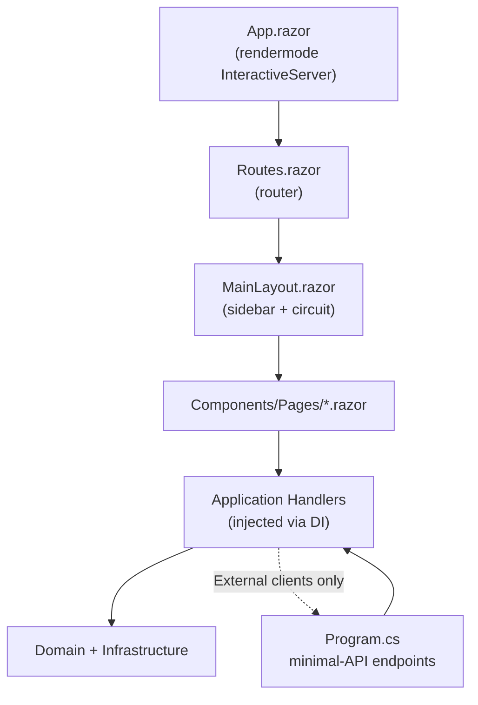

# Frontend Implementation and Maintenance — Blazor Server

**Implementation reference: baseline v0.1.0.** This document describes the **Blazor Server** dashboard currently implemented in `src/OEESentinel.WebUI/`, including its file layout, routing, state handling, component catalogue, and extension points.

There is **no separate SPA**. The dashboard compiles to C# assemblies that run server-side; Blazor Server streams UI deltas over a SignalR circuit and shares the Application DTOs with the backend. This eliminates a JS build pipeline, a proxy configuration, and an HTTP interceptor — the trade-off is that the dashboard requires a live server connection (`ReconnectModal.razor` handles transient drops).

The architectural decision to use Blazor Server over a React/Angular SPA, WebAssembly, or plain Razor Pages is documented in **ADR-0004**. This document describes the *current* implementation and how to extend it.

---

## 1. Application architecture

`OEESentinel.WebUI` is a single ASP.NET Core 10 project hosting two things:

1. **Blazor Server components** in `Components/` (Razor class library structure rendered as a server-side circuit).
2. **REST API endpoints** in `Program.cs` (minimal-API handlers per `docs/api/openapi.yaml`).

Both consume the **same** Application handlers via DI. A Blazor page never calls the REST API; it injects `I*Handler` directly. The REST API is for external MES/ERP integration only.



**Render mode:** `@rendermode InteractiveServer` applied globally on `Routes.razor` (`App.razor`). No per-page WASM opt-in. Every interactive feature (buttons, forms, chart updates) uses the SignalR circuit.

**What is stateful:** the circuit holds the current component tree and any `[Parameter]` values in it. Cross-page navigation disposes and recreates page components; state is rehydrated from `I*Handler` reads on each page.

**What is stateless between requests:** the REST API and the `DbContext`. No `HttpContext.Items`, no session middleware, no cookies (baseline).

---

## 2. File distribution and ownership

All paths are relative to `src/OEESentinel.WebUI/`:

```text
Components/
  App.razor                  → <Routes @rendermode="InteractiveServer" />
  Routes.razor               → <Router AppAssembly="…">, NotFound routing
  _Imports.razor             → shared @using directives
  Layout/
    MainLayout.razor         → sidebar + content area (existing template, kept)
    MainLayout.razor.css
    NavMenu.razor            → navigation links (to be adapted: Home, Upload, Machines, Ingestions)
    NavMenu.razor.css
    ReconnectModal.razor     → SignalR reconnection modal (kept from template)
    ReconnectModal.razor.css
    ReconnectModal.razor.js
  Pages/
    Home.razor               → landing page: recent ingests, current machines
    Upload.razor             → file upload form (baseline feature)
    MachineDetail.razor      → shift detail with gauges + breakdown
    Pareto.razor             → downtime Pareto chart
    Ingestions.razor         → ingestion history table
    ShiftDetail.razor        → single shift detail (linked from MachineDetail)
    Error.razor              → unhandled error boundary (kept)
    NotFound.razor           → 404 page (kept)
    Counter.razor            → ⚠️ template artifact — to be removed in P0-7
    Weather.razor            → ⚠️ template artifact — to be removed in P0-7
  Shared/                    → (create; shared UI components, see §4)
    OeeGauge.razor
    ParetoChart.razor
    ShiftSummaryCard.razor
    IngestionStatusBadge.razor
    UploadDropzone.razor
  Interop/
    ChartJsInterop.cs        → IJSRuntime wrapper for Chart.js
    wwwroot/js/chart-interop.js
wwwroot/
  app.css
  favicon.png
  lib/bootstrap/dist/        → Bootstrap 5 (kept from template)
  lib/chartjs/               → Chart.js 4.x (added in P0-7)
Properties/
  launchSettings.json
Program.cs                   → DI wiring, EF Core config, Blazor registration, REST endpoints
appsettings.json
appsettings.Development.json
```

### Placement rules

| Responsibility | Location |
|---|---|
| Page (routed component) | `Components/Pages/<Page>.razor` |
| Layout or shell | `Components/Layout/` |
| Reusable UI component used by ≥ 2 pages | `Components/Shared/` |
| JS interop wrapper | `Components/Interop/` |
| Third-party JS/CSS assets | `wwwroot/lib/<package>/` |
| Cross-cutting DI wiring | `Program.cs` |
| REST endpoint definitions | `Program.cs` (minimal APIs) |

**No `.csproj` split for shared components** — the baseline has too few to justify a separate project. If the shared set grows past ~15 components, extract `OEESentinel.WebUI.Shared` in a future refactor.

**Template cleanup is a P0 task.** `Counter.razor` and `Weather.razor` are template artifacts and must be removed before submission (`ROADMAP.md` P0-7). `Home.razor` is currently the template landing page and must be replaced with a real dashboard landing page.

---

## 3. Routes and page entrypoints

Routes are declared on each page via `@page "/path"` at the top of the `.razor` file. `Routes.razor` handles not-found routing to `NotFound.razor`.

### 3.1. Baseline routes

| Browser URL | Component | Implemented behavior |
|---|---|---|
| `/` | `Home.razor` | Landing page: recent 5 ingestions, active machines list. |
| `/upload` | `Upload.razor` | File upload with machine selector, window start/end, inline validation, live progress. |
| `/machines` | *(optional — a static list page)* | Machine list with links to detail pages. |
| `/machines/{Code}` | `MachineDetail.razor` | Machine OEE trend (last 7/30 days selector), shift list. |
| `/machines/{Code}/shifts/{ShiftId:guid}` | `ShiftDetail.razor` | Single `ProductionShift`: A/P/Q/OEE gauges + downtime breakdown table. |
| `/machines/{Code}/pareto` | `Pareto.razor` | Pareto chart of downtime reasons over a window. |
| `/ingestions` | `Ingestions.razor` | Ingestion history table with status, row counts, rejection sample link. |
| `/error` | `Error.razor` | Unhandled error boundary (kept from template). |

### 3.2. Planned routes (post-baseline)

| Browser URL | Component | Roadmap |
|---|---|---|
| `/login`, `/logout` | `Login.razor` | T2 |
| `/machines/{Code}/edit` | `MachineEdit.razor` | T2 |
| `/downtime-reasons` | `DowntimeReasons.razor` | T2 |
| `/reports` | `Reports.razor` (PDF export trigger) | T1 |

### 3.3. Route parameters

```csharp
@page "/machines/{Code}"
@page "/machines/{Code}/pareto"
@inject IGetMachineOeeHandler OeeHandler
@inject IGetDowntimeParetoHandler ParetoHandler

[Parameter] public string Code { get; set; } = default!;
```

**Case sensitivity:** `MachineCode` is uppercase by invariant (ADR-0006), so URLs use `MAQ-01` and the handler validates against `^[A-Z0-9-]{2,32}$`. A lowercase URL is normalised to uppercase before lookup.

---

## 4. Component catalogue

### 4.1. Page components

| Component | Key inputs (via `@page` parameter or `[Parameter]`) | Injected handlers |
|---|---|---|
| `Home.razor` | — | `IListRecentIngestionsHandler`, `IMachineRepository` (for active list) |
| `Upload.razor` | — | `IProcessLogFileHandler` |
| `MachineDetail.razor` | `[Parameter] Code` | `IGetMachineOeeHandler`, `IListMachineShiftsHandler` |
| `ShiftDetail.razor` | `[Parameter] Code`, `[Parameter] ShiftId` | `IGetMachineShiftHandler` |
| `Pareto.razor` | `[Parameter] Code` | `IGetDowntimeParetoHandler` |
| `Ingestions.razor` | — | `IListRecentIngestionsHandler` |

### 4.2. Shared components

| Component | Responsibility |
|---|---|
| `OeeGauge.razor` | Doughnut gauge bound to a single `Percentage`. Renders via `ChartJsInterop`. Props: `Title`, `Value` (`Percentage`), `Threshold` (colour band, e.g. green ≥ 0.85). |
| `ParetoChart.razor` | Horizontal bar chart bound to `IReadOnlyList<ParetoEntryDto>`. Renders via `ChartJsInterop`. |
| `ShiftSummaryCard.razor` | Compact card showing A/P/Q/OEE for one shift with link to detail page. |
| `IngestionStatusBadge.razor` | Coloured badge driven by `IngestionStatus` enum. |
| `UploadDropzone.razor` | Drag-and-drop file picker with preview; used inside `Upload.razor`. |

**Component conventions:**
- Props are `[Parameter]` public C# properties.
- Events are `EventCallback` or `EventCallback<T>`.
- No component injects `I*Repository` — only `I*Handler`. The Application boundary is preserved.
- No component contains domain math. `OeeMetrics` is always computed by `OeeCalculatorEngine`; components only **render** the resulting `OeeMetricsDto`.

### 4.3. Layout components

| Component | Responsibility |
|---|---|
| `MainLayout.razor` | Page shell with sidebar + main content area. Bootstrap 5 grid. |
| `NavMenu.razor` | Sidebar navigation links. To be adapted (baseline template has `Home`, `Counter`, `Weather` — replace with `Upload`, `Machines`, `Ingestions`, `Pareto`). |
| `ReconnectModal.razor` | Shows when the SignalR circuit drops; offers a retry. Kept from template. |

---

## 5. State and form handling

### 5.1. Page state

Page components hold their state in C# fields. No global state library. Example:

```csharp
@page "/machines/{Code}"
@inject IGetMachineOeeHandler OeeHandler
@inject IListMachineShiftsHandler ShiftsHandler

[Parameter] public string Code { get; set; } = default!;

private MachineOeeDto? _oee;
private List<ShiftSummaryDto>? _shifts;
private string? _error;
private bool _loading = true;
private DateOnly _from = DateOnly.FromDateTime(DateTime.UtcNow.AddDays(-7));
private DateOnly _to = DateOnly.FromDateTime(DateTime.UtcNow);

protected override async Task OnParametersSetAsync()
{
    _loading = true;
    _error = null;
    try
    {
        var window = DateWindow.From(_from, _to);
        _oee = await OeeHandler.HandleAsync(new GetMachineOeeQuery(Code, window));
        _shifts = await ShiftsHandler.HandleAsync(new ListMachineShiftsQuery(Code, window));
    }
    catch (Exception ex)
    {
        _error = ex.Message;  // In dev; use a typed mapper in prod
    }
    finally
    {
        _loading = false;
    }
}
```

**No `useEffect`, no `signal`, no RxJS.** The component lifecycle (`OnInitializedAsync`, `OnParametersSetAsync`) is the effect hook. `await` on the handler is the async boundary. Blazor's renderer diffing is the reactivity primitive.

### 5.2. Form handling

Blazor forms use `EditForm` + `DataAnnotationsValidator` or a plain `<form @onsubmit="…">` for small forms.

**Baseline `Upload.razor` form:**

```csharp
<EditForm Model="_model" OnValidSubmit="HandleUploadAsync" FormName="upload">
    <DataAnnotationsValidator />
    <ValidationSummary />

    <InputText @bind-Value="_model.MachineCode" placeholder="MAQ-01" />
    <InputDate @bind-Value="_model.WindowStart" />
    <InputDate @bind-Value="_model.WindowEnd" />
    <UploadDropzone OnFileSelected="f => _model.File = f" />

    <button type="submit" disabled="@_uploading">
        @(_uploading ? "Uploading…" : "Upload")
    </button>
</EditForm>

@code {
    private UploadViewModel _model = new();
    private bool _uploading;

    private async Task HandleUploadAsync()
    {
        _uploading = true;
        try
        {
            var command = _model.ToCommand();
            var result = await Handler.HandleAsync(command);
            Navigation.NavigateTo($"/machines/{result.MachineCode}/shifts/{result.ProductionShiftId}");
        }
        catch (MachineNotFoundDomainException ex) { /* display */ }
        catch (DuplicateShiftDomainException ex) { /* display */ }
        catch (PlannedTimeZeroDomainException ex) { /* display */ }
        catch (Exception ex) { /* generic error card */ }
        finally { _uploading = false; }
    }
}
```

**Validation strategy:**
- **Client-side:** `DataAnnotations` on the view-model class (`[Required]`, `[Range]`, `[RegularExpression]` for machine code).
- **Server-side:** the handler remains authoritative. Every exception is caught and displayed; the client never assumes success.

### 5.3. Loading and error states

Standard pattern: three states (`_loading`, `_error`, `_data`). Rendered as:

```razor
@if (_loading)  { <LoadingSpinner /> }
else if (_error is not null) { <ErrorCard Message="_error" OnRetry="ReloadAsync" /> }
else { <Content /> }
```

`ErrorBoundary` (from `Microsoft.AspNetCore.Components.Web`) wraps the router for unhandled exceptions; the fallback is `Error.razor`.

---

## 6. Chart.js integration

Chart.js 4.x is loaded from `wwwroot/lib/chartjs/`. A minimal `IJSRuntime` wrapper (`Components/Interop/ChartJsInterop.cs`) initialises a chart on a `<canvas>` element and exposes update/destroy:

```csharp
public sealed class ChartJsInterop : IAsyncDisposable
{
    private readonly IJSRuntime _js;

    public ChartJsInterop(IJSRuntime js) => _js = js;

    public ValueTask CreateGaugeAsync(string canvasId, double value) =>
        _js.InvokeVoidAsync("oeeCharts.createGauge", canvasId, value);

    public ValueTask UpdateAsync(string canvasId, double value) =>
        _js.InvokeVoidAsync("oeeCharts.update", canvasId, value);

    public ValueTask DisposeAsync() =>
        _js.InvokeVoidAsync("oeeCharts.destroyAll").AsTask().ContinueWith(_ => { });
}
```

`wwwroot/js/chart-interop.js` implements `window.oeeCharts` with three functions (`createGauge`, `update`, `destroyAll`) using the standard Chart.js API. A `OeeGauge.razor` component:

```razor
@inject ChartJsInterop ChartInterop
@implements IAsyncDisposable

<canvas id="@_canvasId"></canvas>

@code {
    [Parameter] public string Title { get; set; } = "";
    [Parameter] public Percentage Value { get; set; } = Percentage.Zero;

    private readonly string _canvasId = $"gauge-{Guid.NewGuid():N}";

    protected override async Task OnAfterRenderAsync(bool firstRender)
    {
        if (firstRender)
            await ChartInterop.CreateGaugeAsync(_canvasId, Value.Value);
        else
            await ChartInterop.UpdateAsync(_canvasId, Value.Value);
    }

    public async ValueTask DisposeAsync() => await ChartInterop.DisposeAsync();
}
```

**Why a thin wrapper and not a library:** the `ChartJs.Blazor` and `Blazor-ApexCharts` libraries add a NuGet dependency that must track .NET 10 releases. The wrapper is ~60 lines and stable. Revisit if a future feature (e.g., complex time-series with zoom) justifies the dependency.

**No chart uses WASM.** All rendering happens server-side; the `IJSRuntime` call transmits a JSON payload to the browser, which the Chart.js instance renders client-side.

---

## 7. Backend integration

### 7.1. In-process handlers (Blazor path)

Every Blazor page injects `I*Handler` directly. DI is configured in `Program.cs`:

```csharp
builder.Services.AddScoped<IProcessLogFileHandler, ProcessLogFileHandler>();
builder.Services.AddScoped<IGetMachineOeeHandler, GetMachineOeeHandler>();
builder.Services.AddScoped<IGetMachineShiftHandler, GetMachineShiftHandler>();
builder.Services.AddScoped<IListMachineShiftsHandler, ListMachineShiftsHandler>();
builder.Services.AddScoped<IGetDowntimeParetoHandler, GetDowntimeParetoHandler>();
builder.Services.AddScoped<IListRecentIngestionsHandler, ListRecentIngestionsHandler>();
```

**No HTTP client is registered for internal calls.** A page that needs OEE data calls `IGetMachineOeeHandler` — one method call, one DTO returned.

### 7.2. REST endpoints (external clients)

Defined in `Program.cs`:

```csharp
app.MapPost("/api/v1/logs", async (
    [FromForm] LogUploadRequest req,
    IProcessLogFileHandler handler,
    CancellationToken ct) =>
{
    try
    {
        var result = await handler.HandleAsync(req.ToCommand(), ct);
        return Results.Created($"/api/v1/machines/{result.MachineCode}/shifts/{result.ProductionShiftId}", result);
    }
    catch (MachineNotFoundDomainException ex)
    {
        return Results.Problem(/* ProblemDetails mapping */);
    }
    // … other domain exceptions
});

app.MapGet("/api/v1/machines/{code}/oee", async (
    string code, [FromQuery] DateTimeOffset from, [FromQuery] DateTimeOffset to,
    IGetMachineOeeHandler handler, CancellationToken ct) => { … });
```

Full contracts are in [`docs/api/openapi.yaml`](../api/openapi.yaml). The endpoints are **independent of the Blazor circuit** — a Bruno collection, a `curl`, or a future MES client hits them without touching the dashboard.

### 7.3. When to use which

| Need | Path |
|---|---|
| A Razor page needs OEE data to render | Inject `IGetMachineOeeHandler`; **never** `HttpClient` |
| An external MES needs OEE data | `GET /api/v1/machines/{code}/oee` (HTTP) |
| A Bruno test verifies the contract | `GET /api/v1/...` (HTTP) |
| A future Prometheus exporter scrapes metrics | `GET /metrics` (HTTP; roadmap T5) |

The **only** acceptable reason for a Razor page to use `HttpClient` is if a future feature consumes an external third-party API (e.g., a weather integration for shift planning). Baseline has none.

---

## 8. Running and opening the application

### 8.1. Prerequisites

- [.NET 10 SDK](https://dotnet.microsoft.com/download)
- [Docker Desktop](https://www.docker.com/products/docker-desktop/) (for PostgreSQL)

### 8.2. Quickstart

```bash
# 1. Start PostgreSQL
docker compose up -d

# 2. Apply migrations
dotnet ef database update \
  --project src/OEESentinel.Infrastructure \
  --startup-project src/OEESentinel.WebUI

# 3. Run the app
dotnet run --project src/OEESentinel.WebUI
```

Open **http://localhost:5278** in a browser. In `Development`, the seed data (`MAQ-01`, `MAQ-02`, `PRESSA-B2`, six downtime reasons, `samples/sample_shift.csv` pre-ingested) is applied automatically (`SeedData:Enabled = true` in `appsettings.Development.json`).

### 8.3. Building

```bash
dotnet build                                    # verify compilation
dotnet test                                     # run unit tests
dotnet publish -c Release src/OEESentinel.WebUI # publish
```

The published artifact is a self-contained ASP.NET Core application. There is **no separate frontend build** — Blazor is compiled into the same assembly.

### 8.4. Docker

The `Dockerfile` (baseline: TBD in P0-9) will produce a multi-stage build:

1. `mcr.microsoft.com/dotnet/sdk:10.0` → `dotnet publish`.
2. `mcr.microsoft.com/dotnet/aspnet:10.0` → copy publish output, expose port 8080.

`docker-compose.yml` starts `postgres` and `webui`. `webui` depends on `postgres` (healthcheck via `pg_isready`), applies migrations at startup, and serves the dashboard.

---

## 9. Styles and assets

### 9.1. CSS

- **Bootstrap 5** is used as the baseline UI framework (`wwwroot/lib/bootstrap/dist/`, already present from the .NET 10 Blazor template).
- **Page-specific styles** live in `Components/Pages/<Page>.razor.css` (Blazor CSS isolation).
- **Layout styles** live in `Components/Layout/MainLayout.razor.css` and `NavMenu.razor.css`.
- **Global styles** live in `wwwroot/app.css`.

**No SCSS pipeline** — Blazor CSS isolation renders scoped class names automatically. Adding a CSS preprocessor would require a build step (LibSass, Web Compiler) that the baseline does not justify.

### 9.2. Icons and images

- **Icons:** Bootstrap Icons (loaded via CDN or from `wwwroot/lib/bootstrap-icons/` — to be added in P0-7).
- **Images:** `wwwroot/favicon.png` (present). Any future plant logos go in `wwwroot/img/`.
- **Charts:** Chart.js from `wwwroot/lib/chartjs/` (to be added in P0-7).

### 9.3. Responsiveness

- The sidebar collapses into a drawer below 768 px (Bootstrap's `offcanvas` or a custom toggle in `NavMenu.razor.css`).
- Dashboard cards stack vertically below 992 px.
- Tables scroll horizontally inside their card on narrow screens.
- Charts are responsive (`maintainAspectRatio: false` in Chart.js config).

---

## 10. Extending the code

### 10.1. Add a new page

1. Create `Components/Pages/<NewPage>.razor` with `@page "/<route>"`.
2. Create the corresponding Application handler in `OEESentinel.Application/Handlers/` and its port `I<NewPage>Handler` in `OEESentinel.Application/Ports/Inbound/`.
3. Implement the handler, register it in `Program.cs` (one `AddScoped` line).
4. Inject the handler in the `.razor` file, bind the DTO, render.
5. Add a `NavLink` entry in `NavMenu.razor` if the page is top-level.

**No route registration is needed** — Blazor discovers `@page` directives at compile time.

### 10.2. Add a new REST endpoint

1. Add a `MapPost`/`MapGet` call in `Program.cs`.
2. Reuse an existing Application handler if the semantics match; otherwise add a new handler (see 10.1).
3. Document the endpoint in `docs/api/openapi.yaml` **first** (contract-first).
4. Add a `ProblemDetails` mapping for any new domain exception.

### 10.3. Add a new shared component

1. Create `Components/Shared/<Component>.razor` and `.razor.css`.
2. Use `[Parameter]` for props, `EventCallback` for events.
3. Inject `I*Handler` only if the component itself performs a read/write; otherwise receive data via props.
4. Add a visual test in `docs/architecture/frontend-implementation-and-maintenance.md` §4.2 (this table).

### 10.4. Add a new domain concept (rare)

Follow `docs/domain/domain-model.md` §6 (rationale log). Any new aggregate or Value Object requires:
1. A Domain type (with invariants in the constructor).
2. An EF Core configuration in `Infrastructure/Persistence/Configurations/`.
3. A migration (`dotnet ef migrations add AddX`).
4. A repository port and its adapter.
5. A handler consuming it.
6. A page or endpoint exposing it.
7. Tests (domain + handler).

### 10.5. Formatting

- **C#:** `.editorconfig` in the repo root, enforced by `dotnet format` in CI (T8).
- **Razor:** follow the standard .NET formatting; `dotnet format` covers it.

---

## 11. Verification and troubleshooting

### 11.1. Verification

| Check | Command |
|---|---|
| Compiles | `dotnet build` |
| Unit tests pass | `dotnet test` |
| Migration is up to date | `dotnet ef migrations list` (should show all applied) |
| Dashboard renders | `dotnet run --project src/OEESentinel.WebUI` then open http://localhost:5278 |
| REST API works | `curl http://localhost:5278/api/v1/health` |

**End-to-end browser tests are not in the baseline** (no Playwright — see ADR-0007). Manual verification steps for each page are documented in `ROADMAP.md` P0-8 acceptance criteria.

### 11.2. Troubleshooting

| Symptom | First checks |
|---|---|
| App fails to start; DB error | `docker compose ps`; is `postgres` healthy? `docker compose logs postgres` |
| Migrations fail | `dotnet ef migrations list`; connection string in `appsettings.Development.json` |
| Dashboard renders but charts are empty | Browser devtools → console for JS errors; check `wwwroot/js/chart-interop.js` loaded; `wwwroot/lib/chartjs/chart.umd.js` present |
| SignalR reconnects repeatedly | Server logs; `ReconnectModal` shows retry; check network for proxy buffering |
| Upload fails with 404 machine | `GET /api/v1/machines` — is the machine seeded? Check `SeedData:Enabled` |
| Upload returns 409 | A shift for the same `(machine, window)` already exists; use a different window or delete the existing shift (T2 adds correction workflow) |
| Upload returns 422 | Domain invariant failed; check `LogIngestion.FAILED` reason (`/ingestions` page) |
| `/api/v1/health` returns 503 | Database unreachable; check PostgreSQL container |

---

## 12. Current implementation boundaries

### 12.1. What is implemented (baseline)

- Blazor Server layout, sidebar, reconnect modal (from template, adapted).
- All baseline pages listed in §3.1 (once P0-7 completes).
- Chart.js integration for `OeeGauge` and `ParetoChart`.
- Minimal-API endpoints per `docs/api/openapi.yaml`.
- No authentication; open on trusted network.

### 12.2. What is *not* implemented (must not be documented as available)

- **Template artifacts still present** (`Counter.razor`, `Weather.razor`) — to be removed in P0-7.
- **No authentication or authorization** — planned T2. Do not add `[Authorize]` attributes; the middleware is not wired.
- **No machine management UI** — planned T2. Reference data is seeded only.
- **No downtime reason management UI** — planned T2.
- **No PDF export** — planned T1.
- **No folder watcher** — planned T3. Uploads are manual only.
- **No Prometheus `/metrics`** — planned T5.
- **No real-time updates** — the dashboard refreshes on navigation or explicit user action. A `BackgroundService` polling for new shifts (WebSocket/SSE push) is not in scope.
- **No offline mode** — Blazor Server requires a live connection.

### 12.3. What must never be added without re-opening an ADR

- **A JavaScript SPA (React/Vue/Angular)** — would contradict ADR-0004.
- **A separate `frontend` project** — would duplicate the DTOs and lose model-sharing.
- **`HttpClient` inside a Razor component for internal calls** — bypasses the Application layer.
- **Direct `DbContext` access from a component** — bypasses the ports and the Application handlers.
- **Client-side OEE math** — the OEE formula is the domain's, always computed server-side.
- **A state management library** (Redux-like) — Blazor's component state is sufficient; introducing a global store contradicts KB §7.3's "no premature complexity".

---

## 13. References

- **ADR-0004** — Blazor Server decision and considered alternatives.
- **ADR-0001** — Clean/Onion architecture (Dependency Rule enforced in `WebUI`).
- **ADR-0002** — Stack (ASP.NET Core 10, .NET 10).
- **ADR-0005** — Streaming parser (used by `Upload.razor` via `IProcessLogFileHandler`).
- **ADR-0006** — Immutable `ProductionShift`, pure `OeeCalculatorEngine`.
- `docs/sad/04-principles-and-guidelines.md` §4.2 — dual inbound path (Blazor + REST).
- `docs/api/openapi.yaml` — REST contract.
- `docs/architecture/components-diagram.md` §4 — L3 component view of `WebUI`.
- `docs/architecture/use-case-diagram.md` — use cases mapped to pages and endpoints.
- `ROADMAP.md` — baseline tasks (P0-1..P0-9) and roadmap tasks (T1–T8).