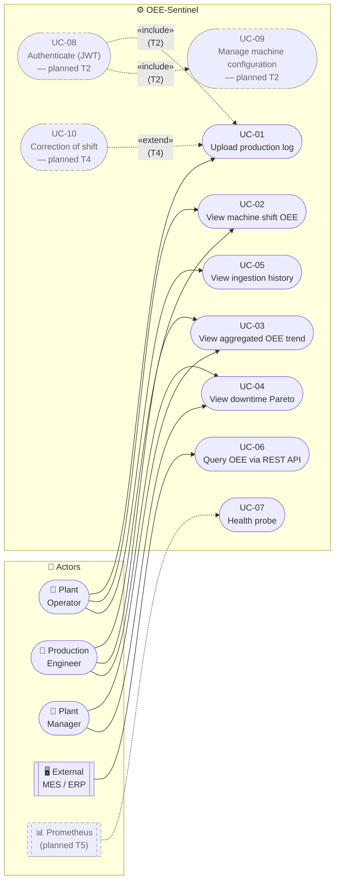

# Use Case Diagram — OEE-Sentinel

## 1. Purpose and Scope

This document enumerates the **baseline** and **planned** use cases of
OEE-Sentinel, their actors, and the relationships between them. It is the
use-case view (the `+1` of the 4+1 Kruchten model, KB §6.1) that validates
the System Context and Container diagrams (`components-diagram.md`).

Per KB §2.1, use cases are described in a **black-box** style (foco no
*quê*, nunca no *como*). Technical procedures ("o utilizador clica", "o
sistema executa um INSERT") are explicitly avoided.

> **Scope note.** The baseline (`v0.1.0-baseline`) ships the **UC-01**
> through **UC-07**. UC-08 and UC-09 are planned under **Roadmap T2**
> (JWT + RBAC). UC-10 is the deferred correction workflow (Roadmap T4).
> The distinction is preserved throughout so that an evaluator can see
> exactly what is real and what is planned.

---

## 2. Actors

| Actor | Type | Description | Authorized operations (baseline) |
|---|---|---|---|
| **Plant Operator** | Human (primary) | Floor staff who run the machines and record shift outcomes. | Upload a log, view shift OEE, view ingestion history. |
| **Production Engineer** | Human (primary) | Technical staff responsible for machine configuration and downtime catalogues. | All of the Operator's, plus Pareto analysis and machine configuration (planned T2). |
| **Plant Manager** | Human (primary) | Business stakeholder consuming weekly/monthly KPIs. | View aggregated OEE trends, Pareto, and drill-down to a specific shift. |
| **External MES / ERP** | System (secondary) | Manufacturing Execution System or ERP that consumes OEE results programmatically. | Query aggregated OEE via `GET /api/v1/machines/{code}/oee`; query shift facts via `/shifts`. |
| **Prometheus / Monitoring** | System (secondary, **planned T5**) | Enterprise monitoring that scrapes metrics. | Poll `/metrics` (OpenMetrics). *Not in baseline.* |

> **Note on the primary/secondary distinction.** Primary actors initiate
> use cases through the Blazor dashboard. Secondary actors are external
> systems that consume the REST API. Both hit the same Application layer
> (see `04-principles-and-guidelines.md` §4.2).

---

## 3. Use Case Diagram (Mermaid)

**Legend.**
- Solid line: baseline use case, implemented today.
- Dashed line + grey node: **planned** (Roadmap T2 / T4 / T5).
- `«include»`: UC-08 is a precondition of UC-01 and UC-09 (planned).
- `«extend»`: UC-10 extends UC-01 by offering a correction path.

---

## 4. Baseline Use Case Descriptions

Per KB §2.1, descriptions are provided in **fully-dressed** format for the
two most critical use cases (UC-01, UC-02) and **casual** format for the
remaining baseline cases.

### UC-01 — Upload production log (fully-dressed)

| Section | Description |
|---|---|
| **Primary actor** | Plant Operator |
| **Stakeholders & interests** | Operator (wants accurate shift OEE), Engineer (wants consistent catalogue), Manager (wants trustable KPI) |
| **Preconditions** | The `MachineCode` exists in the active catalogue. The uploaded file is a CSV/TXT with the canonical schema. |
| **Postconditions** | A new `LogIngestion` is persisted and (on success) a new `ProductionShift` fact is persisted, linked to its source ingestion. The dashboard shows the shift. |
| **Trigger** | Operator selects "Upload" on the dashboard. |
| **Basic flow** | 1. Operator selects a file and fills in `machineCode`, `windowStart`, `windowEnd`. 2. The system validates the window (`windowStart < windowEnd`). 3. The system streams the file through the parser, applying per-line rejection. 4. On completion, the system invokes the OEE calculator. 5. The system persists the ingestion (status `COMPLETED`) and the shift. 6. The system navigates to the shift detail page, rendering A/P/Q/OEE gauges. |
| **Alternative flow A1 — Domain invariant fails** | 4a. The calculator throws `ArgumentOutOfRangeException` (`planned == 0` or `downtime > planned`). 5a. The ingestion is recorded as `FAILED` with a stable reason code (`PLANNED_TIME_ZERO`, `DOWNTIME_OVERFLOW`). 6a. The dashboard shows an error card. No `ProductionShift` is created. |
| **Alternative flow A2 — Machine not found** | 2a. `GetByCodeAsync` returns null. 3a. The request is rejected with `MachineNotFoundDomainException` → `404`. |
| **Alternative flow A3 — Duplicate window** | 4a. A non-superseded `ProductionShift` already exists for the same `(machineCode, window)`. 5a. The request is rejected with `DuplicateShiftDomainException` → `409`. |
| **Special requirements** | Bounded memory (≤ 200 MB peak RSS at 200k rows). Per-line rejection without abort. Cancellation propagates through parse + persist. |
| **Frequency** | ~1 upload per shift per machine (baseline). |

### UC-02 — View machine shift OEE (fully-dressed)

| Section | Description |
|---|---|
| **Primary actors** | Plant Operator, Production Engineer, Plant Manager |
| **Preconditions** | A `ProductionShift` exists for the selected machine and window. |
| **Postconditions** | The dashboard renders the A/P/Q/OEE pillars and the downtime breakdown. No data is mutated. |
| **Trigger** | The actor navigates to `/machines/{code}/shifts/{id}` or clicks a shift row. |
| **Basic flow** | 1. The dashboard injects `IGetMachineShiftHandler`. 2. The handler reads the `ProductionShift` via `IProductionShiftRepository`. 3. The handler maps to `ProductionShiftSummaryDto`. 4. The dashboard binds gauges (`OeeGauge.razor`) and the breakdown table. |
| **Alternative flow** | 2a. The shift does not exist → `404` error card. 2b. The shift is superseded → shown with a "superseded by …" banner and a link to the current one. |
| **Special requirements** | All percentages displayed as `0–100%` (client multiplies by 100 at render time). |

### UC-03 — View aggregated OEE trend (casual)

The actor selects a machine and a window (default: last 7 days, maximum 90
days). The dashboard calls `IGetMachineOeeHandler`, which aggregates across
all non-superseded shifts **from totals** (never by averaging percentages —
see `06-api-design-specification.md` §3.3). The dashboard renders a
time-series chart (Chart.js) plus the four consolidated pillars.

### UC-04 — View downtime Pareto (casual)

The actor selects a machine and a window (maximum 90 days). The dashboard
calls `IGetDowntimeParetoHandler`, which aggregates `DowntimeBreakdown`
entries across shifts in Application memory (see
`05-key-scenarios.md` Scenario 4 for the rationale). Returns the top-20
reasons, sorted by duration descending, ties broken by `reasonCode`. The
dashboard renders a horizontal bar chart.

### UC-05 — View ingestion history (casual)

The actor navigates to `/ingestions`. The dashboard reads
`ILogIngestionRepository.ListRecentAsync` and renders a table with status,
file name, rows processed/rejected, and a link to the shift (if any).

### UC-06 — Query OEE via REST API (casual)

An external MES calls `GET /api/v1/machines/{code}/oee?from=…&to=…`. The
response schema and aggregation policy are documented in
`06-api-design-specification.md` §3.3. This use case bypasses the Blazor
dashboard entirely — it exercises the same Application handler as UC-03.

### UC-07 — Health probe (casual)

Docker Compose (`healthcheck`) and a future Prometheus blackbox exporter
(Roadmap T5) call `GET /api/v1/health`. Returns `200` when the database is
reachable, `503` otherwise. No actor interaction.

---

## 5. Planned Use Cases (Roadmap)

| UC | Description | Roadmap | Why it is deferred |
|---|---|---|---|
| **UC-08 — Authenticate (JWT)** | Actor exchanges credentials for a signed JWT, then presents it on subsequent requests. Roles: `OPERATOR`, `ENGINEER`, `ADMINISTRATOR`. | T2 | Baseline runs on a trusted internal network (ADR-0002 §Context). Adding auth before the dashboard is fully working delays the working slice. |
| **UC-09 — Manage machine configuration** | Engineer edits `Machine` (name, ideal cycle time, planned shift duration), deactivates (soft) or reactivates. Requires RBAC. | T2 | Requires UC-08. Domain supports it (`Machine.activate`/`deactivate`); WebUI endpoints are additive. |
| **UC-10 — Correction of shift** | Operator/Engineer re-uploads a shift with corrected downtime mapping, superseding the current `ProductionShift`. | T4 | Baseline returns `409 Conflict` on duplicate windows. The supersession workflow is already modelled (`superseded_by_id`, partial unique index) but the correction UI is out of baseline scope. |

---

## 6. Relationship to the Domain and Application

| Use case | Application handler | Domain involvement |
|---|---|---|
| UC-01 | `ProcessLogFileHandler` | `Machine`, `LogIngestion`, `ProductionShift`, `OeeCalculatorEngine`, `ProductionTotals`, `DowntimeBreakdown` |
| UC-02, UC-03, UC-06 | `GetMachineOeeHandler`, `GetMachineShiftHandler` | Read-only; uses `ProductionShift` aggregate but does not invoke the calculator |
| UC-04 | `GetDowntimeParetoHandler` | Reads `DowntimeBreakdown` value objects across shifts |
| UC-05 | `ListRecentIngestionsHandler` | Reads `LogIngestion` |
| UC-07 | *(none — direct `WebUI` handler)* | Uses `OEESentinelDbContext.Database.CanConnectAsync()` |

The Application handlers are the same for Blazor and REST consumers (see
`04-principles-and-guidelines.md` §4.2). No use case is UI-specific.

---

## 7. Anti-Patterns Avoided (per KB §2.1)

- **No technical procedures.** "Clica no botão" and "executa um INSERT" are prohibited. The flow describes *what* the system does, not *how*.
- **No actors that are really UI components.** "Botão de upload" is not an actor.
- **No use cases named after CRUD operations.** `UploadProductionLog`, not `InsertProductionShift`.
- **No speculative use cases.** UC-08 through UC-10 are explicitly marked planned and traced to a roadmap task.

---

## 8. References

- KB §2.1 (User Stories, Use Cases, SSDs), §6.1 (4+1 model, Scenarios view), §13.1 (Entity vs VO decisions used throughout the flow descriptions).
- `docs/sad/01-problem-statement.md` §1, §2.
- `docs/sad/02-context.md` §3 (stakeholder personas — this document's actor table is their use-case projection).
- `docs/glossary.md` (Ubiquitous Language).
- `docs/sad/04-principles-and-guidelines.md` §4.2 (dual inbound path).
- `docs/sad/05-key-scenarios.md` (formal scenarios exercising UC-01, UC-02, UC-03, UC-04).
- `docs/api/openapi.yaml` (the REST contract for UC-06).
- ADR-0001, ADR-0004, ADR-0005, ADR-0006, ADR-0007.