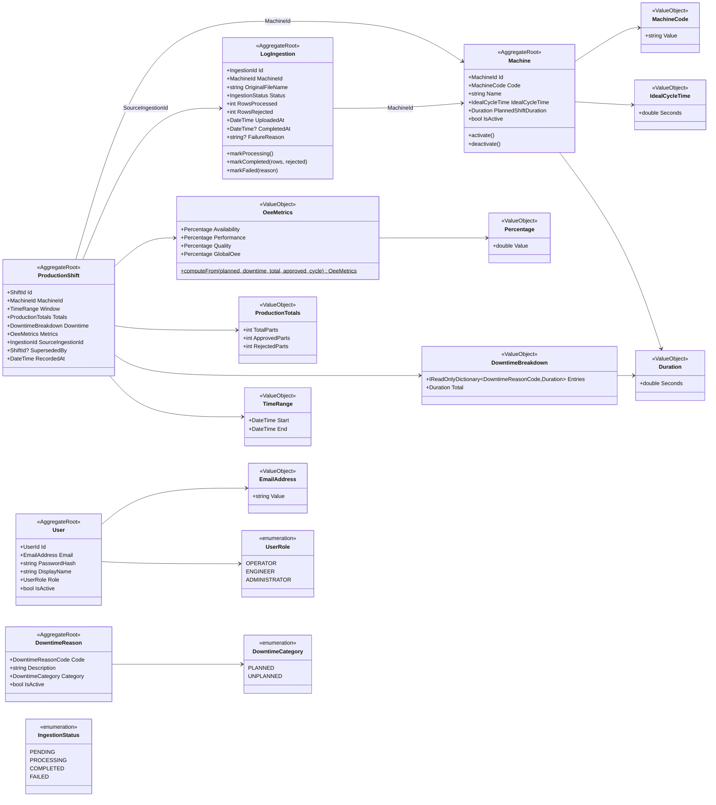

# Domain Model: OEE-Sentinel

This document is the canonical reference for the tactical DDD design of OEE-Sentinel. It complements the diagram below with a **rationale log** (per KB §20) explaining boundary choices and invariant guarantees.

## 1. Diagram



## 2. Aggregate Boundaries & Rationale

### 2.1. `Machine` — small, reference-like

`Machine` holds only intrinsic configuration: `MachineCode`, `Name`, `IdealCycleTime`, `PlannedShiftDuration`, `IsActive`. It **does not** hold `ProductionShift` children. Referenced by ID from `ProductionShift` and `LogIngestion`. Soft-deactivation only — historical shifts must never lose their machine reference.

**Why not one big `Machine` with all shifts?** Because a machine's lifetime is decades; loading all shifts into the aggregate is incompatible with a well-defined consistency boundary (KB §3.3, "cenário A" trade-off — rejected).

### 2.2. `ProductionShift` — computed, immutable

A `ProductionShift` is a **fact**: it captures the OEE of one machine over one window, computed from one ingestion run. Once persisted, it is never mutated. Corrections (re-parse with new downtime catalogue) create a new shift and link the old one via `SupersededBy`.

**Invariants:**
- `Totals.TotalParts == Totals.ApprovedParts + Totals.RejectedParts` (enforced by `ProductionTotals`).
- `Downtime.Total ≤ PlannedProductionTime`.
- `Metrics` was computed by `OeeCalculatorEngine` from `Totals`, `Downtime.Total`, and the machine's `IdealCycleTime` — the aggregate does **not** recompute on load (immutable fact).
- All `Percentage` values ∈ [0,1].

### 2.3. `LogIngestion` — audit and pipeline state

One upload = one `LogIngestion`. Tracks lifecycle (`PENDING → PROCESSING → COMPLETED | FAILED`), row counts, and failure reason. This is the **audit anchor** — every `ProductionShift` produced by an ingestion can be traced back. Not part of `ProductionShift` (different lifecycle: ingestion may fail after zero shifts).

### 2.4. `User`, `DowntimeReason` — reference aggregates

Both are **reference data**, small and rarely-changing. `DowntimeReason` is a catalogue (not an enum) because the mapping from vendor error codes to canonical reasons is client-specific. `User` exists in baseline (schema + repository) even before authentication is wired (ADR-0002).

### 2.5. `ProductionEvent` — NOT an aggregate

Raw events are **append-only facts**, not aggregate children. Streaming constraints (bounded memory) forbid loading them into `ProductionShift`. Persisted in a dedicated table `production_events` with FK to `log_ingestions(id)` — used for audit and re-analysis.

## 3. Value Objects — invariants

| VO | Invariant | Enforcement |
|---|---|---|
| `Percentage` | `0.0 ≤ Value ≤ 1.0` | Constructor throws `ArgumentOutOfRangeException` |
| `Duration` | `Seconds ≥ 0.0` | Constructor throws |
| `IdealCycleTime` | `Seconds > 0.0` | Constructor throws |
| `TimeRange` | `Start < End` | Constructor throws |
| `ProductionTotals` | `TotalParts ≥ ApprovedParts ≥ 0` and `RejectedParts = TotalParts − ApprovedParts` | Constructor validates; `RejectedParts` computed |
| `OeeMetrics` | All fields ∈ [0,1] | Computed by `OeeCalculatorEngine` with clamping |
| `MachineCode` | Non-empty, `[A-Z0-9-]{2,32}` | Constructor + regex |
| `DowntimeReasonCode` | Non-empty, `[A-Z_]{3,64}` | Constructor + regex |

## 4. Domain Services

### `OeeCalculatorEngine`

```csharp
public static OeeMetrics Calculate(
    Duration plannedProductionTime,
    Duration totalDowntime,
    ProductionTotals totals,
    IdealCycleTime idealCycleTime)
```

**Rules:**
- `Availability = (planned − downtime) / planned`; if `planned == 0` → throw (invalid input).
- `OperatingTime = planned − downtime`; if `< 0` → throw.
- `Performance = (totals.TotalParts × cycle.Seconds) / OperatingTime.Seconds`; if `OperatingTime == 0` → `Performance = 0` (no production time).
- `Quality = totals.ApprovedParts / totals.TotalParts`; if `TotalParts == 0` → `Quality = 1.0` (nothing was produced, nothing was rejected — this is the *mathematically neutral* value; a business exception is a concern of the caller, not the engine).
- `OEE = A × P × Q`.
- All four values clamped to `[0,1]` after computation. Clamping is documented as a **defensive** measure — the domain *expects* clean inputs, but downstream corruption must not produce a value that renders as `>100%`.

### Parser port — `IProductionLogParser`

Not a domain service (introduced by the Infrastructure adapter). Belongs to Application as a **port**:

```csharp
public interface IProductionLogParser
{
    IAsyncEnumerable<ProductionEvent> ParseAsync(Stream source, CancellationToken ct);
}
```

## 5. Cross-Aggregate References

All cross-aggregate references are **typed IDs**, never object references:
- `ProductionShift.MachineId` → `Machine`
- `ProductionShift.SourceIngestionId` → `LogIngestion`
- `LogIngestion.MachineId` → `Machine`

This honors the DDD rule: *"nothing outside an aggregate can hold a reference to an internal object"* (KB §3.2).

## 6. Deliberate Design Choices (Rationale Log)

| Decision | Alternative rejected | Why |
|---|---|---|
| `ProductionShift` stores computed `OeeMetrics` | Recompute on read | Immutability: the metric is a fact, tied to the calculator version. Recomputes break auditability. |
| `DowntimeReason` as aggregate, not enum | `enum DowntimeReason` | Catalogue changes per client; enum forces recompile. |
| `ProductionEvent` outside aggregate | Embed in `ProductionShift` | Streaming constraint: 200k rows/shift, cannot fit in memory (KB §3.3). |
| Single bounded context | Split into Identity / Topology / Ingestion | Modular monolith (KB §7.4, "1º Mandamento"). No scaling pressure justifies distribution. |
| Scrap ≠ downtime | Treat rejections as downtime | Semantically wrong: scrap kills Quality, not Availability. |
| `User` aggregate ships before auth | Defer user model to T2 | BYOP baseline requires *some* runnable UI; auth is a roadmap item. But the schema must be in place to justify "active and real". |