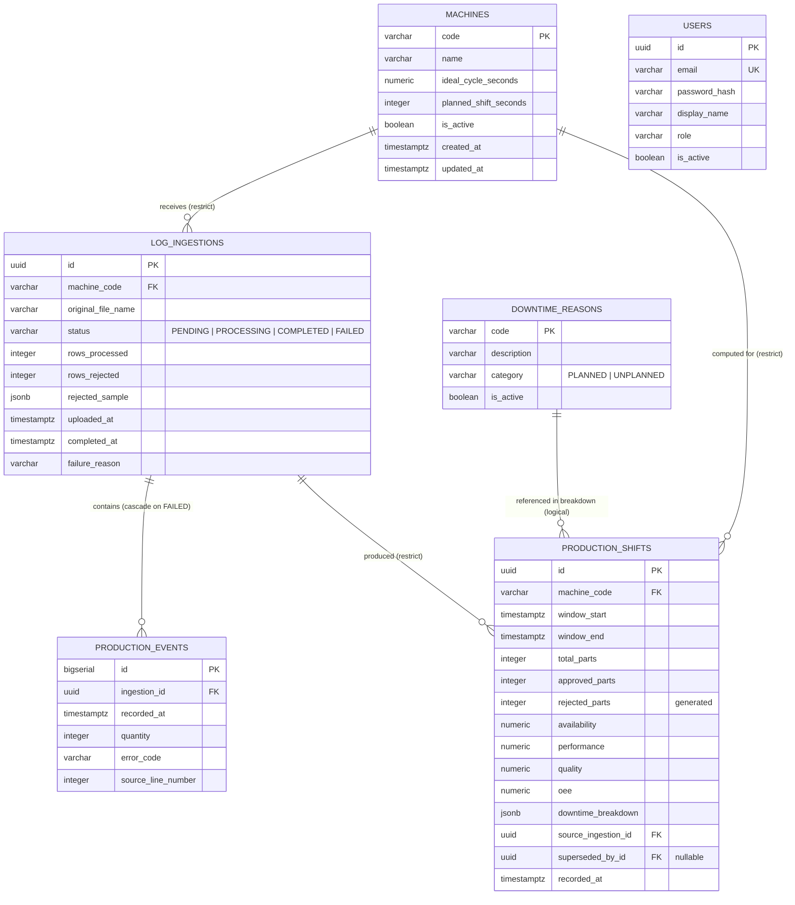

# Database Structure and Physical Relational Model — OEE-Sentinel

## 1. Context, Rationale, and Architecture Alignment

The persistence tier of OEE-Sentinel is designed to uphold the invariants defined in ADR-0003 (PostgreSQL + EF Core), ADR-0006 (immutable facts, pure calculator), and `07-relational-mapping-and-persistence-strategy.md`.

Two architectural constraints shape this schema:

1. **Business identifiers, not surrogate UUIDs, for reference aggregates.** `machines.code` and `downtime_reasons.code` are VARCHAR primary keys. They appear in URLs (`/api/v1/machines/MAQ-01`), in external MES messages, and in the raw log files themselves. A UUID would force a lookup at every boundary.
2. **Immutable facts.** `production_shifts` is append-only. The only post-insert update is `superseded_by_id` (metadata for correction tracking, not computed data). This is enforced by the absence of any `UPDATE` statement in the application, except the single supersession write.

### Core Invariants (Baseline)

- **Referential integrity on reference aggregates:** `ON DELETE RESTRICT` on `machines`, `downtime_reasons` FKs. A machine or reason referenced by any shift or ingestion cannot be deleted. Soft-deactivation (`is_active = FALSE`) is the supported lifecycle.
- **OEE range:** `CHECK (availability BETWEEN 0 AND 1)` and the same for `performance`, `quality`, `oee` on `production_shifts`. Defence-in-depth on top of the calculator's clamp (ADR-0006).
- **Totals consistency:** `CHECK (approved_parts BETWEEN 0 AND total_parts)` and `CHECK (total_parts >= 0)`. `rejected_parts` is `GENERATED ALWAYS AS (total_parts - approved_parts) STORED`.
- **Window validity:** `CHECK (window_start < window_end)`.
- **One current shift per window:** partial unique index `uq_production_shifts_current` on `(machine_code, window_start, window_end) WHERE superseded_by_id IS NULL`.
- **Downtime breakdown JSONB shape:** a PL/pgSQL CHECK function validates that all values are non-negative numbers.

---

## 2. Physical Relational Entity-Relationship Diagram (ERD)



---

## 3. DDL — Baseline Schema

### 3.1. `users`

```sql
-- Identity aggregate. Baseline ships without auth (roadmap T2).
CREATE TABLE users (
    id              UUID            PRIMARY KEY,
    email           VARCHAR(255)    NOT NULL,
    password_hash   VARCHAR(255)    NOT NULL,
    display_name    VARCHAR(100)    NOT NULL,
    role            VARCHAR(20)     NOT NULL,
    is_active       BOOLEAN         NOT NULL DEFAULT TRUE,
    created_at      TIMESTAMPTZ     NOT NULL DEFAULT CURRENT_TIMESTAMP,
    updated_at      TIMESTAMPTZ     NOT NULL DEFAULT CURRENT_TIMESTAMP,

    CONSTRAINT uq_users_email   UNIQUE (email),
    CONSTRAINT chk_users_email  CHECK (email = LOWER(email)),
    CONSTRAINT chk_users_role   CHECK (role IN ('OPERATOR', 'ENGINEER', 'ADMINISTRATOR'))
);
```

> **Note:** `password_hash` is `NOT NULL` in baseline. T2 will not need to change this — baseline seeding sets a valid Argon2id hash even though no login is wired.

### 3.2. `machines`

```sql
CREATE TABLE machines (
    code                    VARCHAR(32)     PRIMARY KEY,
    name                    VARCHAR(150)    NOT NULL,
    ideal_cycle_seconds     DOUBLE PRECISION NOT NULL,
    planned_shift_seconds   INTEGER         NOT NULL,
    is_active               BOOLEAN         NOT NULL DEFAULT TRUE,
    created_at              TIMESTAMPTZ     NOT NULL DEFAULT CURRENT_TIMESTAMP,
    updated_at              TIMESTAMPTZ     NOT NULL DEFAULT CURRENT_TIMESTAMP,

    CONSTRAINT chk_machines_code_upper      CHECK (code = UPPER(code)),
    CONSTRAINT chk_machines_code_pattern    CHECK (code ~ '^[A-Z0-9-]{2,32}$'),
    CONSTRAINT chk_machines_ideal_cycle      CHECK (ideal_cycle_seconds > 0),
    CONSTRAINT chk_machines_planned_shift    CHECK (planned_shift_seconds > 0)
);

CREATE UNIQUE INDEX uq_machines_code_ci ON machines (LOWER(code));
```

`ideal_cycle_seconds > 0` is the DDL mirror of the `IdealCycleTime` Value Object invariant (ADR-0006). A `Machine` with cycle time 0 cannot exist.

### 3.3. `downtime_reasons`

```sql
CREATE TABLE downtime_reasons (
    code        VARCHAR(64)     PRIMARY KEY,
    description VARCHAR(255)    NOT NULL,
    category    VARCHAR(10)     NOT NULL,
    is_active   BOOLEAN         NOT NULL DEFAULT TRUE,
    created_at  TIMESTAMPTZ     NOT NULL DEFAULT CURRENT_TIMESTAMP,

    CONSTRAINT chk_downtime_reasons_category CHECK (category IN ('PLANNED', 'UNPLANNED')),
    CONSTRAINT chk_downtime_reasons_code_upper CHECK (code = UPPER(code))
);

CREATE UNIQUE INDEX uq_downtime_reasons_code_ci ON downtime_reasons (LOWER(code));
```

`downtime_reasons` is a **reference aggregate** and cannot be deleted if referenced in any `production_shifts.downtime_breakdown`. Since `downtime_breakdown` is JSONB, this is enforced by the application layer (parser validates the code against `downtime_reasons` before writing the shift).

### 3.4. `log_ingestions`

```sql
CREATE TABLE log_ingestions (
    id                  UUID            PRIMARY KEY,
    machine_code        VARCHAR(32)     NOT NULL,
    original_file_name  VARCHAR(255)    NOT NULL,
    status              VARCHAR(20)     NOT NULL,
    rows_processed      INTEGER         NOT NULL DEFAULT 0,
    rows_rejected       INTEGER         NOT NULL DEFAULT 0,
    rejected_sample     JSONB,
    uploaded_at         TIMESTAMPTZ     NOT NULL DEFAULT CURRENT_TIMESTAMP,
    completed_at        TIMESTAMPTZ,
    failure_reason      VARCHAR(500),

    CONSTRAINT fk_log_ingestions_machine
        FOREIGN KEY (machine_code) REFERENCES machines(code) ON DELETE RESTRICT,
    CONSTRAINT chk_log_ingestions_status
        CHECK (status IN ('PENDING', 'PROCESSING', 'COMPLETED', 'FAILED')),
    CONSTRAINT chk_log_ingestions_rows
        CHECK (rows_processed >= 0 AND rows_rejected >= 0 AND rows_rejected <= rows_processed),
    CONSTRAINT chk_log_ingestions_completed_at
        CHECK ((status = 'COMPLETED' AND completed_at IS NOT NULL)
            OR (status <> 'COMPLETED' AND completed_at IS NULL)),
    CONSTRAINT chk_log_ingestions_failure_reason
        CHECK ((status = 'FAILED' AND failure_reason IS NOT NULL)
            OR (status <> 'FAILED' AND failure_reason IS NULL))
);
```

The `rejected_sample` is a JSONB array of `{ lineNumber, rawLine, reason }` objects, capped at 100 entries by the Application handler.

### 3.5. `production_shifts`

```sql
CREATE TABLE production_shifts (
    id                  UUID            PRIMARY KEY,
    machine_code        VARCHAR(32)     NOT NULL,
    window_start        TIMESTAMPTZ     NOT NULL,
    window_end          TIMESTAMPTZ     NOT NULL,
    total_parts         INTEGER         NOT NULL,
    approved_parts      INTEGER         NOT NULL,
    rejected_parts      INTEGER         GENERATED ALWAYS AS (total_parts - approved_parts) STORED,
    availability        NUMERIC(5,4)    NOT NULL,
    performance         NUMERIC(5,4)    NOT NULL,
    quality             NUMERIC(5,4)    NOT NULL,
    oee                 NUMERIC(5,4)    NOT NULL,
    downtime_breakdown  JSONB           NOT NULL,
    source_ingestion_id UUID            NOT NULL,
    superseded_by_id    UUID,
    recorded_at         TIMESTAMPTZ     NOT NULL DEFAULT CURRENT_TIMESTAMP,

    CONSTRAINT fk_shifts_machine
        FOREIGN KEY (machine_code) REFERENCES machines(code) ON DELETE RESTRICT,
    CONSTRAINT fk_shifts_ingestion
        FOREIGN KEY (source_ingestion_id) REFERENCES log_ingestions(id) ON DELETE RESTRICT,
    CONSTRAINT fk_shifts_superseded_by
        FOREIGN KEY (superseded_by_id) REFERENCES production_shifts(id) ON DELETE RESTRICT,
    CONSTRAINT chk_shifts_window
        CHECK (window_start < window_end),
    CONSTRAINT chk_shifts_totals
        CHECK (total_parts >= 0 AND approved_parts >= 0 AND approved_parts <= total_parts),
    CONSTRAINT chk_shifts_availability CHECK (availability BETWEEN 0 AND 1),
    CONSTRAINT chk_shifts_performance  CHECK (performance  BETWEEN 0 AND 1),
    CONSTRAINT chk_shifts_quality      CHECK (quality      BETWEEN 0 AND 1),
    CONSTRAINT chk_shifts_oee          CHECK (oee          BETWEEN 0 AND 1),
    CONSTRAINT chk_shifts_no_self_supersede CHECK (superseded_by_id IS NULL OR superseded_by_id <> id)
);

-- Enforce the "one current shift per (machine, window)" invariant.
CREATE UNIQUE INDEX uq_production_shifts_current
    ON production_shifts (machine_code, window_start, window_end)
    WHERE superseded_by_id IS NULL;

-- Fast lookups by machine + window.
CREATE INDEX idx_production_shifts_machine_window
    ON production_shifts (machine_code, window_start, window_end)
    WHERE superseded_by_id IS NULL;

-- Fast lookups by ingestion (audit).
CREATE INDEX idx_production_shifts_ingestion ON production_shifts (source_ingestion_id);
```

**The `downtime_breakdown` JSONB shape** is:
```json
{
  "PLANNED_BREAK":        1800,
  "UNPLANNED_MECHANICAL":  900,
  "UNPLANNED_TOOL_CHANGE": 300
}
```
Keys are `DowntimeReasonCode` strings; values are seconds (`double`). A PL/pgSQL function validates on insert:

```sql
CREATE OR REPLACE FUNCTION fn_validate_downtime_breakdown(p_json JSONB)
RETURNS BOOLEAN AS $$
DECLARE
    v_key TEXT;
    v_val JSONB;
BEGIN
    IF p_json IS NULL THEN RETURN FALSE; END IF;
    IF jsonb_typeof(p_json) <> 'object' THEN RETURN FALSE; END IF;
    FOR v_key, v_val IN SELECT * FROM jsonb_each(p_json) LOOP
        IF jsonb_typeof(v_val) <> 'number' THEN RETURN FALSE; END IF;
        IF (v_val)::text::numeric < 0 THEN RETURN FALSE; END IF;
    END LOOP;
    RETURN TRUE;
END;
$$ LANGUAGE plpgsql IMMUTABLE;

ALTER TABLE production_shifts
    ADD CONSTRAINT chk_shifts_downtime_shape
    CHECK (fn_validate_downtime_breakdown(downtime_breakdown));
```

### 3.6. `production_events`

```sql
CREATE TABLE production_events (
    id                  BIGSERIAL       PRIMARY KEY,
    ingestion_id        UUID            NOT NULL,
    recorded_at         TIMESTAMPTZ     NOT NULL,
    quantity            INTEGER         NOT NULL,
    error_code          VARCHAR(64),
    source_line_number  INTEGER         NOT NULL,

    CONSTRAINT fk_events_ingestion
        FOREIGN KEY (ingestion_id) REFERENCES log_ingestions(id) ON DELETE CASCADE,
    CONSTRAINT chk_events_quantity CHECK (quantity >= 0),
    CONSTRAINT chk_events_line      CHECK (source_line_number > 0)
);

CREATE INDEX idx_production_events_ingestion_recorded
    ON production_events (ingestion_id, recorded_at);
```

`source_line_number` is the physical line in the uploaded file. It survives for audit and for re-linking rejected lines to their origin. `error_code` is nullable (a normal production event has no error).

---

## 4. Referential Integrity and Cascade Action Matrix

| Source | Target | On Delete | Reason |
|---|---|---|---|
| `log_ingestions.machine_code` | `machines.code` | `RESTRICT` | Machine with ingestion history cannot be deleted |
| `production_shifts.machine_code` | `machines.code` | `RESTRICT` | Machine with shift history cannot be deleted |
| `production_shifts.source_ingestion_id` | `log_ingestions.id` | `RESTRICT` | Ingestion that produced a shift cannot be deleted |
| `production_shifts.superseded_by_id` | `production_shifts.id` | `RESTRICT` | Supersession chain cannot be broken |
| `production_events.ingestion_id` | `log_ingestions.id` | `CASCADE` | Only for `FAILED` ingestions (app-enforced) |

**No `SET NULL`, no `CASCADE` on reference aggregates.** Every missing reference is a data integrity violation, not a valid state.

---

## 5. Read Views (Planned — T4)

The baseline reads via EF Core queries with `AsNoTracking()`. Views are deferred to roadmap T4 where they buy measurable performance. Two views are planned:

### 5.1. `v_machine_oee_current`

Aggregates the current (non-superseded) shifts per machine:

```sql
CREATE OR REPLACE VIEW v_machine_oee_current AS
SELECT
    machine_code,
    COUNT(*)                                        AS shift_count,
    SUM(total_parts)                                AS total_parts,
    SUM(approved_parts)                             AS approved_parts,
    SUM(total_parts - approved_parts)               AS rejected_parts,
    SUM(window_end - window_start) / 3600.0         AS total_hours,
    CASE WHEN SUM(window_end - window_start) > 0
         THEN SUM(EXTRACT(EPOCH FROM (window_end - window_start)) * (1 - (1 - availability) )) -- placeholder
         ELSE NULL
    END                                             AS weighted_availability,
    MAX(recorded_at)                                AS last_recorded_at
FROM production_shifts
WHERE superseded_by_id IS NULL
GROUP BY machine_code;
```

> **Note:** the weighted-aggregation formula is a placeholder; T4 will define it precisely (aggregate-from-totals, not average-of-percentages — see `06-api-design-specification.md` §3.3). The baseline handles this in Application memory (Scenario 4).

### 5.2. `v_machine_downtime_pareto` (T4)

Explodes `downtime_breakdown` JSONB into rows and aggregates per machine and reason:

```sql
CREATE OR REPLACE VIEW v_machine_downtime_pareto AS
SELECT
    ps.machine_code,
    dr.code                 AS reason_code,
    dr.description          AS reason_description,
    dr.category             AS reason_category,
    SUM((entry.value)::text::numeric)::double precision AS total_seconds
FROM production_shifts ps
CROSS JOIN LATERAL jsonb_each(ps.downtime_breakdown) AS entry
JOIN downtime_reasons dr ON dr.code = entry.key
WHERE ps.superseded_by_id IS NULL
GROUP BY ps.machine_code, dr.code, dr.description, dr.category;
```

The baseline does this aggregation in Application memory (Scenario 4). The view is a T4 optimisation, activated when the number of shifts in a 90-day window exceeds the in-memory threshold (to be benchmarked under T7).

---

## 6. Indexing Strategy

| Index | Purpose | Notes |
|---|---|---|
| `uq_machines_code_ci` | Case-insensitive uniqueness on `machines.code` | Enforced alongside the uppercase CHECK; regex validation rejects malformed codes |
| `uq_downtime_reasons_code_ci` | Case-insensitive uniqueness on reason codes | Same pattern |
| `uq_production_shifts_current` | "One current shift per (machine, window)" | **Partial** — only non-superseded. This is the invariant's enforcement |
| `idx_production_shifts_machine_window` | Fast read of active shifts for a machine and window | Partial, aligned with the query in `GetMachineOeeHandler` |
| `idx_production_shifts_ingestion` | Audit: shifts produced by an ingestion | Non-partial (includes superseded) |
| `idx_production_events_ingestion_recorded` | Re-analysis: events for an ingestion, ordered | `(ingestion_id, recorded_at)` |
| *(future, T4)* `idx_machine_pareto` | View support | Added with the view |

**No index on `downtime_breakdown` JSONB.** Query patterns never filter by reason code — they read the whole column and aggregate in memory (Scenario 4). A GIN index would be a premature optimisation.

**No index on `production_events.recorded_at` alone.** The composite `(ingestion_id, recorded_at)` covers the audit query; a standalone `recorded_at` index would only help cross-ingestion time-range queries, which are not in the baseline.

---

## 7. Seeds — Reference Data

Seeded only in `Development` with `SeedData:Enabled = true`. All values are fictitious, aligned with BYOP `(Ext) BYOP - Project submission instructions.pdf` p.3.

### 7.1. Machines

| code | name | ideal_cycle_seconds | planned_shift_seconds |
|---|---|---|---|
| `MAQ-01` | Injection Press A1 | 2.5 | 28800 |
| `MAQ-02` | Injection Press A2 | 2.8 | 28800 |
| `PRESSA-B2` | Assembly Press B2 | 4.0 | 28800 |

### 7.2. Downtime reasons

| code | description | category |
|---|---|---|
| `PLANNED_BREAK` | Scheduled shift break | `PLANNED` |
| `PLANNED_MAINTENANCE` | Scheduled preventive maintenance | `PLANNED` |
| `UNPLANNED_MECHANICAL` | Mechanical failure | `UNPLANNED` |
| `UNPLANNED_TOOL_CHANGE` | Unplanned tool change | `UNPLANNED` |
| `UNPLANNED_ELECTRICAL` | Electrical failure | `UNPLANNED` |
| `UNPLANNED_OPERATOR` | Operator absence / error | `UNPLANNED` |

### 7.3. Users

| email | role | is_active |
|---|---|---|
| `admin@oee-sentinel.local` | `ADMINISTRATOR` | `true` |
| `operator@oee-sentinel.local` | `OPERATOR` | `true` |

Passwords are Argon2id hashes of a documented demo password (`Demo#2026!`) — the hash is seeded as a constant, never the plaintext.

### 7.4. Sample ingestion + shift

For dashboard verification on first launch, `samples/sample_shift.csv` (fictitious, ~50 rows) is pre-ingested via `BaselineSeed` in `Development`. The resulting `ProductionShift` appears on the dashboard immediately.

---

## 8. Revision History

| Rev | Change |
|---|---|
| v1.0 (baseline) | Initial schema: `machines`, `downtime_reasons`, `log_ingestions`, `production_shifts`, `production_events`, `users`. JSONB for `downtime_breakdown` and `rejected_sample`. Partial unique index for "one current shift". |
| Planned (T2) | Add `POST /api/v1/auth/login` endpoint. No schema change — `users` is already complete. |
| Planned (T3) | Optional `triggered_by` column on `log_ingestions` for folder watcher. Small migration. |
| Planned (T4) | Add `v_machine_oee_current` and `v_machine_downtime_pareto` views. No table changes. |

### Comparative Log

- **v0.9 → v1.0:** `rejected_parts` changed from a stored column to `GENERATED ALWAYS AS (...) STORED`. Justification: eliminates the class of bug where `total ≠ approved + rejected` (ADR-0006 §Decision.1).
- **v0.8 → v1.0:** `production_events.id` changed from `UUID` to `BIGSERIAL`. Justification: volume-based write-pattern (see `07-relational-mapping-and-persistence-strategy.md` §2.4).
- **v0.7 → v1.0:** `downtime_breakdown` changed from a child table to JSONB. Justification: read pattern (always whole) and write cost (single column, single bulk insert) — `07-relational-mapping-and-persistence-strategy.md` §2.2.
- **v0.6 → v1.0:** added partial unique index `uq_production_shifts_current`. Justification: prevents two current shifts for the same window under concurrent ingestion (Scenario 3).