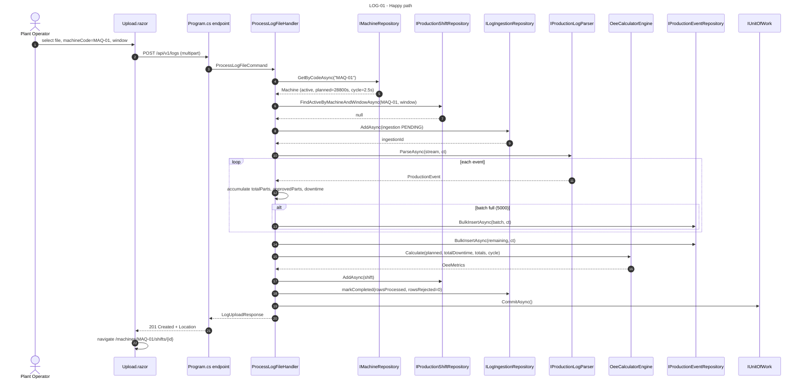
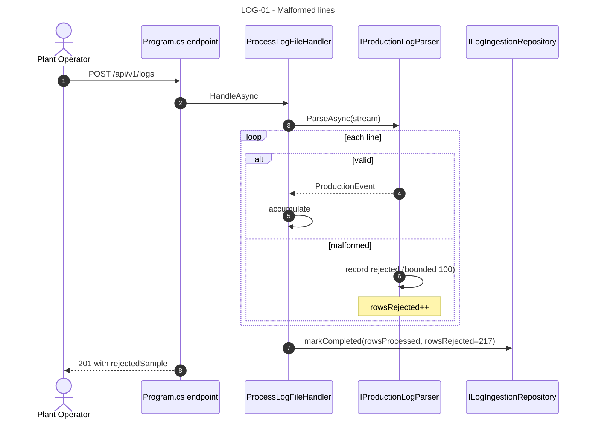
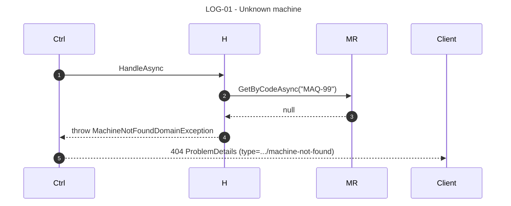
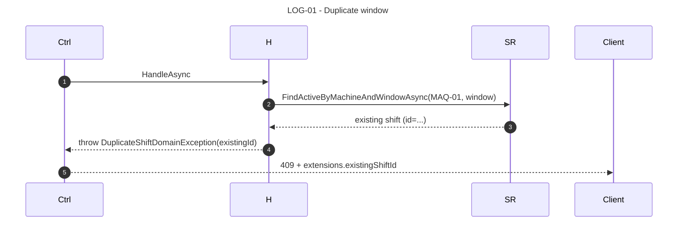
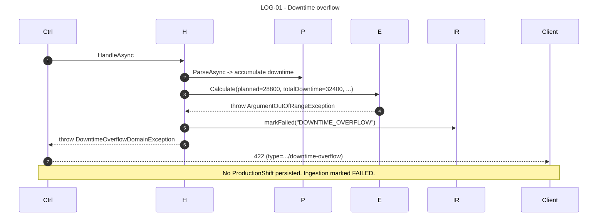
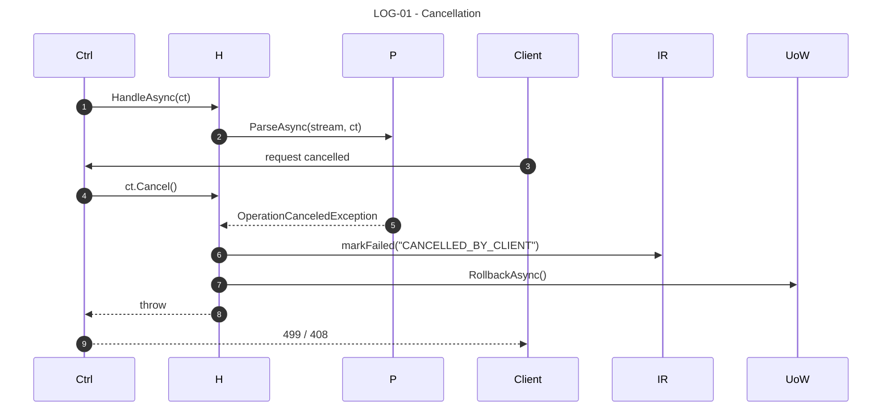

# LOG-01 — As a Plant Operator, I want to upload a production log so that the system computes and persists the shift OEE without manual calculation.

## 1. Requirements Engineering

### 1.1. User Story Description

As a **Plant Operator**, I want to **upload a CSV/TXT shift log** for a specific machine and time window so that the system streams the file through the parser, computes Availability/Performance/Quality/OEE, and persists an immutable `ProductionShift` fact that the dashboard can render.

The US is the primary entry point of the entire system — without LOG-01, no `ProductionShift` exists, and OEE-01/02/03 have nothing to display. It is also the highest-risk US in the baseline (streaming at 200k rows, per-line rejection, transactional persistence).

### 1.2. Customer Specifications and Clarifications

#### From the specification document (KB §1, §4)

> Extracted from `docs/sad/01-problem-statement.md` §2.1, §2.2, §4; `docs/sad/02-context.md` §2, §4; `docs/sad/05-key-scenarios.md` §2.

- **Ingestion volume:** 5k–200k lines per shift per machine (baseline target).
- **Malformed lines:** the whole batch must **not** be aborted by a single bad line. Rejected rows are sampled (max 100) into `LogIngestion.rejected_sample`.
- **Duplicates:** a non-superseded `ProductionShift` already exists for the same `(machineCode, window)` → `409 Conflict`.
- **Domain invariant failure:** `planned == 0` or `downtime > planned` → `422 Unprocessable Entity`.
- **Machine not found:** → `404 Not Found`.
- **Bounded memory:** peak RSS ≤ 50 MB on a 200k-row file (verified by BenchmarkDotNet under T7).
- **Cancellation:** an interrupted request propagates `CancellationToken` through `ParseAsync` + `BulkInsertAsync`; `LogIngestion` transitions to `FAILED`.
- **Traceability:** every `ProductionShift` must be linked to its `LogIngestion` (the audit anchor).

#### From ADRs and KB

- **ADR-0003 (KB §5.3, §16, §17):** `LogIngestion`, `ProductionShift`, `ProductionEvent` persisted in PostgreSQL; bulk insert via `EFCore.BulkExtensions`; `ON DELETE RESTRICT` on `machine_code` and `source_ingestion_id`; partial unique index `uq_production_shifts_current` on `(machine_code, window_start, window_end) WHERE superseded_by_id IS NULL`.
- **ADR-0005 (KB §5.5, §16.4):** `CsvHelper` with `IAsyncEnumerable<ProductionEvent>`; `BadDataFound = null`, `MissingFieldFound = null`; `CultureInfo.InvariantCulture`; per-line rejection callback; bounded sample (100).
- **ADR-0006 (KB §5.6, §8.4):** `OeeCalculatorEngine.Calculate` is a pure static method that throws `ArgumentOutOfRangeException` on structural corruption and clamps `[0,1]` defensively; `ProductionShift` is immutable after persist.
- **§4.1 (Key Scenario 1)** describes the exact happy path and the failure semantics.

### 1.3. Acceptance Criteria (expanded, testable)

#### AC1 — File and window accepted

- **AC1.1** The endpoint accepts `multipart/form-data` with four fields: `file` (binary, CSV/TXT, UTF-8), `machineCode` (`^[A-Z0-9-]{2,32}$`), `windowStart` (ISO 8601 UTC), `windowEnd` (ISO 8601 UTC).
- **AC1.2** `windowStart < windowEnd` is validated at the boundary; failure → `400 Bad Request`.
- **AC1.3** The file may have a header row or not; both are accepted.
- **AC1.4** The canonical row format is `timestamp,machine_code,quantity,error_code` (with optional whitespace tolerated).
- **AC1.5** The file is processed **without** loading the entire content into RAM (streaming `IAsyncEnumerable<ProductionEvent>`; no `ReadAllLines`).

#### AC2 — Happy path produces an immutable `ProductionShift`

- **AC2.1** On a clean file, the handler returns `201 Created` with a `LogUploadResponse` containing `ingestionId`, `status = COMPLETED`, `rowsProcessed > 0`, `rowsRejected == 0`, `productionShiftId`, `completedAt`.
- **AC2.2** A `ProductionShift` row exists in `production_shifts` with computed `availability`, `performance`, `quality`, `oee` ∈ `[0,1]` and `total_parts >= approved_parts >= 0`.
- **AC2.3** The shift is linked to `source_ingestion_id` (FK to the `LogIngestion`).
- **AC2.4** The `Location` header points to `/api/v1/machines/{code}/shifts/{shiftId}`.
- **AC2.5** The response `Cache-Control` is `no-store` (defence-in-depth against caching).

#### AC3 — Malformed lines are rejected without aborting

- **AC3.1** A line with a missing comma, bad decimal locale (`15,5`), truncated timestamp, or unknown error code **increments** `rows_rejected` but does **not** abort the batch.
- **AC3.2** The rejected sample (bounded to 100) records `{ lineNumber, rawLine, reason }` where `reason` ∈ `{ MISSING_FIELD, INVALID_DECIMAL_LOCALE, INVALID_TIMESTAMP, UNKNOWN_ERROR_CODE, QUANTITY_NOT_INTEGER, QUANTITY_NEGATIVE }`.
- **AC3.3** A file with 5% malformed lines still produces a `ProductionShift` with 95% of the data. The `LogIngestion` reflects the exact `rows_rejected`.
- **AC3.4** No single bad row kills the request.

#### AC4 — Unknown machine → `404`

- **AC4.1** `IMachineRepository.GetByCodeAsync(machineCode)` returns null → the handler throws `MachineNotFoundDomainException`.
- **AC4.2** The endpoint maps it to `404 Not Found` with `ProblemDetails.type = ".../machine-not-found"`.
- **AC4.3** No `LogIngestion` is created; no orphan row.

#### AC5 — Duplicate window → `409`

- **AC5.1** Before parsing, `IProductionShiftRepository.FindActiveByMachineAndWindowAsync(machineCode, windowStart, windowEnd)` is called. If it returns a non-null shift, the handler throws `DuplicateShiftDomainException`.
- **AC5.2** The endpoint maps it to `409 Conflict` with `ProblemDetails.type = ".../shift-already-exists"` and the `extensions.existingShiftId` carrying the conflicting shift's id.
- **AC5.3** Concurrency: the partial unique index `uq_production_shifts_current` is the final defence; a race condition on two concurrent uploads of the same window fails the second at `COMMIT` with a `409`-mappable `NpgsqlException` on the unique constraint.

#### AC6 — Domain invariant failure → `422`

- **AC6.1** `plannedProductionTime = Machine.PlannedShiftDuration` is read at the start. If it is `<= 0`, the handler throws `PlannedTimeZeroDomainException` (this is theoretically impossible because `chk_machines_planned_shift CHECK (planned_shift_seconds > 0)` — documented as defence-in-depth).
- **AC6.2** `totalDowntime` is accumulated from `DowntimeBreakdown.Entries` after parse. If `totalDowntime > plannedProductionTime`, the handler throws `DowntimeOverflowDomainException`.
- **AC6.3** The endpoint maps both to `422 Unprocessable Entity` with distinct `ProblemDetails.type` values (`.../planned-time-zero`, `.../downtime-overflow`).
- **AC6.4** The `LogIngestion` is persisted as `FAILED` with a stable reason code (`failure_reason = "PLANNED_TIME_ZERO" | "DOWNTIME_OVERFLOW"`); no `ProductionShift` row is written.
- **AC6.5** The full transaction is rolled back atomically.

#### AC7 — Cancellation handling

- **AC7.1** The `CancellationToken` is propagated through `IProductionLogParser.ParseAsync(stream, ct)`, `IProductionEventRepository.BulkInsertAsync(batch, ct)`, and `IUnitOfWork.CommitAsync(ct)`.
- **AC7.2** On cancellation, the handler catches `OperationCanceledException` and calls `LogIngestion.markFailed("CANCELLED_BY_CLIENT")`; the transaction rolls back; no partial state is persisted.
- **AC7.3** The endpoint returns `499 Client Closed Request` (or `408 Request Timeout`) — documented as acceptable.

#### AC8 — Transactional persistence of ingestion + events + shift

- **AC8.1** The following writes happen in a **single EF Core transaction** (`IUnitOfWork.BeginTransactionAsync`):
  1. `log_ingestions.AddAsync` (PENDING)
  2. `production_events.BulkInsertAsync` (batches of 5000)
  3. `production_shifts.AddAsync`
  4. `log_ingestions.markCompleted(rowsProcessed, rowsRejected)`
  5. `IUnitOfWork.CommitAsync`
- **AC8.2** Any failure at any step rolls back the entire transaction; no partial rows survive.
- **AC8.3** A `FAILED` ingestion persists only the `log_ingestions` row (status FAILED, failure_reason set); no events, no shift.

#### AC9 — Bounded-memory guarantee

- **AC9.1** A 200k-row file is processed with peak RSS ≤ 50 MB (verified by BenchmarkDotNet under T7; the target is documented and asserted by the memory test).
- **AC9.2** Batches of 5000 events are buffered before `BulkInsertAsync`; the buffer is not accumulated across the entire file.

#### AC10 — Response contract matches OpenAPI

- **AC10.1** The `201 Created` response body matches `LogUploadResponse` (§23.1) — every field documented, no additional fields.
- **AC10.2** Every error response matches `ProblemDetails` with the mapped `type`, `title`, `status`, `detail`.
- **AC10.3** `Cache-Control: no-store` and `Location` headers are set.

### 1.4. Found out Dependencies

**Preceding:**
- ADR-0003 (`OEESentinelDbContext`, EF Core mappings, migration).
- ADR-0005 (`CsvProductionLogParser`, `IProductionLogParser`).
- ADR-0006 (`OeeCalculatorEngine`, `ProductionShift`, `ProductionTotals`, `DowntimeBreakdown`).
- `IMachineRepository`, `IProductionShiftRepository`, `ILogIngestionRepository`, `IProductionEventRepository`, `IUnitOfWork`.

**Succeeding:**
- LOG-02 (polling depends on the `LogIngestion` lifecycle created here).
- OEE-01/02/03 (every read is on `production_shifts` or `log_ingestions` created here).
- MACH-01 (the `MachineCode` selector is a precondition of the upload form).

### 1.5. Input and Output Data

#### 1.5.1. `LogUploadRequest` (multipart/form-data)

| Field | Type | Required | Constraint | Notes |
|---|---|---|---|---|
| `file` | binary | yes | CSV/TXT, UTF-8 | Content-Type checked by extension; no size limit enforced by the API (bounded memory, not bounded size) |
| `machineCode` | string | yes | `^[A-Z0-9-]{2,32}$` | Must match an active `Machine` |
| `windowStart` | ISO datetime | yes | UTC | `< windowEnd` |
| `windowEnd` | ISO datetime | yes | UTC | `> windowStart`; `(windowEnd − windowStart) ≤ Machine.PlannedShiftDuration + 1h` (grace for log latency; overflow beyond this is `422`) |

#### 1.5.2. `LogUploadResponse` (201)

```json
{
  "ingestionId": "018e9c7e-6c2a-7b8e-9a3d-4f1c7e2b5d10",
  "status": "COMPLETED",
  "machineCode": "MAQ-01",
  "window": { "start": "2026-11-04T08:00:00Z", "end": "2026-11-04T16:00:00Z" },
  "rowsProcessed": 184532,
  "rowsRejected": 217,
  "rejectedSample": [
    { "lineNumber": 47, "rawLine": "2026-11-04T08:03:12,MAQ-01,,ERR_OK", "reason": "MISSING_FIELD" }
  ],
  "productionShiftId": "019e2b1a-7d3f-7c4e-8b2f-5a6d8e0c4f12",
  "completedAt": "2026-11-04T16:02:11Z"
}
```

#### 1.5.3. Persistence

No new tables (all in ADR-0003). Rows written:

- `log_ingestions`: 1 row (PENDING → COMPLETED).
- `production_events`: N rows (bulk-inserted, one per accepted line).
- `production_shifts`: 1 row (immutable).

On `FAILED`: 1 row in `log_ingestions` only.

#### 1.5.4. Headers

- `Location: /api/v1/machines/{code}/shifts/{productionShiftId}` (201).
- `Cache-Control: no-store`.
- `Content-Type: application/json; charset=utf-8`.

### 1.6. System Sequence Diagrams (SSD)

#### 1.6.1. Happy path — small file, no rejections



#### 1.6.2. Malformed lines — rejections do not abort



#### 1.6.3. Unknown machine → 404



#### 1.6.4. Duplicate window → 409



#### 1.6.5. Domain invariant failure → 422



#### 1.6.6. Cancellation



### 1.7. Other Relevant Remarks

#### 1.7.1. Clean Architecture placement

| Layer | Component | Responsibility |
|---|---|---|
| WebUI | `Program.cs` endpoint | Bind multipart, validate `machineCode` + window, invoke handler, map domain exceptions to `ProblemDetails` |
| Application | `ProcessLogFileHandler` | Orchestrate: validate machine, duplicate check, create ingestion, stream parse, accumulate, compute, persist, commit |
| Application | `IProductionLogParser` | Port: `IAsyncEnumerable<ProductionEvent> ParseAsync(Stream, CancellationToken)` |
| Domain | `OeeCalculatorEngine` | Pure math; throws on structural corruption |
| Domain | `ProductionShift`, `ProductionTotals`, `DowntimeBreakdown`, `OeeMetrics` | Immutable facts with construction-time invariants |
| Infrastructure | `CsvProductionLogParser` | CsvHelper streaming, per-line rejection, bounded sample |
| Infrastructure | `EfMachineRepository`, `EfProductionShiftRepository`, `EfLogIngestionRepository`, `EfProductionEventRepository`, `EfUnitOfWork` | EF Core / `EFCore.BulkExtensions` |

#### 1.7.2. Ordering of checks (critical)

The handler runs in this order. Each failure returns before the next check runs:

1. **`machineCode` exists** (`IMachineRepository.GetByCodeAsync`) → `404` if not.
2. **Window valid** (`windowStart < windowEnd`, `(windowEnd − windowStart) ≤ plannedShiftDuration + 1h`) → `400` if not.
3. **No current shift** for `(machineCode, window)` → `409` if exists.
4. **`plannedShiftDuration > 0`** (defensive, from DB CHECK) → `422 PLANNED_TIME_ZERO` if not.
5. **Create `LogIngestion`** PENDING.
6. **Parse** the file (streaming).
7. **`totalDowntime ≤ plannedShiftDuration`** → `422 DOWNTIME_OVERFLOW` if not.
8. **Persist** shift + mark ingestion COMPLETED (single transaction).

Steps 1–4 are cheap (index lookups) and happen before any bytes are read. Step 7 can only be evaluated after parse; failure marks ingestion FAILED and rolls back.

#### 1.7.3. Decision record — duplicate policy

Baseline **rejects** duplicates rather than silently superseding. Rationale (§21.4, §4.3):

- Silent supersession hides a likely user error (wrong file, wrong machine).
- Corrections are an **explicit** operation — Roadmap T4 (`POST /api/v1/logs/{id}/correct`).
- The partial unique index `uq_production_shifts_current` makes supersession possible in the future (only the correction endpoint needs to write `superseded_by_id`).

Until T4 lands, an operator who wants to correct a shift must either (a) use a slightly different window (documented as workaround), or (b) delete the shift (future admin endpoint, T2). Both are documented known limitations.

#### 1.7.4. Decision record — cancellation state

`CancellationToken` is passed through every `await` in the handler. On `OperationCanceledException`:

1. `LogIngestion.markFailed("CANCELLED_BY_CLIENT")` is called.
2. `IUnitOfWork.RollbackAsync()` discards any partial bulk inserts.
3. No `ProductionShift` row exists.

The ingestion row survives with `status = FAILED` and `failure_reason = "CANCELLED_BY_CLIENT"` — visible in `/ingestions` (LOG-02 / OEE-01).

#### 1.7.5. Error-to-HTTP matrix

| Condition | HTTP | `ProblemDetails.type` | `LogIngestion.status` |
|---|---|---|---|
| Missing `file` / `machineCode` / `windowStart` / `windowEnd` | 400 | (RFC 9457 default) | n/a (no row created) |
| `windowStart >= windowEnd` or span > `plannedShiftDuration + 1h` | 400 | `.../invalid-window` | n/a |
| Unknown `machineCode` | 404 | `.../machine-not-found` | n/a |
| Current shift already exists for `(machine, window)` | 409 | `.../shift-already-exists` | n/a |
| `plannedShiftDuration == 0` (defensive) | 422 | `.../planned-time-zero` | FAILED |
| `totalDowntime > plannedShiftDuration` | 422 | `.../downtime-overflow` | FAILED |
| Request cancelled | 499 / 408 | (no ProblemDetails) | FAILED |
| Unhandled exception | 500 | `about:blank` | FAILED (if handler caught it) |

#### 1.7.6. Verification (automated + demo)

- **Domain tests:** `OeeCalculatorEngineTests` (already in baseline) covers the edge-case branch that this US exercises indirectly (throws on structural corruption).
- **Application tests (hand-written fakes):**
  - `ProcessLogFileHandlerTests` — 6 cases: happy path; machine not found; duplicate window; malformed-line-only file; downtime overflow; cancellation.
  - Each uses `FakeMachineRepository`, `FakeProductionShiftRepository`, `FakeProductionLogParser`, `FakeLogIngestionRepository`, `FakeProductionEventRepository`, `FakeUnitOfWork` (all ~15 LOC each).
- **Integration test (deferred T6, `WebApplicationFactory<Program>`):** `POST /api/v1/logs` with a 3-machine × 3-window fixture set; verify each HTTP status matches the matrix; verify `GET /api/v1/machines/{code}/shifts` returns the persisted shift.
- **Demo:** login (post-T2); upload `samples/sample_shift.csv` for `MAQ-01`; see `201` with `status = COMPLETED`; navigate to `/machines/MAQ-01/shifts/{id}`; upload the same file → `409`; upload a file with `planned == 0` (or mis-set machine) → `422`.

#### 1.7.7. Open questions / deferred

- **`file` size limit:** none enforced by the API — the constraint is bounded memory (streaming), not bounded file. Documented as intentional.
- **Multiple machines in one file:** not supported in baseline; the `machine_code` field is form-provided and authoritative. Mixed-machine files are documented as out of scope (should be split per machine by the operator or a future folder-watcher, T3).
- **Idempotency key:** not implemented; uploads are not idempotent. A retry of the same file with the same window returns `409`. Deferred (T4 correction endpoint will offer an explicit idempotency token).
- **Content-Type sniffing:** baseline trusts the file extension (`.csv`, `.txt`); a future enhancement could validate the MIME. Documented as baseline limitation.