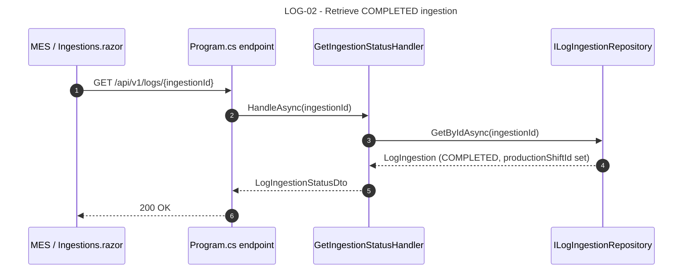
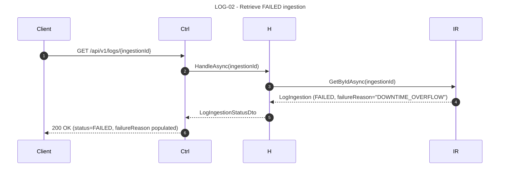
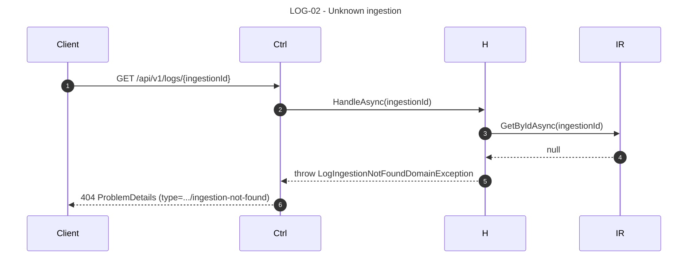

# LOG-02 — As an external MES, I want to retrieve the status of a log ingestion so that I can react to failures programmatically.

## 1. Requirements Engineering

### 1.1. User Story Description

As an **external MES / ERP integrator**, I want to **retrieve the status of a `LogIngestion`** by its `ingestionId`, so that I can poll for completion, detect failures, and trigger downstream processing without holding an HTTP connection open.

The US also serves the Blazor dashboard (`Ingestions.razor`), which lists recent ingests with status, row counts, and a link to the resulting `ProductionShift`.

### 1.2. Customer Specifications and Clarifications

#### From the specification document (KB §1, §4.1)

> Extracted from `docs/sad/01-problem-statement.md` §2.1, §4; `docs/sad/05-key-scenarios.md` §2.1 step 10; §22.1.

- Polling endpoint for an asynchronous ingestion path (reserved for Roadmap T3, folder-watcher); baseline synchronous upload returns the status in the 201 response, but the endpoint is **always** available for audit.
- The `LogIngestion` lifecycle: `PENDING → PROCESSING → COMPLETED | FAILED`.
- Row counts (`RowsProcessed`, `RowsRejected`) and rejection sample (max 100) must be exposed.
- `productionShiftId` populated only when `status == COMPLETED`.

#### From ADRs and KB

- **ADR-0003 (§5.3, §17.3):** `log_ingestions` schema; `rejected_sample` JSONB (bounded by the Application handler, not by the DB).
- **ADR-0005 (§5.5, §16.4):** rejection sample structure `{ lineNumber, rawLine, reason }`.
- **§23.1** defines the `LogIngestionStatus` response shape.
- **§24.2** defines the error mapping (`LogIngestionNotFoundDomainException` → `404 .../ingestion-not-found`).

### 1.3. Acceptance Criteria (expanded, testable)

#### AC1 — Retrieve a `LogIngestion` by id

- **AC1.1** `GET /api/v1/logs/{ingestionId}` returns `200 OK` with a `LogIngestionStatus` body matching §23.1.
- **AC1.2** `ingestionId` is a UUIDv7 (baseline; matches the entity's typed identifier).
- **AC1.3** Response fields: `ingestionId`, `machineCode`, `status`, `uploadedAt`, `completedAt` (nullable), `rowsProcessed`, `rowsRejected`, `productionShiftId` (nullable), `failureReason` (nullable, ≤ 500 chars).
- **AC1.4** `Cache-Control: no-store`.

#### AC2 — Lifecycle status matches the baseline ingestion semantics

- **AC2.1** `PENDING` — the ingestion row exists but parsing has not started. Baseline synchronous upload never returns PENDING from the 201; PENDING is only observable if the process crashes between ingestion creation and parsing (rare edge case, reconciled manually).
- **AC2.2** `PROCESSING` — the handler has started parsing. Not observable from a synchronous upload (which returns 201 after completion); reserved for T3's async path.
- **AC2.3** `COMPLETED` — parse + compute + persist succeeded. `completedAt` populated. `productionShiftId` populated. `failureReason` null.
- **AC2.4** `FAILED` — parse or compute failed. `failureReason` populated with a stable code (`PLANNED_TIME_ZERO`, `DOWNTIME_OVERFLOW`, `CANCELLED_BY_CLIENT`, `PARSER_ERROR`). `productionShiftId` null. `completedAt` null.

#### AC3 — Rejection sample reflects the parsed file

- **AC3.1** `rejectedSample` is an array of `{ lineNumber, rawLine, reason }` objects, capped at 100 entries.
- **AC3.2** `reason` ∈ `{ MISSING_FIELD, INVALID_DECIMAL_LOCALE, INVALID_TIMESTAMP, UNKNOWN_ERROR_CODE, QUANTITY_NOT_INTEGER, QUANTITY_NEGATIVE }`.
- **AC3.3** When `rowsRejected == 0`, `rejectedSample` is `[]` (empty array, not null).
- **AC3.4** When `rowsRejected > 100`, `rejectedSample.length == 100`; the total count `rowsRejected` is exact.

#### AC4 — `productionShiftId` populated only when COMPLETED

- **AC4.1** `productionShiftId` is null when `status != COMPLETED`.
- **AC4.2** When `status == COMPLETED`, `productionShiftId` is the id of the persisted `ProductionShift` — a `GET /api/v1/machines/{code}/shifts/{id}` on that id returns `200`.

#### AC5 — Unknown ingestion → 404

- **AC5.1** A request for a non-existent `ingestionId` returns `404 Not Found` with `ProblemDetails.type = ".../ingestion-not-found"`.
- **AC5.2** A malformed UUID in the path returns `400 Bad Request`.

#### AC6 — Traceability

- **AC6.1** The returned `ingestionId` is the same one returned by `POST /api/v1/logs` for the same upload (correlation).
- **AC6.2** For COMPLETED ingestions, the `ProductionShift` referenced by `productionShiftId` has `source_ingestion_id` equal to that `ingestionId`.

#### AC7 — Contract matches OpenAPI

- **AC7.1** Response body matches `LogIngestionStatus` schema (§23.1).
- **AC7.2** Errors match `ProblemDetails`.

### 1.4. Found out Dependencies

**Preceding:**
- LOG-01 (creates the `LogIngestion` and the `ProductionShift`).
- ADR-0003 (`log_ingestions` table).
- `ILogIngestionRepository`, `IProductionShiftRepository`.

**Succeeding:**
- OEE-01/02/03 (the shift created by a COMPLETED ingestion is what they read).
- Roadmap T3 (folder watcher will call this endpoint for its own status polling).

### 1.5. Input and Output Data

#### 1.5.1. `LogIngestionStatus` (200 OK)

```json
{
  "ingestionId": "018e9c7e-6c2a-7b8e-9a3d-4f1c7e2b5d10",
  "machineCode": "MAQ-01",
  "status": "COMPLETED",
  "uploadedAt": "2026-11-04T16:01:59Z",
  "completedAt": "2026-11-04T16:02:11Z",
  "rowsProcessed": 184532,
  "rowsRejected": 217,
  "productionShiftId": "019e2b1a-7d3f-7c4e-8b2f-5a6d8e0c4f12",
  "failureReason": null
}
```

For a `FAILED` ingestion:
```json
{
  "ingestionId": "018e9c7e-...",
  "machineCode": "MAQ-01",
  "status": "FAILED",
  "uploadedAt": "2026-11-04T16:01:59Z",
  "completedAt": null,
  "rowsProcessed": 15203,
  "rowsRejected": 3,
  "productionShiftId": null,
  "failureReason": "DOWNTIME_OVERFLOW"
}
```

#### 1.5.2. Persistence

Read-only. `SELECT * FROM log_ingestions WHERE id = $1` (with `rejected_sample` JSONB loaded).

`AsNoTracking()` is the default for this handler.

#### 1.5.3. Headers

- `Cache-Control: no-store`.

### 1.6. System Sequence Diagrams (SSD)

#### 1.6.1. Retrieve a COMPLETED ingestion



#### 1.6.2. Retrieve a FAILED ingestion



#### 1.6.3. Unknown ingestion → 404



### 1.7. Other Relevant Remarks

#### 1.7.1. Clean Architecture placement

| Layer | Component | Responsibility |
|---|---|---|
| WebUI | `Program.cs` endpoint | Bind `{ingestionId}` (validate UUID), invoke handler, map exceptions |
| Application | `GetIngestionStatusHandler` | Load `LogIngestion` via repo, map to DTO |
| Infrastructure | `EfLogIngestionRepository` | `GetByIdAsync` with `AsNoTracking()` |

No domain service is involved. The handler is a pure query.

#### 1.7.2. Decision record — PENDING / PROCESSING semantics

Baseline is **synchronous**: the `POST /api/v1/logs` handler does the full parse + compute + persist inside the request, and returns `201` only after `LogIngestion.markCompleted`. Therefore:

- A `GET /api/v1/logs/{id}` on a **completed** ingestion returns `COMPLETED`.
- A `GET /api/v1/logs/{id}` on a **failed** ingestion returns `FAILED`.
- `PENDING` and `PROCESSING` are **not observable** through normal API use; they exist for T3 (folder watcher, async path) and are surfaced here for completeness.

If a client polls immediately after `POST` returns 201, they will always see `COMPLETED` or `FAILED` — never `PENDING` / `PROCESSING`.

#### 1.7.3. Decision record — polling cadence and UI

The Blazor `Ingestions.razor` page renders the same data as a table (all recent ingestions), populated via `ListRecentIngestionsHandler` (LOG-02's read model extended to list). No polling loop is implemented in the baseline — the page refreshes on navigation. T3 will add polling for the async path.

#### 1.7.4. Decision record — no pagination on the single-read

The endpoint returns the single `LogIngestion` identified by its typed `ingestionId`. No pagination, no filters. The list endpoint (used only by `Ingestions.razor`) is a separate handler (`ListRecentIngestionsHandler`) and is **not** part of LOG-02's public contract — it's an internal read model.

#### 1.7.5. Error-to-HTTP matrix

| Condition | HTTP | `ProblemDetails.type` |
|---|---|---|
| Missing `ingestionId` | 405 / 400 | (routing error) |
| Malformed UUID | 400 | (RFC 9457 default) |
| Ingestion not found | 404 | `.../ingestion-not-found` |
| Unhandled exception | 500 | `about:blank` |

#### 1.7.6. Verification (automated + demo)

- **Application test:** `GetIngestionStatusHandlerTests` — 3 cases: COMPLETED ingestion returns a DTO with `productionShiftId`; FAILED ingestion returns a DTO with `failureReason`; unknown id throws `LogIngestionNotFoundDomainException`.
- **Integration test (deferred T6):** `POST /api/v1/logs` then `GET /api/v1/logs/{id}` — the returned `productionShiftId` matches the shift created by the upload.
- **Demo:** after LOG-01 upload, `GET /api/v1/logs/{id}` returns the same `productionShiftId`; after a failed upload, `status = FAILED` with the reason code visible.