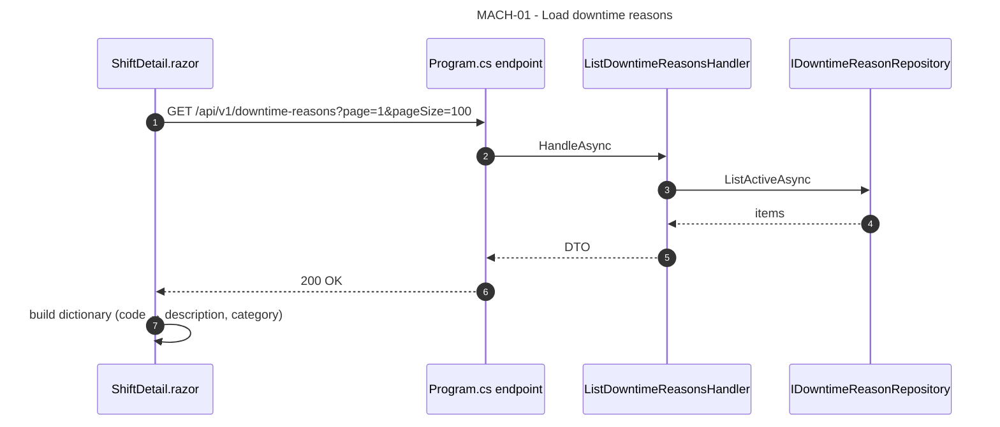
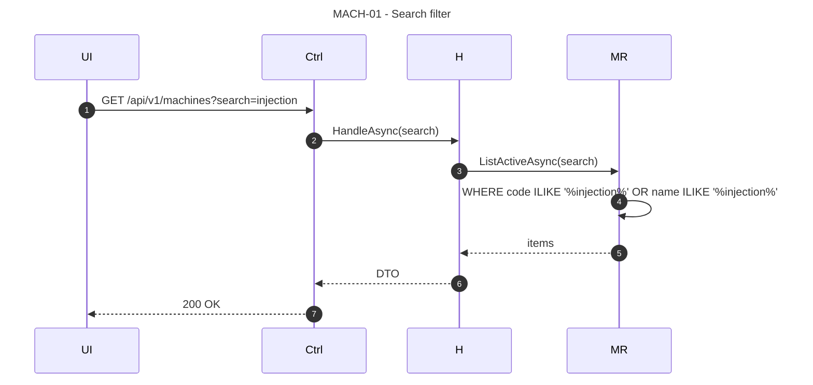
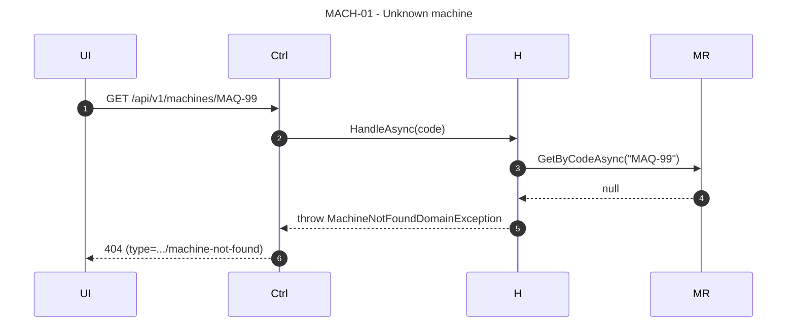

# MACH-01 — As a Plant Operator, I want to see the list of machines and downtime reasons so that I can pick the correct machine when uploading and interpret the breakdown.

## 1. Requirements Engineering

### 1.1. User Story Description

As a **Plant Operator**, I want to **list the active machines and the downtime reasons catalogue** so that I can (a) select the correct machine when uploading a log, and (b) interpret the downtime breakdown on the shift detail page.

The US covers **read-only reference data**. Creation / edit / deactivation of machines and downtime reasons is **MACH-02 (Roadmap T2)** — it requires authentication first.

### 1.2. Customer Specifications and Clarifications

#### From the specification document (KB §1, §4)

> Extracted from §17.7 (Seed reference data) and §23.1 (Machines DTO).

- The baseline ships **seeded reference data** (3 machines, 6 downtime reasons) so the dashboard and upload form have meaningful selectors on first launch.
- Both `GET /api/v1/machines` and `GET /api/v1/machines/{code}` are public in baseline.
- The `Machine` selector in `Upload.razor` and `Home.razor` uses `IMachineRepository.ListActiveAsync`.
- The `DowntimeReason` catalogue is enriched into the shift breakdown (§1.7 of OEE-01).

#### From ADRs and KB

- **ADR-0003 (§5.3, §17.1, §17.2):** `machines` and `downtime_reasons` tables; `is_active` soft-deactivation; case-insensitive unique indexes.
- **ADR-0006 (§5.6, §8.3):** `Machine` and `DowntimeReason` are reference aggregates; soft-deactivation only.
- **§23.1** defines the `MachineSummary`, `MachineDetail`, `PaginatedMachines` shapes.

### 1.3. Acceptance Criteria (expanded, testable)

#### AC1 — List active machines

- **AC1.1** `GET /api/v1/machines` returns `200 OK` with a `PaginatedMachines` body.
- **AC1.2** Only `is_active = TRUE` machines are returned by default (soft-deactivated machines are hidden).
- **AC1.3** Each item has `code`, `name`, `idealCycleSeconds`, `plannedShiftSeconds`, `isActive`.
- **AC1.4** `page` (default `1`), `pageSize` (default `20`, max `100`), `search` (case-insensitive substring on `code` or `name`) are supported.
- **AC1.5** Response includes `page`, `pageSize`, `total`, `totalPages`.

#### AC2 — Retrieve one machine

- **AC2.1** `GET /api/v1/machines/{code}` returns `200 OK` with a `MachineDetail` body.
- **AC2.2** Fields: `code`, `name`, `idealCycleSeconds`, `plannedShiftSeconds`, `isActive`, `createdAt`, `updatedAt`.
- **AC2.3** Unknown `code` → `404 Not Found` with `type = ".../machine-not-found"`.

#### AC3 — List downtime reasons

- **AC3.1** `GET /api/v1/downtime-reasons` returns `200 OK` with a paginated list of `DowntimeReason` items.
- **AC3.2** Each item has `code`, `description`, `category` (`PLANNED` | `UNPLANNED`), `isActive`.
- **AC3.3** Only `is_active = TRUE` reasons are returned by default.
- **AC3.4** Pagination as AC1.4.

#### AC4 — Dropdown / selector contracts

- **AC4.1** `Upload.razor` and `Home.razor` use `IMachineRepository.ListActiveAsync` for the machine dropdown; the dropdown is populated from a single call (no N+1).
- **AC4.2** The shift breakdown (`OEE-01`) uses `IDowntimeReasonRepository.ListActiveAsync` to enrich entries; a missing reason code renders the code with description `"<unknown>"`.
- **AC4.3** The dropdowns render the list in a stable order (`machines.code ASC`; `downtime_reasons.code ASC`).

#### AC5 — Seeded data meets the acceptance minimum

- **AC5.1** The baseline seed contains at least **3 machines** and **6 downtime reasons** (§17.7).
- **AC5.2** A fresh `dotnet run` with `SeedData:Enabled = true` populates the tables and the dashboard renders with real selectors.
- **AC5.3** Re-running the seed does not duplicate rows (idempotent: `INSERT ... ON CONFLICT DO NOTHING` or existence check).

#### AC6 — Machine with no shifts is still listed

- **AC6.1** A machine with zero `ProductionShift` rows is returned by `GET /api/v1/machines` (the endpoint is a reference-data read, not a "machines with data" report).

#### AC7 — Contract matches OpenAPI

- **AC7.1** Response bodies match `PaginatedMachines` (§23) / `MachineDetail` (§23).
- **AC7.2** Errors match `ProblemDetails`.

### 1.4. Found out Dependencies

**Preceding:**
- ADR-0003 (`machines`, `downtime_reasons` tables + seed).
- ADR-0006 (reference aggregates, soft-deactivation).
- `IMachineRepository`, `IDowntimeReasonRepository`.

**Succeeding:**
- LOG-01 (`Upload.razor` uses the machine dropdown).
- OEE-01 (`ShiftDetail.razor` uses the reason catalogue to enrich the breakdown).
- MACH-02 (Roadmap T2 — write operations).

### 1.5. Input and Output Data

#### 1.5.1. `GET /api/v1/machines` query parameters

| Name | Type | Required | Constraint |
|---|---|---|---|
| `search` | string | no | `≤ 100 chars` |
| `page` | int | no | `≥ 1` (default 1) |
| `pageSize` | int | no | `1 ≤ n ≤ 100` (default 20) |

#### 1.5.2. `PaginatedMachines` (200 OK)

```json
{
  "items": [
    { "code": "MAQ-01", "name": "Injection Press A1", "idealCycleSeconds": 2.5, "plannedShiftSeconds": 28800, "isActive": true },
    { "code": "MAQ-02", "name": "Injection Press A2", "idealCycleSeconds": 2.8, "plannedShiftSeconds": 28800, "isActive": true },
    { "code": "PRESSA-B2", "name": "Assembly Press B2", "idealCycleSeconds": 4.0, "plannedShiftSeconds": 28800, "isActive": true }
  ],
  "page": 1,
  "pageSize": 20,
  "total": 3,
  "totalPages": 1
}
```

#### 1.5.3. `MachineDetail` (200 OK)

```json
{
  "code": "MAQ-01",
  "name": "Injection Press A1",
  "idealCycleSeconds": 2.5,
  "plannedShiftSeconds": 28800,
  "isActive": true,
  "createdAt": "2026-10-01T09:00:00Z",
  "updatedAt": "2026-10-01T09:00:00Z"
}
```

#### 1.5.4. `GET /api/v1/downtime-reasons` (200 OK)

```json
{
  "items": [
    { "code": "PLANNED_BREAK",        "description": "Scheduled shift break",           "category": "PLANNED",   "isActive": true },
    { "code": "PLANNED_MAINTENANCE",  "description": "Scheduled preventive maintenance", "category": "PLANNED",   "isActive": true },
    { "code": "UNPLANNED_MECHANICAL", "description": "Mechanical failure",              "category": "UNPLANNED", "isActive": true },
    { "code": "UNPLANNED_TOOL_CHANGE","description": "Unplanned tool change",           "category": "UNPLANNED", "isActive": true },
    { "code": "UNPLANNED_ELECTRICAL", "description": "Electrical failure",              "category": "UNPLANNED", "isActive": true },
    { "code": "UNPLANNED_OPERATOR",   "description": "Operator absence / error",        "category": "UNPLANNED", "isActive": true }
  ],
  "page": 1, "pageSize": 20, "total": 6, "totalPages": 1
}
```

#### 1.5.5. Persistence

Read-only. `SELECT * FROM machines WHERE is_active = TRUE` (default; `AsNoTracking()`); same for `downtime_reasons`.

Uses `uq_machines_code_ci` and `uq_downtime_reasons_code_ci` for the `search` filter (case-insensitive).

#### 1.5.6. Headers

- `Cache-Control: no-store`.

### 1.6. System Sequence Diagrams (SSD)

#### 1.6.1. Load machine dropdown

```mermaid
sequenceDiagram
autonumber
title MACH-01 - Load machine dropdown
    participant UI as Upload.razor
    participant Ctrl as Program.cs endpoint
    participant H as ListMachinesHandler
    participant MR as IMachineRepository

    UI->>Ctrl: GET /api/v1/machines?page=1&pageSize=100
    Ctrl->>H: HandleAsync(query)
    H->>MR: ListActiveAsync(page, pageSize, search)
    MR-->>H: PaginatedMachines
    H-->>Ctrl: PaginatedMachinesDto
    Ctrl-->>UI: 200 OK
    UI->>UI: populate <select> with items
```



#### 1.6.2. Load downtime reason catalogue (for enrichment)



#### 1.6.3. Search filter



#### 1.6.4. Unknown machine → 404



### 1.7. Other Relevant Remarks

#### 1.7.1. Clean Architecture placement

| Layer | Component | Responsibility |
|---|---|---|
| WebUI | `Upload.razor`, `Home.razor`, `ShiftDetail.razor` | Inject the handlers; render dropdowns / enrich breakdown |
| Application | `ListMachinesHandler`, `GetMachineHandler`, `ListDowntimeReasonsHandler` | Load via repository, map to DTOs |
| Infrastructure | `EfMachineRepository`, `EfDowntimeReasonRepository` | EF Core, `AsNoTracking()` |

#### 1.7.2. Decision record — read-only baseline

The baseline exposes **read** endpoints only. **MACH-02 (Roadmap T2)** adds `POST /api/v1/machines`, `PUT /api/v1/machines/{code}`, `DELETE /api/v1/machines/{code}`, and the corresponding `downtime_reasons` endpoints — all gated by `[Authorize(Roles="ENGINEER|ADMINISTRATOR")]`. Documented in §6.3, §30 (T2).

Until T2 lands, adding / editing machines and downtime reasons requires a database migration or direct SQL. Documented as a known limitation; acceptable for the baseline (a demo with 3 seeded machines + 6 seeded reasons is sufficient for LOG-01/OEE-01/OEE-02/OEE-03).

#### 1.7.3. Decision record — seeded data

The seed is **idempotent** (`INSERT ... ON CONFLICT DO NOTHING` or existence check). Rationale:

- Re-running `dotnet run` in development must not duplicate rows.
- The BYOP reviewers who clone and run the repo must get a consistent baseline.
- No real customer data (§16.6, BYOP p.3).

The seed contains:
- 3 machines (`MAQ-01`, `MAQ-02`, `PRESSA-B2`).
- 6 downtime reasons (2 `PLANNED`, 4 `UNPLANNED`).
- 2 users (baseline, for T2 readiness).

#### 1.7.4. Decision record — soft-deactivation semantics

`is_active = false` machines are hidden from `GET /api/v1/machines` by default. They still:
- Appear in historical `ProductionShift` rows (FK preserved).
- Are visible in `GET /api/v1/machines/{code}` (single read returns the row regardless of `is_active`).
- Are **excluded** from `Upload.razor`'s dropdown (cannot upload new shifts for an inactive machine — the `Machine` active check is also enforced in `ProcessLogFileHandler` before persist; future T2 will add this explicitly).

Baseline behaviour: `GET /api/v1/machines` filters `is_active = TRUE`; `GET /api/v1/machines/{code}` returns the machine regardless of `is_active`. This allows the shift detail page to display a shift whose machine was later deactivated.

#### 1.7.5. Error-to-HTTP matrix

| Condition | HTTP | `ProblemDetails.type` |
|---|---|---|
| Unknown `machineCode` (single read) | 404 | `.../machine-not-found` |
| Malformed pagination (`page < 1`, `pageSize > 100`) | 400 | (RFC 9457 default) |
| `search` too long (`> 100`) | 400 | (RFC 9457 default) |
| Unhandled exception | 500 | `about:blank` |

#### 1.7.6. Verification (automated + demo)

- **Application test:** `ListMachinesHandlerTests` — 3 cases: active-only filter; search filter; pagination.
- **Application test:** `GetMachineHandlerTests` — 2 cases: found; not found.
- **Seed idempotency test (Integration, T6):** run the seed twice; assert `COUNT(*)` unchanged.
- **Demo:** `dotnet run`; open `/upload`; see 3 machines in the dropdown; open `/machines/MAQ-01`; see the shift list; open a shift; see the 6 downtime reasons in the breakdown.

#### 1.7.7. Open questions / deferred

- **MACH-02** (write endpoints): T2.
- **Add / edit machines without T2:** not supported in baseline; documented limitation.
- **Downtime reason inactive handling in Pareto:** inactive reasons are still counted in historical breakdowns (they exist in the JSONB); the description is resolved from the `downtime_reasons` table regardless of `is_active`. Documented in OEE-01 §1.7.2.