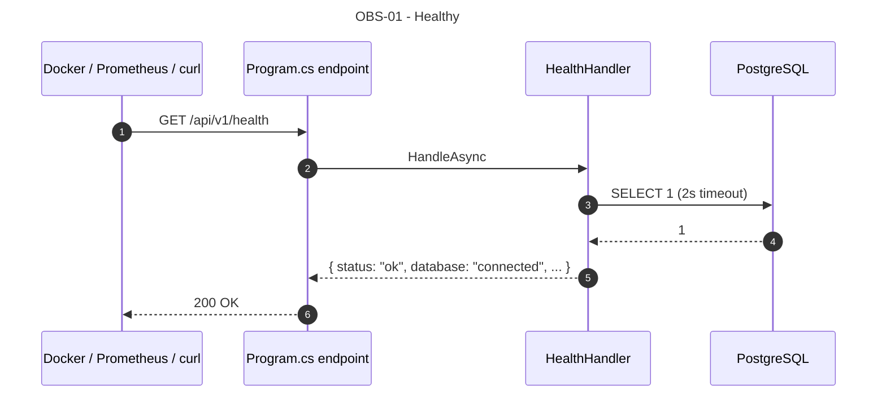
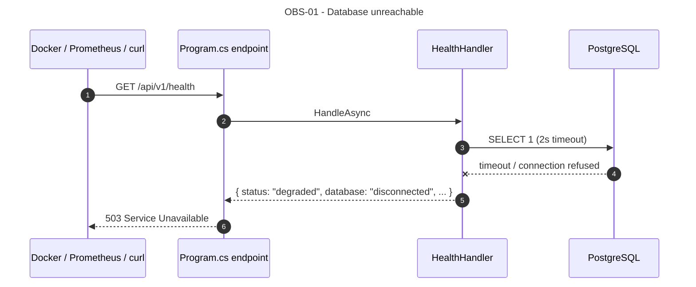
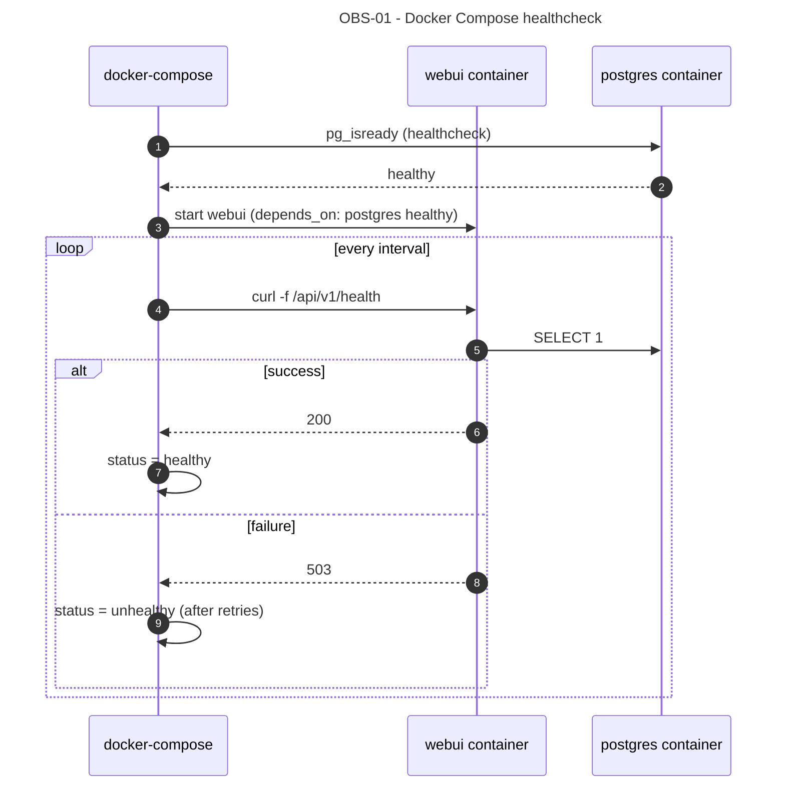

# OBS-01 — As an operator or monitoring system, I want to probe the system's health so that I can detect database unavailability before users are affected.

## 1. Requirements Engineering

### 1.1. User Story Description

As an **operator** or **monitoring system**, I want to **probe `GET /api/v1/health`** to verify that the application is running and the database is reachable, so that:
- `docker compose ps` can report container health (a `healthy` / `unhealthy` state).
- A future Prometheus blackbox exporter (Roadmap T5) can scrape readiness.
- A human operator can quickly confirm the deployment is functional.

### 1.2. Customer Specifications and Clarifications

#### From the specification document (KB §1, §4)

> Extracted from §23.5 and §32 (docker-compose healthcheck).

- Liveness + readiness in one endpoint (`GET /api/v1/health`).
- Returns `200 OK` when healthy, `503 Service Unavailable` when a dependency (the database) is unreachable.
- Uptime reported in seconds.
- Public (no authentication — the endpoint must be usable before login, and by monitoring tools).

#### From ADRs and KB

- **§23.5** defines the `HealthResponse` shape.
- **§32.4** describes the docker-compose healthcheck wiring.
- **§33.1** documents the planned Prometheus `blackbox_exporter` scrape (T5).

### 1.3. Acceptance Criteria (expanded, testable)

#### AC1 — Liveness

- **AC1.1** The process responds to `GET /api/v1/health` within 2 seconds (baseline; documented for T5's blackbox probe).
- **AC1.2** The response is `application/json; charset=utf-8`.
- **AC1.3** `Cache-Control: no-store` (health must never be cached).

#### AC2 — Readiness

- **AC2.1** The handler executes `SELECT 1` against PostgreSQL with a 2-second timeout.
- **AC2.2** On success → `200 OK` with `{ status: "ok", database: "connected", version, timestamp, uptimeSeconds }`.
- **AC2.3** On failure (timeout, connection refused, DB down) → `503 Service Unavailable` with `{ status: "degraded", database: "disconnected", ... }`.
- **AC2.4** The `SELECT 1` is executed **every** request; no caching of the result.

#### AC3 — Response fields

- **AC3.1** `status` ∈ `{ "ok", "degraded" }`.
- **AC3.2** `version` string (baseline: `"0.1.0-baseline"`; source: `AssemblyInformationalVersionAttribute`).
- **AC3.3** `timestamp` ISO 8601 UTC (server clock).
- **AC3.4** `database` ∈ `{ "connected", "disconnected" }`.
- **AC3.5** `uptimeSeconds` integer ≥ 0 (process uptime; source: `Environment.TickCount64 / 1000` or a custom `StartupTime` singleton).

#### AC4 — No authentication

- **AC4.1** The endpoint is public (`@Public()`-equivalent in baseline; no auth middleware since T2 is not wired).
- **AC4.2** After T2 lands, the endpoint remains public — it must not require a JWT (Docker healthcheck does not have one).

#### AC5 — Docker Compose integration

- **AC5.1** `docker compose up -d` starts `postgres` and `webui`; within ~30 s, `docker compose ps` reports `webui` as `healthy`.
- **AC5.2** If PostgreSQL is stopped, the next health check fails → `webui` transitions to `unhealthy` within the configured `healthcheck.interval × healthcheck.retries`.
- **AC5.3** The healthcheck command in `docker-compose.yml` calls `curl -f http://localhost:8080/api/v1/health` (or equivalent).

#### AC6 — Contract matches OpenAPI

- **AC6.1** `200 OK` body matches `HealthResponse` (§23.5).
- **AC6.2** `503 Service Unavailable` body also matches `HealthResponse` (with `status = "degraded"`, `database = "disconnected"`).

### 1.4. Found out Dependencies

**Preceding:**
- ADR-0003 (`OEESentinelDbContext`; the `SELECT 1` uses the DbContext).
- ASP.NET Core hosting.

**Succeeding:**
- §32.4 (Docker Compose healthcheck).
- Roadmap T5 (Prometheus `blackbox_exporter` scrape).

### 1.5. Input and Output Data

#### 1.5.1. Query parameters

None.

#### 1.5.2. `HealthResponse` (200 OK)

```json
{
  "status": "ok",
  "version": "0.1.0-baseline",
  "timestamp": "2026-11-04T16:02:11Z",
  "database": "connected",
  "uptimeSeconds": 86400
}
```

#### 1.5.3. `HealthResponse` (503 Service Unavailable)

```json
{
  "status": "degraded",
  "version": "0.1.0-baseline",
  "timestamp": "2026-11-04T16:02:11Z",
  "database": "disconnected",
  "uptimeSeconds": 86400
}
```

#### 1.5.4. Persistence

No writes. The `SELECT 1` executes against the `OEESentinelDbContext` with `CommandTimeout = 2`.

#### 1.5.5. Headers

- `Cache-Control: no-store`.
- `Content-Type: application/json; charset=utf-8`.

### 1.6. System Sequence Diagrams (SSD)

#### 1.6.1. Healthy



#### 1.6.2. Database unreachable



#### 1.6.3. Docker Compose healthcheck flow



### 1.7. Other Relevant Remarks

#### 1.7.1. Clean Architecture placement

| Layer | Component | Responsibility |
|---|---|---|
| WebUI | `Program.cs` endpoint + `HealthHandler` | Execute `SELECT 1`; assemble DTO; return 200 or 503 |
| Infrastructure | `OEESentinelDbContext` | The `SELECT 1` runs via `dbContext.Database.ExecuteSqlRaw` (or `CanConnectAsync`) |

There is no Application handler and no Domain involvement. `HealthHandler` is a **UI-level** concern, documented in §13.2 as an inline handler (like OBS-01 in §6.3).

#### 1.7.2. Decision record — `SELECT 1` vs `CanConnectAsync`

Two equivalent options:

- `dbContext.Database.ExecuteSqlRawAsync("SELECT 1")` — executes an actual query.
- `dbContext.Database.CanConnectAsync()` — attempts to open a connection.

Baseline uses `ExecuteSqlRawAsync("SELECT 1")` with a 2-second `CancellationTokenSource` timeout. Rationale:
- `CanConnectAsync` returns true if the connection opens, even if the DB is in a degraded state.
- `SELECT 1` proves the DB is actually able to execute a query.
- `CommandTimeout = 2s` guarantees bounded latency.

The 2-second timeout is a **budget**, not a target — the endpoint returns in ~10–50 ms on a healthy DB.

#### 1.7.3. Decision record — 503 vs 500

`503 Service Unavailable` is correct for "the app is running but a dependency is down". `500` implies a bug in the app itself. The distinction matters:
- Docker healthcheck treats `503` as `unhealthy` (a known, expected degraded state).
- Monitoring sees `503` as "upstream dependency unavailable" (correct signal).
- `500` would misclassify the health check itself as a bug.

#### 1.7.4. Decision record — no authentication

Health checks must be callable without credentials:
- Docker healthcheck runs inside the container, no user context.
- Prometheus `blackbox_exporter` scrapes without a JWT.

If T2's auth middleware is wired with a global `[Authorize]`, the health endpoint must be explicitly marked `[AllowAnonymous]` / `@Public()`. Documented in §3.9 (T2's incremental evolution).

#### 1.7.5. Decision record — `uptimeSeconds` source

`Environment.TickCount64 / 1000` measures process uptime (not container uptime). It is reset on restart, which is the correct semantic for "the current process has been alive for X seconds". A container restart resets the counter — that is what an operator wants to see.

Alternative: read `/proc/uptime` (Linux only) or the container's start time. Documented as out-of-scope for the baseline; the process-level uptime is sufficient.

#### 1.7.6. Error-to-HTTP matrix

| Condition | HTTP | Body |
|---|---|---|
| DB reachable | 200 | `{ status: "ok", database: "connected", ... }` |
| DB unreachable | 503 | `{ status: "degraded", database: "disconnected", ... }` |
| Unhandled exception in the handler (e.g., `NpgsqlException` not caught) | 500 | `ProblemDetails` |

The handler **must not** let an exception escape as `500` — it should catch `NpgsqlException` / `DbException` and return `503`. `500` is only for truly unexpected errors.

#### 1.7.7. Verification (automated + demo)

- **Application test:** `HealthHandlerTests` — 2 cases: DB reachable → 200; DB unreachable (mocked `CanConnectAsync` or `ExecuteSqlRawAsync` throwing) → 503.
- **Integration test (deferred T6):** `WebApplicationFactory<Program>` with a real PostgreSQL container (Testcontainers); assert 200. Stop the container; assert 503.
- **Docker Compose test:** `docker compose up -d` → wait 30 s → `docker compose ps` shows `healthy`. `docker compose stop postgres` → wait ~30 s → `webui` shows `unhealthy`.
- **Demo:** `curl http://localhost:5000/api/v1/health` → 200; `docker compose stop postgres` → `curl` → 503.

#### 1.7.8. Open questions / deferred

- **Prometheus `/metrics`** (OpenMetrics exposition): T5. Not the same endpoint — `/api/v1/health` is the *readiness* probe; `/metrics` is the *observability* counter export.
- **Liveness vs readiness split** (e.g., `GET /health/live`, `GET /health/ready`): not in baseline. A single endpoint suffices for Docker; if T5's blackbox probe needs a split, that will be a separate ADR.
- **Deep health** (checking parser availability, Prolog, SMTP): not in baseline. The baseline is single-plant, single-dependency (PostgreSQL). Deep health checks are deferred to T5/T6.