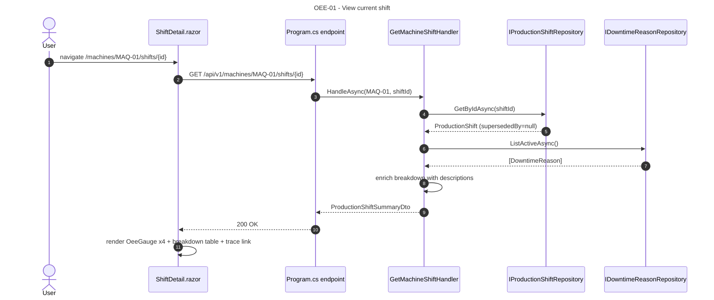
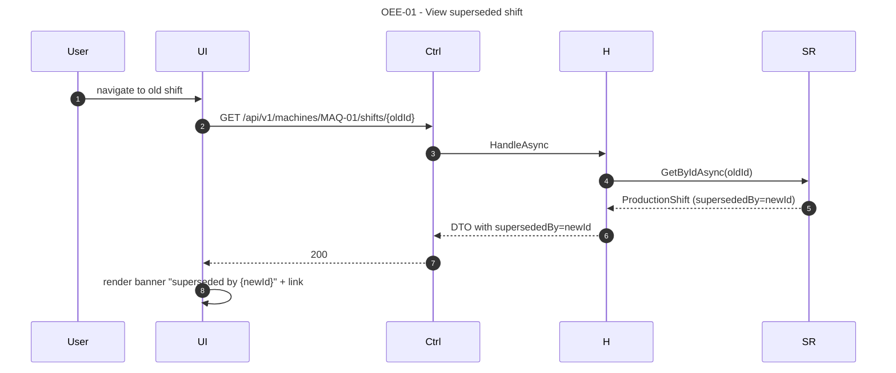
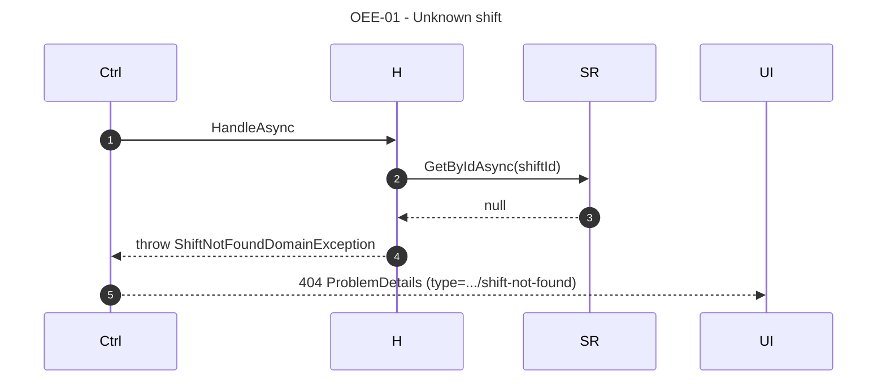

# OEE-01 — As a Plant Operator or Manager, I want to view the A/P/Q/OEE pillars of a single shift so that I can investigate a specific production outcome.

## 1. Requirements Engineering

### 1.1. User Story Description

As a **Plant Operator**, **Production Engineer**, or **Plant Manager**, I want to **view the A/P/Q/OEE pillars and the downtime breakdown of a single `ProductionShift`** so that I can investigate a specific production outcome, trace it to its source ingestion, and understand where the losses came from.

The US exposes the **fact** created by LOG-01. It is read-only — no mutation is possible through this US.

### 1.2. Customer Specifications and Clarifications

#### From the specification document (KB §1, §4.3)

> Extracted from `docs/sad/01-problem-statement.md` §2.4; `docs/sad/05-key-scenarios.md` §3; §23.3.

- The four pillars must be displayed as `0–100%` (client multiplies the persisted `[0,1]` `Percentage` by 100 at render time).
- The downtime breakdown is listed with reason code, description, and duration.
- A superseded shift shows a banner with a link to the superseding shift (T4 will add the UI; the DTO field exists).
- Traceability: `sourceIngestionId` links back to the `LogIngestion` (LOG-02).

#### From ADRs and KB

- **ADR-0006 (§5.6, §8.3):** `ProductionShift` is an immutable fact; the four pillars and `DowntimeBreakdown` are frozen at compute time.
- **ADR-0004 (§5.4, §31):** Blazor Server renders `OeeGauge.razor` bound to `Percentage`; `ParetoChart.razor` for the breakdown.
- **§23.3** defines the `ProductionShiftSummary` response shape.
- **§24.2** defines error mapping (`MachineNotFoundDomainException`, `LogIngestionNotFoundDomainException`).

### 1.3. Acceptance Criteria (expanded, testable)

#### AC1 — Retrieve a `ProductionShift` by id

- **AC1.1** `GET /api/v1/machines/{code}/shifts/{shiftId}` returns `200 OK` with a `ProductionShiftSummary` body matching §23.3. *(Note: baseline lists shifts via `GET /api/v1/machines/{code}/shifts`; the single-shift read is provided by `GetMachineShiftHandler` and is documented here as part of OEE-01's contract.)*
- **AC1.2** `shiftId` is a UUIDv7.
- **AC1.3** Response fields: `id`, `machineCode`, `window`, `totals`, `downtimeBreakdown[]`, `availability`, `performance`, `quality`, `oee`, `sourceIngestionId`, `supersededBy`, `recordedAt`.
- **AC1.4** `Cache-Control: no-store`.

#### AC2 — Four pillars rendered as gauges

- **AC2.1** `OeeGauge.razor` is bound to each of `availability`, `performance`, `quality`, `oee`.
- **AC2.2** The gauge displays the `Percentage` value × 100 (e.g., `87.34%`), with 2 decimal places.
- **AC2.3** The gauge colour band: green ≥ 0.85, amber 0.60–0.85, red < 0.60 (documented UX rule; not a domain rule).
- **AC2.4** `availability`, `performance`, `quality`, `oee` ∈ `[0,1]` — guaranteed by the DB CHECK + ADR-0006 clamp.

#### AC3 — Downtime breakdown is listed

- **AC3.1** Each entry in `downtimeBreakdown[]` renders: reason code, category (`PLANNED` / `UNPLANNED`), description (from `DowntimeReason` catalogue, looked up at render), duration (seconds, formatted to `HH:MM:SS`).
- **AC3.2** Entries are sorted by `seconds DESC`, ties broken by `reasonCode ASC` (deterministic, matches OEE-03's ordering).
- **AC3.3** An empty breakdown (`downtimeBreakdown == []`) renders an empty-state message ("No downtime recorded for this shift").

#### AC4 — Supersession banner

- **AC4.1** When `supersededBy` is non-null, the dashboard renders a banner: "This shift has been superseded by {newer shift id}" with a link to `/machines/{code}/shifts/{supersededBy}`.
- **AC4.2** The superseding shift is **not** auto-navigated; the user must click the link (baseline UX; T4 adds a "compare" view).
- **AC4.3** The banner does not alter the persisted values — the old shift's A/P/Q/OEE are still displayed faithfully.

#### AC5 — Traceability

- **AC5.1** `sourceIngestionId` is rendered as a link to `/ingestions` (filtered to that id) — the audit trail from `OeeMetrics` → `ProductionShift` → `LogIngestion` is complete.
- **AC5.2** `recordedAt` is rendered in ISO 8601 UTC.

#### AC6 — Machine and shift exist

- **AC6.1** Unknown `machineCode` → `404 Not Found` with `type = ".../machine-not-found"`.
- **AC6.2** Unknown `shiftId` → `404 Not Found` with `type = ".../shift-not-found"`.
- **AC6.3** `shiftId` belongs to a different `machineCode` → `404` (the shift is not reachable from the wrong machine).

#### AC7 — Contract matches OpenAPI

- **AC7.1** Response body matches `ProductionShiftSummary` (§23.3).
- **AC7.2** Errors match `ProblemDetails` with the mapped `type`.

### 1.4. Found out Dependencies

**Preceding:**
- LOG-01 (creates the `ProductionShift`).
- ADR-0003 (`production_shifts`, `downtime_reasons` tables).
- ADR-0006 (immutability).
- ADR-0004 (Blazor UI).
- `IProductionShiftRepository`, `IDowntimeReasonRepository`.

**Succeeding:**
- OEE-02 (aggregates across shifts including this one).
- OEE-03 (Pareto uses the `downtimeBreakdown` exposed here).

### 1.5. Input and Output Data

#### 1.5.1. `ProductionShiftSummary` (200 OK)

```json
{
  "id": "019e2b1a-7d3f-7c4e-8b2f-5a6d8e0c4f12",
  "machineCode": "MAQ-01",
  "window": { "start": "2026-11-04T08:00:00Z", "end": "2026-11-04T16:00:00Z" },
  "totals": { "totalParts": 8800, "approvedParts": 8600, "rejectedParts": 200 },
  "downtimeBreakdown": [
    { "reasonCode": "PLANNED_BREAK",        "category": "PLANNED",   "seconds": 1800 },
    { "reasonCode": "UNPLANNED_MECHANICAL", "category": "UNPLANNED", "seconds": 900  },
    { "reasonCode": "UNPLANNED_TOOL_CHANGE","category": "UNPLANNED", "seconds": 300  }
  ],
  "availability": 0.9375,
  "performance": 0.8800,
  "quality": 0.9773,
  "oee": 0.8073,
  "sourceIngestionId": "018e9c7e-6c2a-7b8e-9a3d-4f1c7e2b5d10",
  "supersededBy": null,
  "recordedAt": "2026-11-04T16:02:11Z"
}
```

#### 1.5.2. Persistence

Read-only. The `ProductionShift` is loaded via `IProductionShiftRepository.GetByIdAsync(shiftId)` and mapped to a DTO. `AsNoTracking()`.

The `DowntimeBreakdown` is loaded from the `downtime_breakdown` JSONB column, deserialised into `IReadOnlyDictionary<DowntimeReasonCode, Duration>`, and enriched with the `description` from `DowntimeReason` (joined by `reasonCode`).

#### 1.5.3. Headers

- `Cache-Control: no-store`.

### 1.6. System Sequence Diagrams (SSD)

#### 1.6.1. Happy path — view a current shift



#### 1.6.2. Superseded shift — banner



#### 1.6.3. Unknown shift → 404



### 1.7. Other Relevant Remarks

#### 1.7.1. Clean Architecture placement

| Layer | Component | Responsibility |
|---|---|---|
| WebUI | `ShiftDetail.razor` | Inject `IGetMachineShiftHandler`; render gauges + breakdown + trace link |
| Application | `GetMachineShiftHandler` | Load shift + enrich breakdown, map to DTO |
| Infrastructure | `EfProductionShiftRepository`, `EfDowntimeReasonRepository` | EF Core, `AsNoTracking()` |

No domain service involved. The handler is a pure read + enrichment.

#### 1.7.2. Decision record — enrichment with descriptions

The `downtime_breakdown` JSONB stores only `reasonCode → seconds`. To render the description on the dashboard, the handler loads the `DowntimeReason` catalogue and joins in memory. This is a single extra repository call (`ListActiveAsync`), amortised across the whole breakdown. Documented as acceptable; if the catalogue grows, a batched `GetByCodesAsync` could replace `ListActiveAsync` (deferred).

#### 1.7.3. Decision record — supersession is not auto-navigated

The dashboard shows the **requested** shift, even if superseded. It does not silently redirect to the current one. Rationale:

- The user explicitly navigated to a historical shift (from `/ingestions` or a historical link). Redirecting would break their mental model.
- The old shift's values are still **correct as historical facts** — showing them with a banner is honest.
- The link to the current shift is provided but not auto-followed.

T4 may add a "side-by-side compare" view; baseline ships the banner only.

#### 1.7.4. Decision record — no pagination in single read

The single-shift endpoint returns one shift. No pagination. The list endpoint (`GET /api/v1/machines/{code}/shifts`) is paginated (default 20, max 100) and is used by `MachineDetail.razor`.

#### 1.7.5. Error-to-HTTP matrix

| Condition | HTTP | `ProblemDetails.type` |
|---|---|---|
| Malformed `shiftId` (not UUID) | 400 | (RFC 9457 default) |
| Unknown `machineCode` | 404 | `.../machine-not-found` |
| Unknown `shiftId` | 404 | `.../shift-not-found` |
| `shiftId` belongs to different machine | 404 | `.../shift-not-found` |
| Unhandled exception | 500 | `about:blank` |

#### 1.7.6. Verification (automated + demo)

- **Application test:** `GetMachineShiftHandlerTests` — 3 cases: current shift; superseded shift; unknown id throws.
- **UI test (bUnit, deferred T6):** `ShiftDetail.razor` renders 4 gauges + breakdown table; superseded shift shows banner.
- **Demo:** upload `samples/sample_shift.csv`; navigate to `/machines/MAQ-01/shifts/{id}`; see 4 gauges + breakdown; verify `recordedAt` and `sourceIngestionId` link.

#### 1.7.7. Open questions / deferred

- **Reasoning for the gauge threshold bands:** baseline uses `green ≥ 0.85 / amber 0.60–0.85 / red < 0.60`. World-class OEE ≈ 0.85 (KB §12). Configurable at the UI level only (not persisted).
- **Supersession compare view:** deferred to T4.
- **Export to PDF:** deferred to T1.