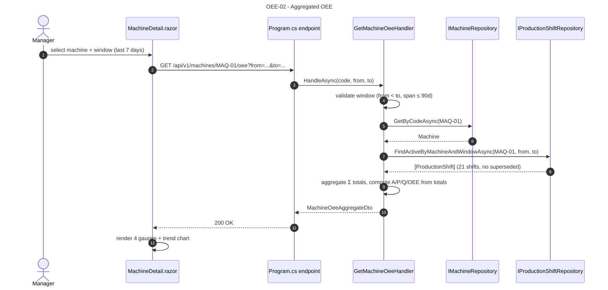
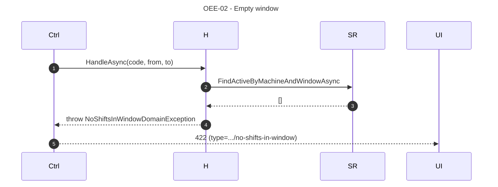
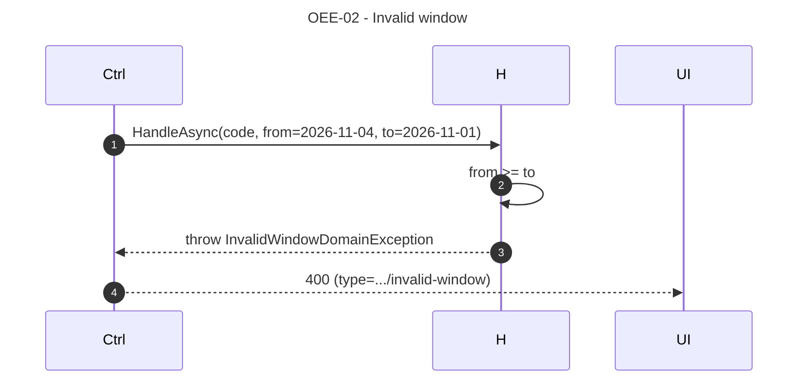
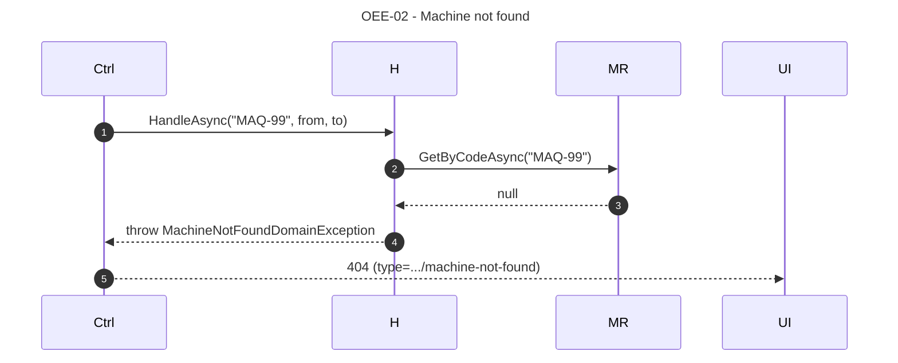

# OEE-02 — As a Manager, I want to view OEE aggregated across a window so that I can assess trend without skew from a single outlier shift.

## 1. Requirements Engineering

### 1.1. User Story Description

As a **Plant Manager**, I want to **view the four OEE pillars aggregated across a window of shifts** so that I can assess the trend over a week or a month without being skewed by a single outlier shift.

The aggregation is **from totals** — `Availability = Σ OperatingTime / Σ PlannedTime` — never by averaging shift-level percentages. This is the single most important semantic of OEE-02 (§23.2).

### 1.2. Customer Specifications and Clarifications

#### From the specification document (KB §1, §4)

> Extracted from `docs/sad/01-problem-statement.md` §2.4; `docs/sad/05-key-scenarios.md` §2.1; §23.2.

- The API computes from raw totals (`Σ` across shifts), not by averaging percentages.
- Window is validated: `to > from`, span ≤ 90 days.
- Empty window (no non-superseded shifts) → `422` with a stable reason code.
- The response echoes the query window and includes `shiftsIncluded`.

#### From ADRs and KB

- **ADR-0006 (§5.6, §8.4):** OEE math is a pure domain concern; the engine computes for **one** shift. Aggregation across shifts is an **Application** concern (KB §4.4).
- **ADR-0003 (§5.3, §17.4):** reads via `IProductionShiftRepository.FindActiveByMachineAndWindowAsync`; partial index `uq_production_shifts_current` on active shifts.
- **§23.2** defines the `MachineOeeAggregate` response shape.
- **§24.2** defines the error mapping (`MachineNotFoundDomainException`, `InvalidWindowDomainException`, `NoShiftsInWindow`).

### 1.3. Acceptance Criteria (expanded, testable)

#### AC1 — Retrieve the aggregate

- **AC1.1** `GET /api/v1/machines/{code}/oee?from=...&to=...` returns `200 OK` with a `MachineOeeAggregate` body matching §23.2.
- **AC1.2** Response fields: `machineCode`, `window { from, to }`, `shiftsIncluded`, `totals { plannedSeconds, downtimeSeconds, operatingSeconds, totalParts, approvedParts, rejectedParts }`, `availability`, `performance`, `quality`, `oee`, `lastUpdatedAt`.
- **AC1.3** `Cache-Control: no-store`.

#### AC2 — Aggregation from totals

- **AC2.1** `Availability = Σ (window_end − window_start − downtime) / Σ (window_end − window_start)` across the included shifts. Equivalently, `= Σ operating / Σ planned`.
- **AC2.2** `Performance = Σ (total_parts × idealCycleTime) / Σ operating`. **Not** `avg(performance)`. **Not** `Σ performance / N`.
- **AC2.3** `Quality = Σ approved / Σ total`.
- **AC2.4** `OEE = A × P × Q` (recomputed from the aggregated pillars).
- **AC2.5** `totals.operatingSeconds = Σ (window_end − window_start) − Σ downtimeSeconds`.
- **AC2.6** All four pillars clamped to `[0,1]` (defence-in-depth; the sum-of-totals formula is monotonic).

#### AC3 — Window validation

- **AC3.1** `from < to` — else `400 Bad Request` with `type = ".../invalid-window"`.
- **AC3.2** `(to − from) ≤ 90 days` — else `400 Bad Request` with `type = ".../invalid-window"`.
- **AC3.3** `from` / `to` parsed as ISO 8601; `date` or `datetime` accepted; UTC assumed if no offset.

#### AC4 — Empty window → 422

- **AC4.1** If `FindActiveByMachineAndWindowAsync` returns 0 shifts, the handler throws `NoShiftsInWindowDomainException`.
- **AC4.2** The endpoint maps it to `422 Unprocessable Entity` with `type = ".../no-shifts-in-window"` and `detail = "No ProductionShift exists for {code} in [{from}, {to})"`.
- **AC4.3** `shiftsIncluded = 0` is not a valid 200 response — the handler refuses to compute an aggregate over nothing.

#### AC5 — Excludes superseded shifts

- **AC5.1** `FindActiveByMachineAndWindowAsync` filters `WHERE superseded_by_id IS NULL`.
- **AC5.2** A superseded shift is **not** included in `shiftsIncluded`, `totals`, or the four pillars. The `?includeSuperseded=true` parameter (planned T4) is **not** part of the baseline contract; the endpoint accepts the parameter syntactically (for forward-compat) but ignores it in the baseline.

#### AC6 — Machine not found → 404

- **AC6.1** Unknown `machineCode` → `404 Not Found` with `type = ".../machine-not-found"`.

#### AC7 — Contract matches OpenAPI

- **AC7.1** Response body matches `MachineOeeAggregate` (§23.2).
- **AC7.2** Errors match `ProblemDetails` with the mapped `type`.

### 1.4. Found out Dependencies

**Preceding:**
- LOG-01 (creates the `ProductionShift` facts).
- ADR-0003 (`production_shifts` table; `uq_production_shifts_current`).
- ADR-0006 (immutable facts; no recompute).
- `IProductionShiftRepository`, `IMachineRepository`.

**Succeeding:**
- Roadmap T4 (`GetPlantParetoHandler` and the SQL view `v_machine_downtime_pareto` will reuse this aggregation pattern across machines).

### 1.5. Input and Output Data

#### 1.5.1. Query parameters

| Name | Type | Required | Constraint |
|---|---|---|---|
| `code` | path | yes | `^[A-Z0-9-]{2,32}$` |
| `from` | ISO datetime | yes | inclusive |
| `to` | ISO datetime | yes | exclusive; `to > from`; span ≤ 90d |

#### 1.5.2. `MachineOeeAggregate` (200 OK)

```json
{
  "machineCode": "MAQ-01",
  "window": { "from": "2026-10-28T00:00:00Z", "to": "2026-11-04T00:00:00Z" },
  "shiftsIncluded": 21,
  "totals": {
    "plannedSeconds": 604800,
    "downtimeSeconds": 72000,
    "operatingSeconds": 532800,
    "totalParts": 184500,
    "approvedParts": 180210,
    "rejectedParts": 4290
  },
  "availability": 0.8809,
  "performance": 0.8654,
  "quality": 0.9767,
  "oee": 0.7447,
  "lastUpdatedAt": "2026-11-04T16:02:11Z"
}
```

#### 1.5.3. Persistence

Read-only. `FindActiveByMachineAndWindowAsync` executes:

```sql
SELECT * FROM production_shifts
WHERE machine_code = $1
  AND window_start >= $2
  AND window_end   <= $3
  AND superseded_by_id IS NULL
ORDER BY window_start;
```

`AsNoTracking()`. Uses `idx_production_shifts_machine_window` (partial).

#### 1.5.4. Headers

- `Cache-Control: no-store`.

### 1.6. System Sequence Diagrams (SSD)

#### 1.6.1. Happy path



#### 1.6.2. Empty window → 422



#### 1.6.3. Invalid window → 400



#### 1.6.4. Machine not found → 404



### 1.7. Other Relevant Remarks

#### 1.7.1. Clean Architecture placement

| Layer | Component | Responsibility |
|---|---|---|
| WebUI | `MachineDetail.razor`, `Trend.razor` (T4) | Inject `IGetMachineOeeHandler`; render 4 gauges + trend |
| Application | `GetMachineOeeHandler` | Validate window; read shifts; aggregate from totals; compute A/P/Q/OEE |
| Infrastructure | `EfMachineRepository`, `EfProductionShiftRepository` | EF Core, `AsNoTracking()` |

The aggregation math lives in the **Application** layer (not Domain), because it is a read-model concern over multiple `ProductionShift` facts. The OEE math for a **single** shift remains in the Domain (`OeeCalculatorEngine`). This is the correct split per §4.4: "the OEE math is done by the calculator (Domain), but summing shifts over a window is a query."

#### 1.7.2. Decision record — aggregate from totals, not from averages

This is the single most important decision of OEE-02. Averaging shift-level percentages is a **known statistical error**:

- A shift with 100 parts and a shift with 100k parts would contribute equally to an averaged `Performance`, which is wrong.
- A short shift with 1h operating time and a long shift with 8h operating time would contribute equally to an averaged `Availability`, which is wrong.

The correct formula is **from totals**:

```
Availability = Σ operating / Σ planned
Performance  = Σ (total_parts × idealCycleTime) / Σ operating
Quality      = Σ approved / Σ total
OEE          = A × P × Q
```

This is documented in §23.2, enforced by the handler's `AggregateOeeFromShifts` method, and asserted by unit tests.

#### 1.7.3. Decision record — no `includeSuperseded` in baseline

The endpoint accepts `includeSuperseded` syntactically for forward-compat, but the baseline handler **ignores** it (always `WHERE superseded_by_id IS NULL`). T4 will activate it for the correction-history view. Documented so a reviewer knows the parameter is a stub.

#### 1.7.4. Decision record — 422 vs 200 on empty window

Baseline returns `422` on an empty window rather than `200` with `oee = 0` and `shiftsIncluded = 0`. Rationale:

- An empty window is not a valid OEE result — it is a precondition failure.
- Returning `200` with `0` is less defensible to a plant manager ("the machine produced 0% this week" vs "we have no data for this week").
- `422` with `type = ".../no-shifts-in-window"` distinguishes the two cases at the client.

Alternative (200 with explicit "no data") is documented but rejected for the baseline; T4 may reconsider if UX demands it.

#### 1.7.5. Error-to-HTTP matrix

| Condition | HTTP | `ProblemDetails.type` |
|---|---|---|
| `from >= to` | 400 | `.../invalid-window` |
| `(to − from) > 90 days` | 400 | `.../invalid-window` |
| Missing `from` or `to` | 400 | (RFC 9457 default) |
| Unknown `machineCode` | 404 | `.../machine-not-found` |
| Empty window (0 shifts) | 422 | `.../no-shifts-in-window` |
| Unhandled exception | 500 | `about:blank` |

#### 1.7.6. Verification (automated + demo)

- **Application test:** `GetMachineOeeHandlerTests` — 5 cases: 1 shift (aggregate == shift); 2 shifts (aggregate from totals, not averages); empty window (`422`); span > 90d (`400`); from ≥ to (`400`).
- **Aggregation test:** construct 2 shifts with deliberately different weights (e.g., 100 parts / 8h vs 100k parts / 1h) and assert that the aggregate's `Performance` matches the **from-totals** formula, not the average.
- **Demo:** upload `samples/sample_shift.csv`; navigate to `/machines/MAQ-01`; see the 4 aggregated gauges; verify against a manual calculation from the shift list.

#### 1.7.7. Open questions / deferred

- **Trend chart:** baseline renders the aggregate + 4 gauges. A time-series chart (last N shifts, week-over-week) is T4 (`Trend.razor`).
- **Cross-machine aggregation:** not in baseline. `GetPlantParetoHandler` (T4) is the first cross-machine read.
- **`includeSuperseded`:** baseline accepts but ignores; T4 activates.