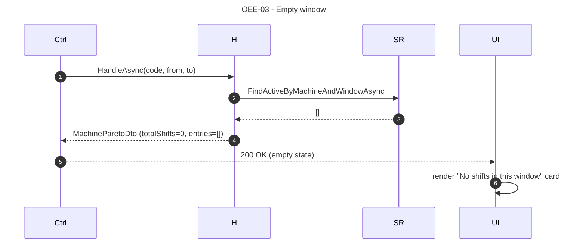
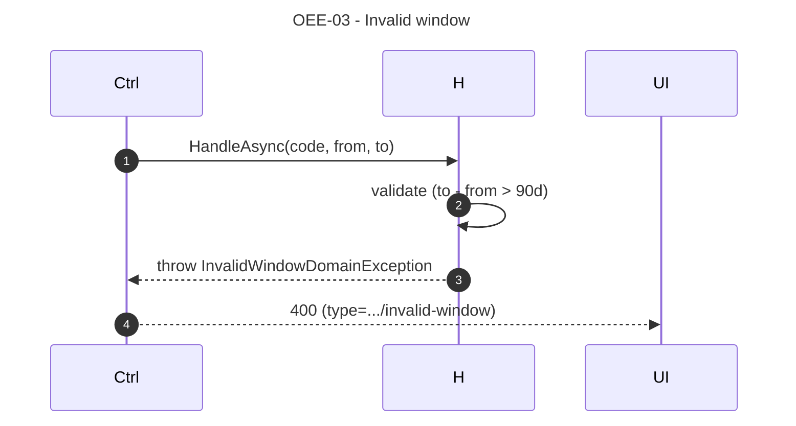

# OEE-03 — As a Production Engineer, I want to see the top downtime reasons by duration so that I can prioritise the highest-loss causes.

## 1. Requirements Engineering

### 1.1. User Story Description

As a **Production Engineer**, I want to **see a Pareto breakdown of the top downtime reasons by aggregated duration** across a window of shifts, so that I can prioritise interventions on the causes that consume the most production time.

The US exposes the `DowntimeBreakdown` already stored in each `ProductionShift`, aggregated **in Application memory** — no SQL aggregation in the baseline (§4.4).

### 1.2. Customer Specifications and Clarifications

#### From the specification document (KB §1, §4.4)

> Extracted from `docs/sad/05-key-scenarios.md` §4; §23.4.

- Top-20 downtime reasons by aggregated duration across a window.
- Sorted descending by `seconds`; ties broken by `reasonCode` ascending (stable, testable).
- Percentages sum to `1.0` (or `0.0` for an empty window).
- Window guard: `to − from ≤ 90 days` → `400` if violated.
- Empty window is a **valid** `200` with `entries = []` and `totalShifts = 0` (unlike OEE-02's empty window, which is `422`) — because a Pareto of "no downtime" is a meaningful answer, while an aggregate of "no data" is not.

#### From ADRs and KB

- **ADR-0003 (§5.3, §17.4):** `downtime_breakdown` is JSONB; not indexed by inner key; read whole.
- **ADR-0006 (§5.6, §8.3):** `DowntimeBreakdown` is an immutable VO on each shift.
- **§23.4** defines the `MachinePareto` response shape.
- **§24.2** defines error mapping (`MachineNotFoundDomainException`, `InvalidWindowDomainException`).

### 1.3. Acceptance Criteria (expanded, testable)

#### AC1 — Retrieve the Pareto breakdown

- **AC1.1** `GET /api/v1/machines/{code}/pareto?from=...&to=...` returns `200 OK` with a `MachinePareto` body matching §23.4.
- **AC1.2** Response fields: `machineCode`, `window { from, to }`, `totalShifts`, `totalDowntimeSeconds`, `entries[]`.
- **AC1.3** Each entry: `reasonCode`, `category`, `description`, `seconds`, `percentage`.
- **AC1.4** `Cache-Control: no-store`.

#### AC2 — Aggregation rules

- **AC2.1** The handler reads all non-superseded shifts in `[from, to)` via `FindActiveByMachineAndWindowAsync`.
- **AC2.2** For each shift, iterates `DowntimeBreakdown.Entries` and sums `Duration` by `reasonCode` into a `Dictionary<DowntimeReasonCode, Duration>`.
- **AC2.3** `totalDowntimeSeconds = Σ entries`.
- **AC2.4** `entries` is the **top 20** entries by `seconds DESC`, ties broken by `reasonCode ASC`.
- **AC2.5** `percentage = seconds / totalDowntimeSeconds` (0 when `totalDowntimeSeconds == 0`).
- **AC2.6** `totalShifts = number of shifts included` (0 when empty; the read is not an error).

#### AC3 — Deterministic ordering

- **AC3.1** Sorting is `seconds DESC`, ties broken by `reasonCode ASC`. Deterministic across runs.
- **AC3.2** A test constructs two reasons with equal seconds and asserts the `reasonCode ASC` tiebreak.

#### AC4 — Empty window is a valid 200

- **AC4.1** When `FindActiveByMachineAndWindowAsync` returns 0 shifts, the endpoint returns `200 OK` with `totalShifts = 0`, `totalDowntimeSeconds = 0`, `entries = []`.
- **AC4.2** `percentage` for empty entries is `0.0` (not NaN).

#### AC5 — Window validation

- **AC5.1** `from < to` — else `400 Bad Request` with `type = ".../invalid-window"`.
- **AC5.2** `(to − from) ≤ 90 days` — else `400 Bad Request`.

#### AC6 — Machine not found → 404

- **AC6.1** Unknown `machineCode` → `404 Not Found` with `type = ".../machine-not-found"`.

#### AC7 — Contract matches OpenAPI

- **AC7.1** Response body matches `MachinePareto` (§23.4).
- **AC7.2** Errors match `ProblemDetails`.

### 1.4. Found out Dependencies

**Preceding:**
- LOG-01 (creates the `ProductionShift` facts with their `DowntimeBreakdown`).
- ADR-0003 (`downtime_breakdown` JSONB; `downtime_reasons` table).
- ADR-0006 (immutable VOs).
- `IProductionShiftRepository`, `IDowntimeReasonRepository`, `IMachineRepository`.

**Succeeding:**
- Roadmap T4 (`v_machine_downtime_pareto` SQL view, when the in-memory volume becomes a bottleneck — not in baseline).

### 1.5. Input and Output Data

#### 1.5.1. Query parameters

| Name | Type | Required | Constraint |
|---|---|---|---|
| `code` | path | yes | `^[A-Z0-9-]{2,32}$` |
| `from` | ISO datetime | yes | inclusive |
| `to` | ISO datetime | yes | exclusive; `to > from`; span ≤ 90d |

#### 1.5.2. `MachinePareto` (200 OK)

```json
{
  "machineCode": "MAQ-01",
  "window": { "from": "2026-10-28T00:00:00Z", "to": "2026-11-04T00:00:00Z" },
  "totalShifts": 21,
  "totalDowntimeSeconds": 72000,
  "entries": [
    { "reasonCode": "UNPLANNED_MECHANICAL",  "category": "UNPLANNED", "description": "Mechanical failure", "seconds": 36000, "percentage": 0.50 },
    { "reasonCode": "UNPLANNED_TOOL_CHANGE", "category": "UNPLANNED", "description": "Tool change",       "seconds": 18000, "percentage": 0.25 },
    { "reasonCode": "PLANNED_BREAK",         "category": "PLANNED",   "description": "Scheduled break",   "seconds": 18000, "percentage": 0.25 }
  ]
}
```

For an empty window:
```json
{
  "machineCode": "MAQ-01",
  "window": { "from": "...", "to": "..." },
  "totalShifts": 0,
  "totalDowntimeSeconds": 0,
  "entries": []
}
```

#### 1.5.3. Persistence

Read-only. `FindActiveByMachineAndWindowAsync` + a dictionary aggregation in memory. No SQL aggregation.

For `totalShifts > 0`, `entries` is a `List<ParetoEntryDto>` sorted by the rule above and truncated to 20.

The `DowntimeReason` catalogue is loaded once (`ListActiveAsync`) to enrich each entry with `description` and `category`.

#### 1.5.4. Headers

- `Cache-Control: no-store`.

### 1.6. System Sequence Diagrams (SSD)

#### 1.6.1. Happy path

```mermaid
sequenceDiagram
autonumber
title OEE-03 - Pareto breakdown
    actor Eng as Engineer
    participant UI as Pareto.razor
    participant Ctrl as Program.cs endpoint
    participant H as GetDowntimeParetoHandler
    participant SR as IProductionShiftRepository
    participant DR as IDowntimeReasonRepository

    Eng->>UI: select machine + window (last 7 days)
    UI->>Ctrl: GET /api/v1/machines/MAQ-01/pareto?from=...&to=...
    Ctrl->>H: HandleAsync(code, from, to)
    H->>H: validate window
    H->>SR: FindActiveByMachineAndWindowAsync
    SR-->>H: [ProductionShift] (21 shifts)
    H->>H: aggregate dictionary by reasonCode
    H->>DR: ListActiveAsync
    DR-->>H: [DowntimeReason]
    H->>H: sort DESC by seconds; tiebreak ASC by reasonCode; top-20
    H-->>Ctrl: MachineParetoDto
    Ctrl-->>UI: 200 OK
    UI->>UI: render ParetoChart
```

#### 1.6.2. Empty window — valid 200



#### 1.6.3. Invalid window → 400



### 1.7. Other Relevant Remarks

#### 1.7.1. Clean Architecture placement

| Layer | Component | Responsibility |
|---|---|---|
| WebUI | `Pareto.razor` | Inject `IGetDowntimeParetoHandler`; render horizontal bar chart |
| Application | `GetDowntimeParetoHandler` | Read shifts; aggregate breakdown in memory; sort; truncate; enrich |
| Infrastructure | `EfProductionShiftRepository`, `EfDowntimeReasonRepository` | EF Core, `AsNoTracking()` |

The aggregation is **Application**, not Domain. It is a query over facts, not a domain invariant. The `DowntimeBreakdown` VO composes cleanly across shifts because it is a `Dictionary<DowntimeReasonCode, Duration>` (ADR-0006).

#### 1.7.2. Decision record — in-memory aggregation vs SQL view

Baseline is **in-memory**. Rationale:

- `downtime_breakdown` is JSONB; SQL aggregation would use `jsonb_each_text()` + `SUM` + `GROUP BY`, which is significantly more complex.
- The volume is bounded: ≤ 90 shifts × ≤ 20 entries = ≤ 1800 rows to sum in memory — trivial.
- No additional DB index is required.
- It honours *Simplicity over Formalism*.

Roadmap T4 introduces a SQL view `v_machine_downtime_pareto` when a real bottleneck is measured (benchmarked under T7). Not in baseline.

#### 1.7.3. Decision record — empty window is 200, not 422

Unlike OEE-02 (aggregate is 422 on empty), OEE-03 returns 200 with `entries = []` on empty. Rationale:

- "No downtime recorded in this window" is a **meaningful** Pareto result — it says the machine ran without recorded stops.
- "No aggregate available" (OEE-02) is a different case: without any shift, there is no OEE at all.
- The distinction is documented in §4.4 and asserted by tests.

#### 1.7.4. Decision record — top-20 and stable ordering

Truncating to top-20 keeps the chart readable and bounds the response size. Sorting is `seconds DESC` then `reasonCode ASC` — deterministic, so two engineers refreshing the page see the same order.

#### 1.7.5. Error-to-HTTP matrix

| Condition | HTTP | `ProblemDetails.type` |
|---|---|---|
| `from >= to` | 400 | `.../invalid-window` |
| `(to − from) > 90 days` | 400 | `.../invalid-window` |
| Missing `from` or `to` | 400 | (RFC 9457 default) |
| Unknown `machineCode` | 404 | `.../machine-not-found` |
| Empty window (0 shifts) | **200** | n/a |
| Unhandled exception | 500 | `about:blank` |

#### 1.7.6. Verification (automated + demo)

- **Application test:** `GetDowntimeParetoHandlerTests` — 4 cases: 1 shift; 2 shifts (aggregation sums correctly); empty window (200 with empty entries); span > 90d (400).
- **Determinism test:** two reasons with equal `seconds`; assert `reasonCode ASC` tiebreak.
- **UI test (bUnit, deferred T6):** `ParetoChart.razor` renders the entries; empty state renders the empty card.
- **Demo:** upload `samples/sample_shift.csv` (with several downtime reasons); navigate to `/machines/MAQ-01/pareto`; verify the chart; compare with a manual calculation.

#### 1.7.7. Open questions / deferred

- **Plant-wide Pareto** (across machines): deferred to T4 (`GetPlantParetoHandler`).
- **SQL view** (`v_machine_downtime_pareto`): deferred to T4, benchmarked under T7.
- **Drill-down from Pareto entry to the shifts that contributed:** deferred (T4 correction-history view).